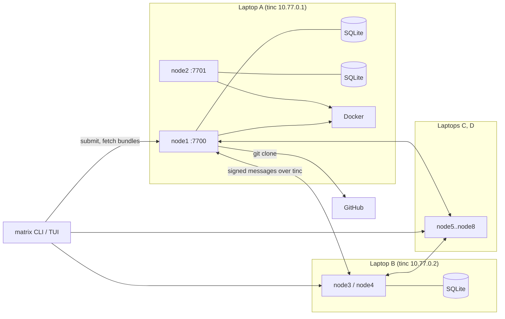
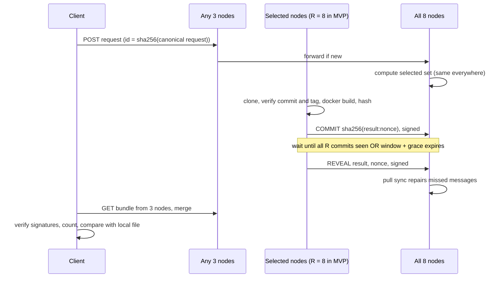
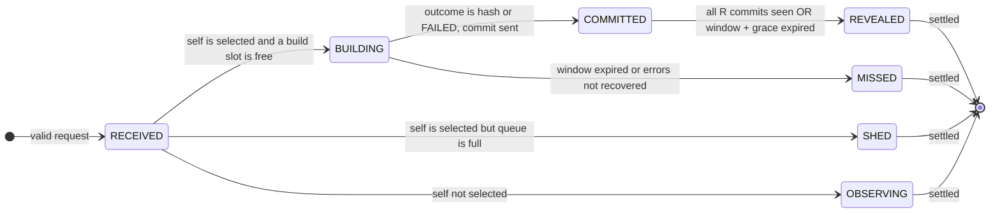

# RFC-0001: Matrix
### Byzantine-tolerant rebuild verification for GitHub releases

| | |
|---|---|
| **Status** | Draft (rev 2) |
| **Date** | 31 October 2026 |
| **Stack** | Python 3.11+, SQLite, tinc, Textual, aiohttp, PyNaCl, Docker, git |
| **Scope** | 12-hour hackathon MVP |

## 1. Summary

Matrix is a peer-to-peer network of rebuilders. Given a GitHub repository, a tag, a commit and a build recipe, a deterministic set of rebuilders independently builds the binary and publishes a signed hash. A client accepts a binary only if its hash matches one that **f+1 distinct rebuilders** produced.

There is no central server and no consensus protocol. With n = 8 rebuilders and f = 2 (a quarter):

- **Safety** (never accepting a wrong binary) holds while up to f nodes lie, stall, equivocate or collude.
- **Liveness** (reaching a verdict) additionally tolerates R − f − T = 3 honest nodes that crash or fail.
- The fault unit in the demo is a **laptop**, not a node: two nodes share one laptop, so one compromised laptop spends the whole safety budget (see A2).

**Core idea:** builds are deterministic, so the system never has to *agree* on an answer. It only has to *count matching answers*. Any result signed by f+1 distinct rebuilders includes at least one honest rebuilder, so an honest build really produced it.

## 2. Motivation

Developers and CI pipelines routinely download binaries from GitHub releases. Doing so trusts a single, unseen build machine. Release-time tampering is a known attack class:

- **SolarWinds (2020):** malicious code was injected by the build environment while the source repository stayed clean. This is exactly what an independent rebuild exposes.
- **xz (2024):** release tarballs differed from git history. That was a malicious-maintainer attack, which Matrix does not address (§3 non-goals), but it shows release artifacts and git source can diverge.

Existing systems do not cover this case with a small, coordinator-free, Byzantine-tolerant network:

- Rebuilders target distro packages (Debian, Arch) or a few registries (Google's OSS Rebuild for npm, PyPI and Crates.io).
- Provenance attestations (SLSA, GitHub Artifact Attestations) are signed by the same build platform that is being trusted. Matrix adds independent rebuilds, which is a different assurance.

## 3. Goals and non-goals

### Goals

- **G1.** Rebuild Go binaries from `repo + tag + commit + recipe` on independent machines.
- **G2.** Give a verdict that cannot be forged by up to f = 2 faulty rebuilders out of n = 8 (safety), and that stays reachable with up to R − f − T = 3 further crashed honest nodes (liveness).
- **G3.** Run with no central server. Any node can accept requests and serve results.
- **G4.** Make verdicts verifiable offline. A client needs only the genesis file (pinned by its hash) and the bundles.
- **G5.** Discourage lazy rebuilders from copying others' results (commit-reveal). This is a **best-effort deterrent**, not a verifiable guarantee in the MVP (§7.6, §8.1). A verifiable version is future work (§10).
- **G6.** Provide a Textual TUI that shows network state, request progress and evidence.
- **G7.** Provide a CLI usable in CI, with meaningful exit codes. In the MVP the CI runner must be able to reach the tinc mesh (for example, a self-hosted runner that has joined it).

### Non-goals (MVP)

- Languages other than Go, and builds with cgo.
- Release assets that are archives (tar.gz, zip) or that embed build timestamps. Only a single binary built from the recipe is compared.
- Dynamic membership. Rebuilders are fixed in a genesis file.
- Consensus, leaders, blockchains, tokens or credits.
- Proving that source code is safe. Matrix proves *binary = source*, nothing more.
- Compromised-toolchain defense (Trusting Trust). All rebuilders use the same pinned image.
- Defending against a compromised repository account (moved tags, malicious commits).
- Public internet exposure. The MVP runs inside the tinc mesh.
- Cryptographic proof that a node did not copy others' answers.

## 4. Terminology, assumptions and threat model

### Terms

| Term | Meaning |
|---|---|
| **Node** | A rebuilder process with an Ed25519 identity listed in genesis |
| **Operator** | The person or machine that runs one or more nodes (in the demo, one laptop) |
| **Request** | `{v, repo_url, commit, tag, recipe}`; its ID is the SHA-256 of its canonical JSON |
| **Selected set** | The R nodes deterministically chosen to build a request (in the MVP R = n, so every node) |
| **Commit** | A signed sealed hash: `c = sha256(result + ":" + nonce)` |
| **Reveal** | A signed `result` and `nonce` that open a commit |
| **Result** | Hex SHA-256 of the built binary, or the literal `FAILED` (a deterministic build failure only, see §7.10) |
| **Bundle** | The request plus all stored envelopes for it. Envelopes are self-verifying. |
| **Quorum result** | A result revealed (and correctly opened) by at least T = 3 selected nodes |

### Parameters

| Name | Value | Rule |
|---|---|---|
| `n` | 8 | `n ≥ 4f` (problem statement) |
| `f` | 2 | Maximum number of malicious nodes |
| `R` (replicas) | 8 | `2f + 1 ≤ R ≤ n`. The MVP uses every node, so selection is the identity. |
| `T` (threshold) | 3 | `f + 1` ensures ≥ 1 honest signer per quorum result |
| slack `s` | 3 | `R − f − T`: honest nodes that may fail without losing liveness |
| `BUILD_TIMEOUT` | 150 s | Covers clone, dependency download and build. Must be less than `COMMIT_WINDOW`. **Measure in hour 1** with two builds running concurrently per laptop. |
| `COMMIT_WINDOW` | 180 s | Starts at local receipt of the request |
| `REVEAL_GRACE` | 20 s | Must be ≥ 2 × `SYNC_INTERVAL` (worst-case propagation: a failed push plus one pull) |
| `SYNC_INTERVAL` | 10 s | Anti-entropy pull period |
| `MAX_CONCURRENT_BUILDS` | 1 per node | One queued request at most; the rest are shed (§7.6) |
| API port | 7700 + k | The k-th node on a laptop (7700, 7701); bound to the tinc IP only |
| tinc subnet | `10.77.0.0/24` | One IP per laptop |
| Demo profile | `genesis.demo.json` | `commit_window_s 60`, `build_timeout_s 45`, `reveal_grace_s 15`, `SYNC_INTERVAL 5 s`. Use it for rehearsals so stall scenarios do not take 200 s each. |

### Assumptions

1. **A1:** Honest nodes run the published code, and their builds are deterministic for a valid recipe. Environmental errors (network, timeout, out-of-memory, Docker) are reported as abstentions, never as `FAILED`.
2. **A2:** At most f nodes are **malicious**: lying, copying, equivocating or colluding. Crashed or offline honest nodes are not counted in f; they only cost liveness (budget s). Nodes on the same laptop are correlated, so for the demo the unit of compromise is the laptop: one compromised laptop = 2 malicious nodes = the whole f.
3. **A3:** Private keys of honest nodes are not stolen. Ed25519 signatures cannot be forged.
4. **A4:** Messages between honest nodes arrive within about one `SYNC_INTERVAL` in the normal case (bounded delay). **Safety never depends on this.** Liveness and copy-deterrence do.
5. **A5:** Clients obtain `genesis.json` out of band and pin its SHA-256. Everything else is verified from signatures.

### Threat model

| Adversary | In scope? |
|---|---|
| Malicious rebuilders (up to f), including colluding ones | Yes |
| A malicious requester submitting junk, abusive recipes or floods | Yes (validation, allowlists, ingest cap, build shedding) |
| A malicious repository trying to run code or exhaust resources during the build | Yes (ldflags allowlist, hardened container, pinned toolchain, resource limits) |
| A malicious tinc peer dropping or misrouting traffic | Yes (liveness only; all messages are signed) |
| A malicious node serving a wrong or malformed bundle to a client | Yes (client verifies everything locally, parser never trusts input) |
| A compromised GitHub release asset | Yes. This is the main use case. |
| Cross-network replay of signed messages | Yes (domain-separated signatures, §7.4) |
| Malicious code committed to the source repo, or a moved tag after account takeover | No |
| A compromised pinned Go toolchain image | No (shared single point of failure) |
| A container escape from the build sandbox | Mitigated by hardening (§7.10); residual risk accepted |

## 5. Design decisions

| # | Decision | Choice | Why | Rejected alternative |
|---|---|---|---|---|
| D1 | Agreement mechanism | **None.** Count f+1 matching signed results. | Deterministic outputs make the correct answer self-identifying. There is no leader, no view change and no log. | PBFT or HotStuff: heavy, and unnecessary for deterministic compute |
| D2 | Membership | Static `genesis.json` | Prevents Sybil attacks; zero protocol for joins and leaves | Dynamic join: needs reconfiguration, which needs consensus |
| D3 | Network | **tinc** full mesh with `StrictSubnets` | No coordinator; NAT-friendly; one config per laptop | Headscale (has a central control server); raw LAN (fragile at venues) |
| D4 | Trust in the network | **None.** Every message is Ed25519-signed at the application layer, with domain separation. | A malicious tinc peer can only drop or delay messages, never forge them | Relying on tinc's tunnel authentication: not transferable to clients |
| D5 | Dissemination | Push to all peers, plus a periodic pull sync | With n = 8, a full mesh is trivial; the pull repairs dropped pushes | Epidemic gossip libraries or a DHT: overkill at n = 8 |
| D6 | Who builds | Rendezvous hashing over **all** genesis nodes; MVP sets R = n | Every node and client computes the same set with no coordination. R = n removes grinding as an attack on liveness. | Excluding suspected nodes: local views diverge, so selections diverge |
| D7 | Replication | T = f+1; R ≥ 2f+1, MVP R = n = 8 | R = 2f+1 = 5 leaves zero tolerance for honest failure: with 2 malicious nodes selected, all 3 honest builders must succeed. R = 8 gives slack s = 3. | R = 2f+1: one honest hiccup blocks or distorts the verdict |
| D8 | Anti-copying | Commit-reveal with a fixed window (best-effort, local) | Honest nodes following the protocol cannot be tempted; violations are flagged as soft evidence. A malicious copier counts toward f anyway. | Trusting operators; verifiable ordering (needs signed witnesses, §10) |
| D9 | Language | **Go only**, `CGO_ENABLED=0` | Reproducible with `-trimpath`. With an ldflags allowlist, `GOTOOLCHAIN=local`, a fixed module proxy and a hardened container, the build runs no repo-supplied program. | Rust (`build.rs` runs code); Python (build hooks) |
| D10 | Build sandbox | Docker, pinned single-platform image digest from a genesis allowlist, network off during build, unprivileged, resource-limited | Hermetic and simple; requesters cannot choose arbitrary images | Bare-metal builds: not reproducible across laptops |
| D11 | Comparison point | Rebuilders attest `source → hash`; the **client** compares with its downloaded file | Rebuilders never touch release assets, which keeps them simple | Rebuilders fetch assets: needs the GitHub API and adds failure modes |
| D12 | Requests | Anonymous, content-addressed, deduplicated, with a per-node ingest cap | No client keys needed; idempotent. A per-source-IP limit is meaningless inside the mesh (forwards share peer IPs). | Signed client identities: unnecessary for the MVP |
| D13 | Storage | SQLite per node | Zero operations; one file | Postgres: a server to run |
| D14 | Serialization | Canonical JSON: sorted keys, `(",", ":")` separators, UTF-8, no floats in signed bodies | Deterministic bytes to sign | CBOR or protobuf: an extra dependency |
| D15 | HTTP | aiohttp for both server and client | Asyncio-native, one dependency, works with Textual | FastAPI + uvicorn + httpx: three dependencies |
| D16 | UI | Textual TUI | Terminal-native, fast to build, good for a live demo | A web dashboard: more code |
| D17 | Faulty nodes | Recorded as **evidence**; never auto-excluded | Keeps selection identical everywhere (see D6) | Auto-eviction: requires agreement on evictions |
| D18 | Failure semantics | `FAILED` is a vote only for deterministic build failures; environmental errors abstain | Otherwise an honest flake plus 2 malicious nodes can manufacture `BUILD_FAILED` or `NOT_REPRODUCIBLE` | Treating every error as `FAILED` |
| D19 | Verdict input | The caller supplies the request; the bundle's own `request` field is never trusted | Stops a malicious node serving a bundle for a different request | Reading the request from the bundle |

## 6. High-level design

### 6.1 Components

| Component | Responsibility |
|---|---|
| **Node daemon** (`matrix-node`) | Accepts requests, forwards them, builds when selected, runs commit-reveal, stores envelopes, serves bundles |
| **Builder** | Clones the repo, verifies commit and tag, runs the two-step hardened Docker build, hashes the output, classifies the outcome |
| **Store** | SQLite tables for requests, messages, own builds and evidence |
| **Protocol engine** | Validates envelopes, drives the per-request state machine, timers and evidence detection |
| **Verdict** | A pure function `(request, bundle, genesis) → verdict`, shared by the node and the client |
| **Client CLI** (`matrix`) | Submits requests, fetches and merges bundles, verifies files, sets exit codes |
| **TUI** (`matrix tui`) | Live view of peers, requests, per-node results and evidence |
| **tinc** | Encrypted mesh between laptops; untrusted transport |

### 6.2 Architecture



Each laptop runs one tinc daemon and two node processes on different ports. All signed traffic travels over tinc IPs.

### 6.3 Request lifecycle



### 6.4 Verdicts

| Verdict | Condition | Exit code |
|---|---|---|
| `REPRODUCED` | Exactly one result reaches T, it is a hash, and it equals `sha256(file)` | 0 |
| `MISMATCH` | Exactly one result reaches T, it is a hash, and it differs from `sha256(file)` | 1 |
| `NOT_REPRODUCIBLE` | Two different results each reach T, **or** no result can still reach T (unrevealed nodes counted as possible votes) | 2 |
| `PENDING` | None of the above | 3 |
| Error | Bad input, unreachable nodes, invalid genesis, malformed local data | 4 |
| `BUILD_FAILED` | Exactly one result reaches T and it is `FAILED` | 5 |

Only exit code 0 means success. CI must treat everything else as failure (fail closed).

Two different results cannot both reach T unless two honest nodes built different outputs: each quorum contains an honest signer, and honest builds are deterministic (A1). That situation is reported as `NOT_REPRODUCIBLE`, never as `REPRODUCED`. `AGREED(hash)` is a display-only state used by `status` when no file was supplied.

## 7. Low-level design

### 7.1 Repository layout

```
matrix/
  canon.py      # canonical_json(), sha256_hex()
  crypto.py     # keygen, sign(), verify() via PyNaCl (domain-separated)
  genesis.py    # load and validate genesis.json
  model.py      # dataclasses: Recipe, Request, Envelope (strict parse)
  select.py     # rendezvous selection
  verdict.py    # pure verdict function (shared by node and client)
  store.py      # SQLite access
  builder.py    # git and Docker build, outcome classification
  protocol.py   # message handling, state machine, timers, evidence
  net.py        # aiohttp server, peer push, pull sync
  faults.py     # demo fault modes
  node.py       # matrix-node entrypoint
  cli.py        # matrix entrypoint
  tui.py        # Textual app
tests/
genesis.json
genesis.demo.json
```

Dependencies: `pynacl`, `aiohttp`, `textual`. Host prerequisites: Docker, git and tinc.

### 7.2 Genesis file

```json
{
  "network_id": "matrix-bios-2026",
  "f": 2,
  "replicas": 8,
  "threshold": 3,
  "commit_window_s": 180,
  "reveal_grace_s": 20,
  "build_timeout_s": 150,
  "allowed_images": {
    "go1.23": "golang@sha256:<linux/amd64 single-platform digest>"
  },
  "allowed_goos": ["linux", "darwin", "windows"],
  "allowed_goarch": ["amd64", "arm64"],
  "nodes": [
    {"id": "node1", "operator": "laptopA", "addr": "10.77.0.1:7700", "pubkey": "<ed25519 hex>"},
    {"id": "node2", "operator": "laptopA", "addr": "10.77.0.1:7701", "pubkey": "<ed25519 hex>"}
  ]
}
```

- **The `nodes` list above is abbreviated.** A real genesis lists all n = 8 nodes (`node3`–`node8` on laptops B–D, `10.77.0.2`–`10.77.0.4`, ports 7700 and 7701). With only two entries it fails the `replicas ≤ n` startup check below.

- The image digest is the **single-platform** manifest, not the multi-arch manifest list. Containers run with `--platform linux/amd64`, so an arm64 laptop emulates. Otherwise laptops could pull different toolchain binaries.
- The goos/goarch allowlists live in genesis, so every node applies the same validation rules. Differing code-embedded lists would make nodes disagree on request validity.

At startup a node checks that `n ≥ 4f`, `2f+1 ≤ replicas ≤ n`, `threshold == f+1`, `build_timeout_s < commit_window_s`, that every node has an `operator`, and that the allowlists are non-empty. It refuses to start otherwise. The `genesis_hash` (SHA-256 of canonical genesis) is exchanged in `/v1/health`. Peers with a different hash are ignored. This is hygiene only; `/v1/health` is unauthenticated and safety does not depend on it.

### 7.3 Recipe and request

Recipe (`matrix.toml` in the target repo, or passed on the command line):

```toml
[build]
image   = "go1.23"            # key into genesis allowed_images
package = "./cmd/hello"
goos    = "linux"
goarch  = "amd64"
ldflags = "-s -w -buildid="
output  = "hello"
```

Request:

```json
{
  "v": 1,
  "repo_url": "https://github.com/org/hello",
  "commit": "<40 lowercase hex>",
  "tag": "v1.2.0",
  "recipe": { "...": "fields above" }
}
```

`request_id = sha256_hex(canonical_json(request))`.

Validation rules (all use `re.fullmatch` with `re.ASCII`; any unknown key anywhere in the request is rejected):

- `repo_url` matches `https://github\.com/[A-Za-z0-9_.-]+/[A-Za-z0-9_.-]+`; neither segment is `.` or `..`; no `.git` suffix.
- `commit` is 40 **lowercase** hex characters.
- `tag` matches `[A-Za-z0-9_.+-]{1,64}`. It is **required** and part of the request ID. The builder verifies that the tag resolves to `commit` (§7.10), so the tag is bound to the commit, not informational.
- `image` is a key in `allowed_images`.
- `goos` is in `allowed_goos` and `goarch` is in `allowed_goarch`.
- `package` matches `\./[A-Za-z0-9_./-]*` and has no `..` component.
- `ldflags` is empty or matches the grammar `token(" " token)*` where `token` is one of `-s`, `-w`, `-buildid=`, or `-X <importpath.name>=<value>` with `value` matching `[A-Za-z0-9_./:@+-]{0,128}`. This is an **allowlist**; anything else, including `-extld`, `-linkmode` and `-extldflags`, is rejected. Total length ≤ 512.
- `output` matches `[A-Za-z0-9_.-]{1,64}`.
- Total request size ≤ 4 KiB.

The client obtains the commit from a source it already trusts (a signed tag, or an out-of-band announcement). A moved tag after repository takeover is out of scope (§4). The client must not take the commit from the compromised release page.

### 7.4 Signed envelope

```json
{
  "v": 1,
  "type": "commit",
  "signer": "node3",
  "body": {"request_id": "<hex>", "c": "<hex>"},
  "sig": "<ed25519 hex>"
}
```

- Signed bytes: `b"matrix/v1\0" + genesis_hash_hex + b"\0" + canonical_json({"v", "type", "signer", "body"})`. The prefix gives domain separation, so a signature from another network or message format cannot be replayed.
- `sig = Ed25519.sign(sk, signed_bytes)`
- `msg_id = sha256_hex(canonical_json(envelope))`

Envelope bodies:

| Type | Body |
|---|---|
| `commit` | `{request_id, c}` where `c = sha256_hex(result + ":" + nonce)` |
| `reveal` | `{request_id, result, nonce}`; `result` is 64 lowercase hex or `"FAILED"`; `nonce` is 32 random bytes as 64 lowercase hex |

Because `result` has a fixed alphabet and `nonce` has a fixed length, `result + ":" + nonce` is unambiguous.

`Envelope.parse(raw, genesis)` returns an envelope or `None` and **never raises**. It requires:

1. Exactly the expected keys, correct types, `v == 1`, `type` in {commit, reveal}, total size ≤ 2 KiB.
2. Body keys exactly as in the table; `request_id` and `c` are 64 lowercase hex; `result` and `nonce` as above.
3. `signer` is in genesis.
4. The signature is valid over the domain-separated bytes.

A node stores an envelope only if, in addition:

5. The request is known. Unknown requests are fetched first from the peer that pushed the message; the body must hash to `request_id`.
6. The signer is in that request's selected set.
7. The signer has fewer than 2 stored envelopes of this type for this request. Two are enough to prove equivocation; the cap stops a malicious signer from bloating the store and bundles.

Timing never causes an envelope to be dropped. Lateness is recorded as a note (§7.6).

### 7.5 Selection

```python
def selected(request_id: str, nodes: list[Node], r: int) -> list[str]:
    scored = sorted(
        nodes,
        key=lambda n: sha256_hex(f"{request_id}:{n.pubkey}".encode()),
    )
    return [n.id for n in scored[:r]]
```

Selection is identical on every node and client. In the MVP, R = n and the set is every node.

Grinding: a requester can vary the request ID (for example via `tag`) to choose which nodes are selected when R < n. This cannot break safety, because any T-signed result contains an honest signer regardless of selection. It **can** hurt liveness, by steering the set towards malicious or slow nodes. That is why the MVP uses R = n. Networks with R < n must size R with slack: `R ≥ 2f + 1 + s`.

### 7.6 Protocol state machine

Each node tracks every request as an observer. A node in the selected set also acts as a builder:



A request is **settled** locally when `verdict()` over the local store is anything but `PENDING`, or when it is older than 1 hour. Settlement stops **new build work** only: no admission, no build retries. A node that has already committed still reveals (rule 6). Until the request's **retention window** closes at `t0 + 1 hour`, the node keeps accepting pushed envelopes, pulling the request's bundle and re-running evidence detection, so late commits and reveals still produce `EQUIVOCATION`, `BAD_OPEN` and `LATE_COMMIT` evidence. After the retention window the request is no longer ingested or pulled; stored envelopes and evidence are kept.

Rules for a node `X` handling request `q`, where `t0` is X's local receipt time of `q`:

1. **Forward.** On first receipt, store `q` with `t0` and push it to all peers. A node accepts at most 20 new requests per minute in total, from any source; beyond that it answers 429. Forwarded requests missed this way are caught by pull sync.
2. **Admit.** If X is selected, it builds one request at a time (`MAX_CONCURRENT_BUILDS`) and may hold one queued request. Any further request is **shed**: no build, no commit, phase `SHED`. Shedding is an honest abstention and spends liveness slack, so the ingest cap protects honest windows.
3. **Build.** Run the builder with `BUILD_TIMEOUT`. Its outcome is one of:
   - `hash`: `result` is the binary's SHA-256.
   - `FAILED`: a deterministic failure only (§7.10). `result` is `"FAILED"`.
   - `ERROR`: an environmental failure. Retry up to 2 times while `now + BUILD_TIMEOUT < t0 + COMMIT_WINDOW`. If it still fails, mark `MISSED`; **never commit or reveal**.
   - `BAD_REF`: the source reference is invalid (commit missing, tag missing, or tag not resolving to `commit`). Do not retry; mark `MISSED` and record the reason in `my_builds.error`; **never commit or reveal**.
4. **Commit.** If `now < t0 + COMMIT_WINDOW`, generate a nonce, store `(result, nonce)` locally, and broadcast the commit. Otherwise mark the request `MISSED`.
5. **Store commits** from selected signers whenever they arrive. A commit that arrives after X has revealed, or after `t0 + COMMIT_WINDOW`, is stored with `note = 'late'`. It is **not** dropped.
6. **Reveal** when X has committed and either it holds commits from all R selected nodes, or `now ≥ t0 + COMMIT_WINDOW + REVEAL_GRACE`.
7. **Store reveals** whenever they arrive, in any order. Whether a reveal opens its signer's commit is evaluated by the verdict function and by evidence detection, which re-run whenever a commit or reveal for `q` arrives. Message ordering therefore cannot cause an honest reveal to be lost.
8. **Record evidence:**
   - `EQUIVOCATION`: two different commits from the same signer for `q`. Hard proof, independent of timing.
   - `BAD_OPEN`: a reveal that does not match the signer's commit. Hard proof.
   - `DISAGREE`: a reveal whose result differs from the quorum result. Soft signal, since it may be honest nondeterminism; anyone can rebuild to check.
   - `STALL`: a selected node with no commit by the end of the window. Soft signal.
   - `LATE_COMMIT`: a commit marked `late` that arrived after X's reveal. Soft signal that the signer may have seen others' reveals first.

**Limits of commit-reveal.** Lateness is judged from each node's own `t0` and local clock, so it cannot be proven to a third party. The verdict function ignores timing on purpose. A malicious copier that commits late and reveals a copied value is therefore still counted. That is acceptable for safety: a copier is malicious and already counts toward f. Commit-reveal only keeps protocol-following operators honest and raises soft evidence. Making it verifiable (signed witnesses of which commits each revealer had seen) is future work (§10).

### 7.7 Verdict function

```python
def verdict(request, bundle, genesis, file_sha256=None) -> Verdict:
    rid = request_id(request)            # built by the caller; bundle.request is never trusted
    sel = set(selected(rid, genesis.nodes, genesis.replicas))

    envs = []
    for raw in bundle.envelopes:
        e = Envelope.parse(raw, genesis)  # None unless schema, formats and signature are valid
        if e and e.body.request_id == rid and e.signer in sel:
            envs.append(e)

    commits = defaultdict(set)           # signer -> distinct commit values
    for e in envs:
        if e.type == "commit":
            commits[e.signer].add(e.body.c)
    equivocators = {s for s, cs in commits.items() if len(cs) > 1}

    results = {}                         # signer -> result (at most one opens a given commit)
    for e in envs:
        if e.type != "reveal" or e.signer in equivocators:
            continue
        cs = commits.get(e.signer)
        if cs and sha256_hex(f"{e.body.result}:{e.body.nonce}".encode()) in cs:
            results[e.signer] = e.body.result

    counts = Counter(results.values())
    quorum = [r for r, k in counts.items() if k >= genesis.threshold]
    outstanding = len(sel) - len(results)

    if len(quorum) > 1:
        return NOT_REPRODUCIBLE          # two quorums => two honest nodes disagree
    if quorum:
        agreed = quorum[0]
        if agreed == "FAILED":
            return BUILD_FAILED
        if file_sha256 is None:
            return AGREED(agreed)
        return REPRODUCED if agreed == file_sha256 else MISMATCH
    if max(counts.values(), default=0) + outstanding < genesis.threshold:
        return NOT_REPRODUCIBLE          # no result can still reach T
    return PENDING
```

The function is total: malformed or hostile input is ignored, never raised. `outstanding` counts equivocators and non-revealers as possible votes, which only delays a final verdict, never invents one.

The client merges bundles from ≥ f+1 = 3 nodes by taking the union of envelopes, deduplicated by `msg_id`, and passes its **own** request to `verdict()`. A malicious node can omit messages but cannot forge them, so the union from three nodes contains everything at least one honest node holds. When possible the client picks nodes from distinct operators.

### 7.8 SQLite schema

```sql
CREATE TABLE requests (
  id           TEXT PRIMARY KEY,
  body         TEXT NOT NULL,          -- canonical JSON
  received_at  REAL NOT NULL,          -- local t0
  phase        TEXT NOT NULL           -- RECEIVED|BUILDING|COMMITTED|REVEALED|MISSED|SHED|OBSERVING
);

CREATE TABLE messages (                -- only accepted envelopes (§7.4); rejected ones are counted, not stored
  msg_id       TEXT PRIMARY KEY,
  request_id   TEXT NOT NULL REFERENCES requests(id),
  type         TEXT NOT NULL,          -- commit|reveal
  signer       TEXT NOT NULL,
  envelope     TEXT NOT NULL,          -- canonical JSON
  received_at  REAL NOT NULL,
  note         TEXT                    -- NULL or late
);
CREATE INDEX messages_req ON messages(request_id, type, signer);

CREATE TABLE my_builds (
  request_id   TEXT PRIMARY KEY REFERENCES requests(id),
  result       TEXT,                   -- hash or FAILED; NULL while building or after ERROR
  nonce        TEXT,
  error        TEXT,                   -- last environmental error, if any
  log_path     TEXT,
  started_at   REAL,
  finished_at  REAL
);

CREATE TABLE evidence (
  id           INTEGER PRIMARY KEY,
  kind         TEXT NOT NULL,          -- EQUIVOCATION|BAD_OPEN|DISAGREE|STALL|LATE_COMMIT
  signer       TEXT NOT NULL,
  request_id   TEXT NOT NULL,
  proof        TEXT,                   -- JSON array of envelopes; NULL for STALL (absence has no proof)
  created_at   REAL NOT NULL,
  UNIQUE (kind, signer, request_id)    -- pull sync must not duplicate evidence
);
```

Use WAL mode and a single writer task. Only the node process touches the database; the TUI reads through the HTTP API.

### 7.9 HTTP API (per node, bound to its tinc IP)

| Method and route | Purpose | Response |
|---|---|---|
| `GET /v1/health` | Node ID, version, genesis hash | 200 |
| `POST /v1/requests` | Submit or forward a request | 202 `{id}`; 400 if invalid; 429 over the ingest cap |
| `GET /v1/requests?since=<unix>` | Requests received since a time (for sync and TUI) | 200 `[{id, phase}]` |
| `GET /v1/requests/{id}` | Request body and local phase | 200 / 404 |
| `POST /v1/messages` | Push a signed envelope | 202; 400 if invalid |
| `GET /v1/requests/{id}/bundle` | `{request, envelopes}`: the request plus **all stored envelopes** | 200 |
| `GET /v1/requests/{id}/log` | Last 64 KiB of this node's own build log | 200 / 404 |
| `GET /v1/evidence?since=<unix>` | Evidence records | 200 |

Limits: `POST /v1/requests` body ≤ 4 KiB; `POST /v1/messages` body ≤ 2 KiB; at most 20 new requests per minute per node in total (not per source IP, since forwards share peer IPs and the two nodes on a laptop share one).

**Pull sync**, every `SYNC_INTERVAL`, for each peer:

1. `GET /v1/requests?since=last_sync - 60` and fetch unknown requests.
2. For each request still inside its retention window (§7.6), settled or not, `GET /bundle` and process every envelope through the normal validation path.

### 7.10 Builder

Each build runs in a work directory `work/<request_id>/{src,out,gomod}`. Every Docker command uses the common flags `--platform linux/amd64 --user "$UID:$GID" --cap-drop ALL --security-opt no-new-privileges --memory 4g --cpus 2 --pids-limit 512 --name mx-<node_id>-<rid8>-<step> -e HOME=/tmp -e GOTOOLCHAIN=local -e GOFLAGS=-mod=readonly`.

```bash
# 1. Source (host; time- and size-capped, no submodules, no prompts)
export GIT_TERMINAL_PROMPT=0
git clone --filter=blob:none --no-checkout "$REPO" src
git -C src checkout --detach "$COMMIT"
test "$(git -C src rev-parse HEAD)" = "$COMMIT"
test "$(git -C src rev-parse "refs/tags/$TAG^{commit}")" = "$COMMIT"

# 2. Dependencies (network on, source read-only; Go verifies go.sum and the checksum DB;
#    explicit proxy, no "direct" fallback, so no VCS tool ever runs)
docker run --rm $COMMON -v "$PWD/src:/src:ro" -v "$PWD/gomod:/go/pkg/mod" -w /src \
  -e GOPROXY=https://proxy.golang.org -e GOSUMDB=sum.golang.org \
  "$IMAGE" go mod download

# 3. Build (network off, read-only source and modules)
docker run --rm $COMMON --network none \
  -v "$PWD/src:/src:ro" -v "$PWD/gomod:/go/pkg/mod:ro" -v "$PWD/out:/out" \
  -e CGO_ENABLED=0 -e GOOS="$GOOS" -e GOARCH="$GOARCH" \
  -e GOPROXY=off -e GOCACHE=/tmp/gocache -w /src \
  "$IMAGE" go build -trimpath -buildvcs=false -ldflags "$LDFLAGS" \
  -o "/out/$OUTPUT" "$PACKAGE"

# 4. Hash
sha256sum "out/$OUTPUT"
```

Outcome classification:

| Situation | Outcome |
|---|---|
| Step 3 `go build` exits 1 (compile or link error) | `FAILED` |
| Clone succeeded but `commit` is missing, or `tag` is missing or does not resolve to `commit` | `BAD_REF`: abstain, no retry (§7.6 rule 3) |
| Clone or fetch network error, proxy error, **any step 2 failure**, timeout, out-of-memory (137), Docker error (125 to 127), disk full | `ERROR`: abstain, retry (§7.6 rule 3) |
| Success | the hash |

`FAILED` is reserved for deterministic build failures of a valid source reference. An invalid or inconsistent reference is an input problem, not a build result, so it never becomes a vote: the verdict stays `PENDING` (exit 3, fail closed) and the reason is visible in the node's build log and `my_builds.error`.

Step 2 failures are always `ERROR`, so a `go.sum` mismatch becomes `PENDING`, not `BUILD_FAILED`. That fails closed and avoids guessing whether a download failure was deterministic.

- Commands run via `asyncio.create_subprocess_exec` with argument lists, never shell strings.
- Docker container names include the node ID, so two nodes on one laptop can run the same step of the same request concurrently without a name conflict.
- Stdout and stderr go to `log_path` (`logs/<request_id>.log`, outside `work/`), capped at 1 MiB. Clone is capped in time and size.
- On timeout, the node terminates whatever step is running. Host commands (`git`) are started in their own process group (`start_new_session=True`) and the whole group is sent SIGTERM, then SIGKILL after 5 s (on Windows hosts, `proc.kill()`). Docker steps additionally get `docker kill` on the named container, because killing the `docker run` client does not stop the container. The outcome is `ERROR`.
- Before the hackathon, pre-pull the pinned image on every laptop.
- `work/<id>` is removed in a `finally` block after **every** terminal outcome of an attempt: hash, `FAILED`, `BAD_REF`, `ERROR`, timeout or cancellation. Each retry starts from an empty work directory. Only the capped log is kept. Containers run as the host user, so `rm -rf work/<id>` always works.
- A build that fails for environmental reasons never reveals `FAILED`; this is what keeps honest flakes from becoming votes.

### 7.11 Client CLI

```
matrix request  --repo URL --commit SHA --tag T --recipe matrix.toml
matrix status   ID
matrix verify   FILE --repo URL --commit SHA --tag T --recipe matrix.toml [--wait 300]
matrix evidence [--since 1h]
matrix tui
```

- The client computes `request_id` itself and passes its own request to `verdict()`. It never trusts a node for either.
- `request` submits to 3 nodes (f+1), preferably on different laptops, so at least one honest node forwards it.
- `verify` fetches bundles from 3 or more nodes, merges and verifies them locally, prints the verdict and the per-node table, and exits with the code from §6.4. With `--wait`, it polls until the verdict is not `PENDING`.
- Config: `~/.matrix/genesis.json` (checked against a pinned hash) and an optional `nodes` override list.
- The client must reach the nodes' tinc addresses.

Example CI step (on a runner that has joined the mesh):

```bash
curl -LO https://github.com/org/hello/releases/download/v1.2.0/hello
matrix verify hello --repo https://github.com/org/hello \
  --commit 3f2a... --tag v1.2.0 --recipe matrix.toml --wait 300 || exit 1
```

### 7.12 TUI (Textual)

| Screen | Contents | Keys |
|---|---|---|
| **Peers** | 8 rows grouped by operator: ID, address, reachable, genesis-hash match, last seen | `p` |
| **Requests** | ID (short), `repo@commit`, phase, commits x/R, reveals x/R, verdict | `r`, `Enter` for detail |
| **Detail** | Per selected node: committed?, revealed result, matches quorum? (green/red), build log tail (local node only) | `l` for log |
| **Evidence** | Kind, signer, request, time; `Enter` shows the proof JSON | `e` |
| **Submit** | Form for repo, tag, commit and recipe path | `s` |

The TUI polls the local node's API every second, and each peer's `/v1/health` for the Peers screen. It reads no database and holds no state of its own. Build logs are served by `/v1/requests/{id}/log`, so only the connected node's logs are available.

### 7.13 tinc setup

Netname `matrix`, one daemon per laptop:

```
# /etc/tinc/matrix/tinc.conf
Name = laptopA
Mode = router
AddressFamily = ipv4
StrictSubnets = yes
ConnectTo = laptopB
ConnectTo = laptopC
ConnectTo = laptopD

# /etc/tinc/matrix/hosts/laptopA
Address = <LAN IP>
Subnet = 10.77.0.1/32
-----BEGIN RSA PUBLIC KEY----- ...
```

- Host files are distributed with genesis.
- `tinc-up` assigns `10.77.0.x/24` to the interface.
- Every laptop uses `ConnectTo` toward every other laptop for a direct full mesh, so no traffic is relayed through a peer.
- Node API ports are reachable only on the tinc interface.
- Venue Wi-Fi often isolates clients from each other. Use a travel router or phone tethering. If tinc is not up on all laptops by hour 2, fall back to plain LAN or WireGuard; nothing above the transport changes. tinc and WireGuard encrypt the transport; **plain LAN does not**. On plain LAN, anyone on the network can read requests, envelopes and bundles (which repositories are being verified, and the results). Signatures still protect integrity and authenticity, so safety is unaffected; only confidentiality is lost.

### 7.14 Fault modes (demo only)

Enabled with `--fault MODE`. Nodes refuse fault flags unless started with `--allow-faults`.

| Mode | Behavior |
|---|---|
| `lie` | Commit to and reveal a random hash |
| `collude --hash H` | Commit to and reveal a shared fixed hash `H` |
| `stall` | Never commit or reveal |
| `crash` | Exit when a request arrives (an honest failure: spends slack, not f) |
| `copy` | Skip the build, wait for the first reveal seen, then commit and reveal that value. The verdict still counts it; peers flag `LATE_COMMIT`. |
| `equivocate` | Send different commits to different peers |

## 8. Security guarantees and failure handling

### 8.1 Guarantees

Safety holds with ≤ f malicious nodes. Liveness additionally needs enough honest nodes to answer.

| Property | Argument |
|---|---|
| **No forged acceptance** | A quorum result has T = f+1 signers, so at least one is honest, so an honest build produced it (A1). `REPRODUCED` therefore means an honest build produced exactly the user's file. |
| **No hidden tampering** | A tampered file never gets `REPRODUCED`. It gets `MISMATCH` once the honest quorum forms. Until then, and on any failure, the verdict is not 0 and CI fails closed. |
| **Liveness** | R − f = 6 honest nodes build; any T = 3 of them suffice. The verdict stays reachable with up to s = R − f − T = 3 honest nodes crashed, shed or failing (A4). |
| **No false failure from a flake** | Environmental errors abstain, and `FAILED` needs T votes, so f malicious nodes plus any number of honest hiccups cannot produce `BUILD_FAILED` from a build that honest nodes complete. |
| **Uniqueness** | Two results both reaching T mean two honest nodes built different outputs, so the verdict is `NOT_REPRODUCIBLE`. Two different results are never both accepted. |
| **Robust client** | `Envelope.parse` and `verdict` never raise on hostile input. The request comes from the client, not the bundle. |
| **No coordinator** | Selection, validation and the verdict are local pure functions. Bundles are self-verifying. |
| **Network attacks cost liveness only** | All messages are signed with domain separation, and tinc peers can only drop or delay them. |
| **Equivocation is provable** | Two signed conflicting commits form a transferable proof. |
| **Copy-deterrence (best-effort)** | Not a guarantee. A malicious late copier is still counted by the verdict (and counts toward f). Peers raise soft `LATE_COMMIT` evidence. |

### 8.2 Failure handling

| Failure | Behavior |
|---|---|
| Node crash or restart | State is in SQLite. On restart: re-read requests, resume timers from `received_at`, reveal from `my_builds` if already committed, never re-commit with a different nonce, then pull-sync. If the window expired while down, the request is `MISSED`. |
| Laptop offline or compromised | Offline: two crashed nodes. Safety is unaffected; liveness spends 2 of s = 3 slack. Compromised: both nodes are malicious, which is the whole f. Keep other laptops healthy during the demo. |
| GitHub or the module proxy unreachable | Environmental `ERROR`: nodes retry, then abstain. The verdict stays `PENDING` and the client can re-request later. It is never `BUILD_FAILED`. |
| Real compile error | Honest nodes all reveal `FAILED`; the verdict is `BUILD_FAILED` (exit 5). |
| Request flood | Per-node ingest cap (429) and one build slot with one queued request; the rest are shed. |
| Propagation delay > `REVEAL_GRACE` | Some honest reveals happen before late commits arrive. Nothing is dropped: late envelopes are stored and counted, so correctness and bundles are unaffected; copy-deterrence weakens. |
| Nondeterministic build | `NOT_REPRODUCIBLE`. The maintainer must fix the recipe. |
| Malformed or hostile bundle served to the client | Ignored by the parser; the client uses the union of ≥ 3 nodes. |
| Duplicate request | Deduplicated by content ID. |
| Disk fills up | Delete `work/<id>` after every terminal build outcome, success or not (§7.10), and remove any leftover `work/*` at startup; keep only capped logs. |

## 9. Testing, build plan and cut list

### 9.1 Tests

| Level | What |
|---|---|
| Unit | Canonical JSON stability; sign and verify round-trip, including cross-network replay rejection; selection determinism; strict-parse tests (wrong types, missing keys, bad formats, oversized input); verdict table tests covering every row in §6.4 |
| Verdict model check | Enumerate every assignment for the 8 selected nodes: each honest node answers the true hash or abstains; each malicious node (≤ 2) abstains, reveals `FAILED`, reveals one of two fake hashes, reveals the true hash, or equivocates. Assert: (a) `REPRODUCED` or `MISMATCH` is returned only for the true hash; (b) if ≥ 3 honest nodes revealed the true hash the verdict is never `PENDING` or wrong; (c) the function never raises |
| Fuzz | Random malformed envelopes and bundles through `Envelope.parse` and `verdict` |
| Integration (one machine) | 8 nodes on `127.0.0.1:7700–7707` without tinc, using the demo profile; scripted fault matrix: `{lie, collude, stall, crash, copy, equivocate}` × up to 2 nodes, **placed on the same laptop and on different laptops**, asserting the verdict and evidence each time; one case with 2 malicious nodes plus 3 honest crashes (still live) and one with 4 (expected to degrade to `PENDING`); the late-copier case, asserting it is counted and flagged `LATE_COMMIT` |
| Reproducibility | Same recipe built on all 4 laptops, with two builds running at once per laptop, yields an identical hash and a measured `BUILD_TIMEOUT`. **Do this in hour 1.** |
| End to end | 4 laptops × 2 nodes over tinc; verify a real release; swap in a tampered binary; pull a network cable |

### 9.2 12-hour plan (team of 3–4)

| Hours | Track A (protocol) | Track B (build and net) | Track C (UX) |
|---|---|---|---|
| 0–1 | `canon`, `crypto`, `genesis`, `model` | tinc up on all laptops (fallback: LAN or WireGuard by hour 2); pre-pull image; cross-laptop determinism; measure build time | Sample Go repo and recipe; tagged release |
| 1–4 | `select`, `verdict` + table, model-check and fuzz tests | `store.py`, `builder.py` (hardened) | `cli.py` request/status |
| 4–6 | `protocol.py` state machine, timers (on top of `store.py`) | `net.py` push, bundle endpoint, pull sync | `cli.py` verify, merge, exit codes |
| 6–8 | Evidence detection | `faults.py` | `tui.py` Peers and Requests |
| 8–10 | Integration fault matrix | Hardening, restart recovery | TUI Detail and Evidence; CI example |
| 10–11.5 | End-to-end over tinc, all together | | |
| 11.5–12 | Rehearse the demo twice with `genesis.demo.json` | | |

### 9.3 Cut list (drop first to last)

1. TUI Submit screen
2. Commit-reveal and everything that depends on it: `copy` and `equivocate` modes, `EQUIVOCATION`, `BAD_OPEN` and `LATE_COMMIT` evidence (reveal directly; safety is unaffected)
3. TUI Evidence screen (the CLI still prints evidence)
4. Pull sync (rely on push and short demo runs; restart recovery then degrades)

**Never cut:** signatures, strict parsing, the verdict function and its model-check test, the builder (including hardening and outcome classification), selection and the `verify` exit codes.

## 10. Open questions and future work

- **Verifiable commit ordering.** Each reveal carries the set of commit `msg_id`s its signer had seen; the verdict counts a result only if the signer's commit appears in enough other reveals' sets. This makes late copying provable and replaces the best-effort rule in §7.6.
- **Retries.** Should a `BUILD_FAILED` or long-`PENDING` request be retryable via a `round` field that is part of the request ID?
- **Operator-level fault accounting.** One node per operator, or operator-aware selection, so f counts independent organisations rather than nodes.
- **Membership changes.** New genesis versions signed by an operator quorum.
- **More languages.** Rust and Python, once sandboxing for build-time code execution is designed.
- **Release formats.** Archive-aware comparison (hash the binary inside a tarball or zip) and common release tools' embedded version strings.
- **Watcher mode.** Nodes fetch published release assets and raise `MISMATCH` alerts proactively.
- **Distribution.** A GitHub Action and a release badge.
- **Public access.** A read-only bundle API outside tinc for CI runners.
- **Toolchain diversity.** Multiple independent Go toolchain sources to address the shared-image single point of failure.
- **Transparency log.** An append-only, hash-chained log of bundles per node, so omissions become detectable.

## Appendix A. Changes in rev 2

| Review finding | Change |
|---|---|
| Commit-reveal not enforceable | Downgraded G5 to best-effort; timing no longer drops envelopes; bundles return all stored envelopes; `LATE_COMMIT` soft evidence; moved to cut-list item 2; verifiable version in §10 |
| Liveness claim false; `FAILED` conflated with errors | `FAILED` only for deterministic failures; environmental errors abstain; R = n = 8 with slack s = 3; NOT_REPRODUCIBLE now covers two quorums and unreachable quorum; new `BUILD_FAILED` exit code 5 |
| Nodes are not independent operators | Fault unit is the laptop (A2); genesis `operator` field; fault matrix by placement |
| "go build never executes repo code" unsupported | ldflags allowlist, `GOTOOLCHAIN=local`, fixed proxy, read-only mounts, unprivileged hardened containers |
| Client can be fed a different request; tag unbound | `verdict()` takes the caller's request; tag required and bound to the commit; commit provenance documented |
| Verdict not robust | `Envelope.parse` never raises; strict formats; dead condition removed |
| No signature domain separation | Domain-separated signed bytes with the genesis hash |
| Spec inconsistencies | Commit format unified; clock-skew wording replaced by bounded delay; TUI reads the API only; log endpoint added; port, size limits and validation regexes fixed; allowlists in genesis; evidence uniqueness and nullable proof; message caps; per-node ingest cap; motivation corrected; CI runner mesh requirement; schedule dependency and demo profile |
