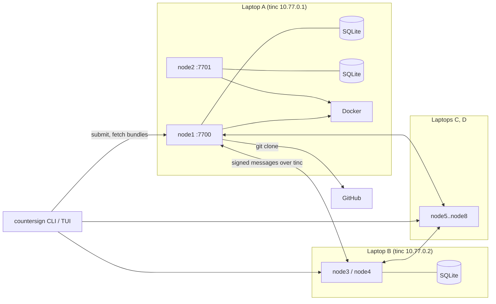
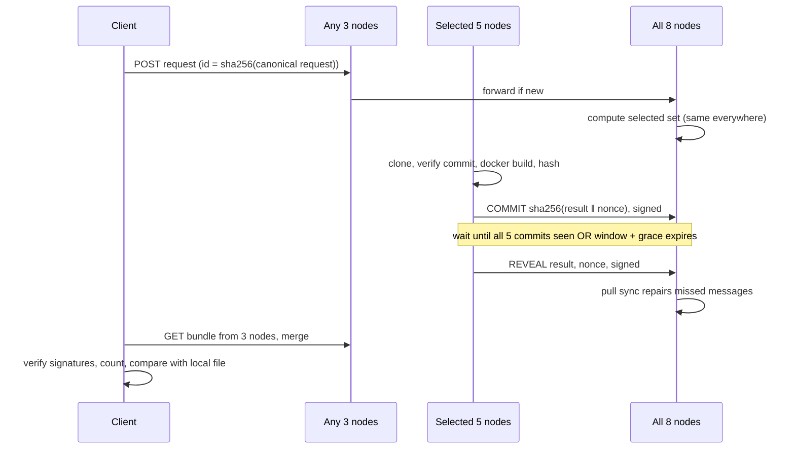
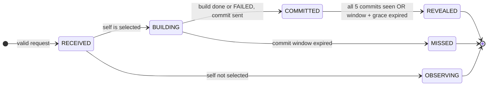

# RFC-0001: Countersign
### Byzantine-tolerant rebuild verification for GitHub releases

| | |
|---|---|
| **Status** | Draft |
| **Date** | 31 October 2026 |
| **Stack** | Python 3.11+, SQLite, tinc, Textual, aiohttp, PyNaCl, Docker, git |
| **Scope** | 12-hour hackathon MVP |

## 1. Summary

Countersign is a peer-to-peer network of rebuilders. Given a GitHub repository, a commit and a build recipe, a deterministic subset of rebuilders independently builds the binary and publishes a signed hash. A client accepts a binary only if its hash matches one that **f+1 independent rebuilders** produced.

There is no central server and no consensus protocol. With n = 8 rebuilders, the system stays correct while up to f = 2 (a quarter) lie, stall or collude.

**Core idea:** builds are deterministic, so the system never has to *agree* on an answer. It only has to *count matching answers*. Any hash signed by f+1 distinct rebuilders includes at least one honest rebuilder, so it is the true build output.

## 2. Motivation

Developers and CI pipelines routinely download binaries from GitHub releases. Doing so trusts a single, unseen build machine. Release-time tampering is a known attack class: the xz backdoor was hidden in release tarballs rather than in the git history.

Existing rebuilder systems target distro packages (Debian, Arch) or a few registries (Google's OSS Rebuild for npm, PyPI and Crates.io). None of them covers ad-hoc GitHub release binaries with a small, coordinator-free, Byzantine-tolerant network.

## 3. Goals and non-goals

### Goals

- **G1.** Rebuild Go binaries from `repo + commit + recipe` on independent machines.
- **G2.** Give a verdict that cannot be forged by up to f = 2 faulty rebuilders out of n = 8.
- **G3.** Run with no central server. Any node can accept requests and serve results.
- **G4.** Make verdicts verifiable offline. A client needs only the genesis public keys.
- **G5.** Prevent lazy rebuilders from copying others' results (commit-reveal).
- **G6.** Provide a Textual TUI that shows network state, request progress and evidence.
- **G7.** Provide a CLI usable in CI, with meaningful exit codes.

### Non-goals (MVP)

- Languages other than Go, and builds with cgo.
- Dynamic membership. Rebuilders are fixed in a genesis file.
- Consensus, leaders, blockchains, tokens or credits.
- Proving that source code is safe. Countersign proves *binary = source*, nothing more.
- Compromised-toolchain defense (Trusting Trust). All rebuilders use the same pinned image.
- Public internet exposure. The MVP runs inside the tinc mesh.

## 4. Terminology, assumptions and threat model

### Terms

| Term | Meaning |
|---|---|
| **Node** | A rebuilder process with an Ed25519 identity listed in genesis |
| **Request** | `{repo_url, commit, tag, recipe}`; its ID is the SHA-256 of its canonical JSON |
| **Selected set** | The R = 5 nodes deterministically chosen to build a request |
| **Commit** | A signed sealed hash: `sha256(result ‖ nonce)` |
| **Reveal** | A signed `result` and `nonce` that open a commit |
| **Result** | Hex SHA-256 of the built binary, or the literal `FAILED` |
| **Bundle** | The request plus all commits and reveals for it. It is self-verifying. |
| **Agreed hash** | A result revealed by at least T = 3 selected nodes |

### Parameters

| Name | Value | Rule |
|---|---|---|
| `n` | 8 | `n ≥ 4f` (problem statement) |
| `f` | 2 | Maximum number of faulty nodes |
| `R` (replicas) | 5 | `2f + 1` ensures ≥ f+1 honest nodes among the selected |
| `T` (threshold) | 3 | `f + 1` ensures ≥ 1 honest signer |
| `BUILD_TIMEOUT` | 150 s | Must be less than `COMMIT_WINDOW` |
| `COMMIT_WINDOW` | 180 s | Starts at local receipt of the request |
| `REVEAL_GRACE` | 20 s | Must exceed twice the expected clock skew |
| `SYNC_INTERVAL` | 10 s | Anti-entropy pull period |
| API port | 7700 | Bound to the tinc IP only |
| tinc subnet | `10.77.0.0/24` | One IP per laptop |

### Assumptions

1. **A1:** Honest nodes run the published code, and their builds are deterministic for a valid recipe.
2. **A2:** At most f nodes are faulty. Faulty means anything: lying, stalling, copying, equivocating or colluding.
3. **A3:** Private keys of honest nodes are not stolen. Ed25519 signatures cannot be forged.
4. **A4:** Messages between honest nodes are eventually delivered. This is a liveness assumption only; safety never depends on timing.
5. **A5:** Node clocks are NTP-synced to within ~5 s. This affects only commit-reveal fairness, not correctness.

### Threat model

| Adversary | In scope? |
|---|---|
| Faulty rebuilders (up to f), including colluding ones | Yes |
| A malicious requester submitting junk or abusive recipes | Yes (validation and allowlist) |
| A malicious tinc peer dropping or misrouting traffic | Yes (liveness only; all messages are signed) |
| A compromised GitHub release asset | Yes. This is the main use case. |
| Malicious code committed to the source repo | No |
| A compromised pinned Go toolchain image | No (shared single point of failure) |

## 5. Design decisions

| # | Decision | Choice | Why | Rejected alternative |
|---|---|---|---|---|
| D1 | Agreement mechanism | **None.** Count f+1 matching signed hashes. | Deterministic outputs make the correct answer self-identifying. There is no leader, no view change and no log. | PBFT or HotStuff: heavy, and unnecessary for deterministic compute |
| D2 | Membership | Static `genesis.json` | Prevents Sybil attacks; zero protocol for joins and leaves | Dynamic join: needs reconfiguration, which needs consensus |
| D3 | Network | **tinc** full mesh with `StrictSubnets` | No coordinator; NAT-friendly; one config per laptop | Headscale (has a central control server); raw LAN (fragile at venues) |
| D4 | Trust in the network | **None.** Every message is Ed25519-signed at the application layer. | A malicious tinc peer can only drop or delay messages, never forge them | Relying on tinc's tunnel authentication: not transferable to clients |
| D5 | Dissemination | Push to all peers, plus a periodic pull sync | With n = 8, a full mesh is trivial; the pull repairs dropped pushes | Epidemic gossip libraries or a DHT: overkill at n = 8 |
| D6 | Who builds | Rendezvous hashing over **all** genesis nodes | Every node and client computes the same set with no coordination | Excluding suspected nodes: local views diverge, so selections diverge |
| D7 | Replication | R = 2f+1, T = f+1 | Guarantees ≥ f+1 honest builders, so a verdict is always reachable | R = f+1: a single stall blocks the verdict |
| D8 | Anti-copying | Commit-reveal with a fixed window | Lazy operators can't copy what they haven't seen | Trusting operators: rational laziness silently eats into f |
| D9 | Language | **Go only**, `CGO_ENABLED=0` | Reproducible with `-trimpath`; **`go build` never executes repo code**, so untrusted repos are safe to build | Rust (`build.rs` runs code); Python (build hooks) |
| D10 | Build sandbox | Docker, pinned image digest from a genesis allowlist, network off during build | Hermetic and simple; requesters cannot choose arbitrary images | Bare-metal builds: not reproducible across laptops |
| D11 | Comparison point | Rebuilders attest `source → hash`; the **client** compares with its downloaded file | Rebuilders never touch release assets, which keeps them simple | Rebuilders fetch assets: needs the GitHub API and adds failure modes |
| D12 | Requests | Anonymous, content-addressed, deduplicated | No client keys needed; idempotent | Signed client identities: unnecessary for the MVP |
| D13 | Storage | SQLite per node | Zero operations; one file | Postgres: a server to run |
| D14 | Serialization | Canonical JSON: sorted keys, `(",", ":")` separators, UTF-8, no floats in signed bodies | Deterministic bytes to sign | CBOR or protobuf: an extra dependency |
| D15 | HTTP | aiohttp for both server and client | Asyncio-native, one dependency, works with Textual | FastAPI + uvicorn + httpx: three dependencies |
| D16 | UI | Textual TUI | Terminal-native, fast to build, good for a live demo | A web dashboard: more code |
| D17 | Faulty nodes | Recorded as **evidence**; never auto-excluded | Keeps selection identical everywhere (see D6) | Auto-eviction: requires agreement on evictions |

## 6. High-level design

### 6.1 Components

| Component | Responsibility |
|---|---|
| **Node daemon** (`countersign-node`) | Accepts requests, forwards them, builds when selected, runs commit-reveal, stores messages, serves bundles |
| **Builder** | Clones the repo, verifies the commit, runs the two-step Docker build, hashes the output |
| **Store** | SQLite tables for requests, messages, own builds and evidence |
| **Protocol engine** | Validates envelopes, drives the per-request state machine, timers and evidence detection |
| **Verdict** | A pure function `bundle → verdict`, shared by the node and the client |
| **Client CLI** (`countersign`) | Submits requests, fetches and merges bundles, verifies files, sets exit codes |
| **TUI** (`countersign tui`) | Live view of peers, requests, per-node results and evidence |
| **tinc** | Encrypted mesh between laptops; untrusted transport |

### 6.2 Architecture



Each laptop runs one tinc daemon and two node processes on different ports. All signed traffic travels over tinc IPs.

### 6.3 Request lifecycle



### 6.4 Verdicts

| Verdict | Condition | Exit code |
|---|---|---|
| `REPRODUCED` | Agreed hash exists and equals `sha256(file)` | 0 |
| `MISMATCH` | Agreed hash exists and differs from `sha256(file)` | 1 |
| `NOT_REPRODUCIBLE` | All 5 revealed, no hash reaches T, and at least 2 distinct non-`FAILED` results | 2 |
| `BUILD_FAILED` | At least T selected nodes revealed `FAILED` | 2 |
| `PENDING` | None of the above | 3 |
| Error | Bad input, unreachable nodes, invalid genesis | 4 |

Two different hashes can never both reach T = 3, because 3 + 3 > 5.

## 7. Low-level design

### 7.1 Repository layout

```
countersign/
  canon.py      # canonical_json(), sha256_hex()
  crypto.py     # keygen, sign(), verify() via PyNaCl
  genesis.py    # load and validate genesis.json
  model.py      # dataclasses: Recipe, Request, Envelope
  select.py     # rendezvous selection
  verdict.py    # pure verdict function (shared by node and client)
  store.py      # SQLite access
  builder.py    # git and Docker build
  protocol.py   # message handling, state machine, timers, evidence
  net.py        # aiohttp server, peer push, pull sync
  faults.py     # demo fault modes
  node.py       # countersign-node entrypoint
  cli.py        # countersign entrypoint
  tui.py        # Textual app
tests/
genesis.json
```

Dependencies: `pynacl`, `aiohttp`, `textual`. `tomllib` is in the standard library. Host prerequisites: Docker, git and tinc.

### 7.2 Genesis file

```json
{
  "network_id": "countersign-bios-2026",
  "f": 2,
  "replicas": 5,
  "threshold": 3,
  "commit_window_s": 180,
  "reveal_grace_s": 20,
  "build_timeout_s": 150,
  "allowed_images": {
    "go1.23": "golang@sha256:<digest>"
  },
  "nodes": [
    {"id": "node1", "addr": "10.77.0.1:7700", "pubkey": "<ed25519 hex>"},
    {"id": "node2", "addr": "10.77.0.1:7701", "pubkey": "<ed25519 hex>"}
  ]
}
```

At startup a node checks that `n ≥ 4f`, `replicas == 2f+1`, `threshold == f+1` and `build_timeout_s < commit_window_s`, and refuses to start otherwise. The `genesis_hash` (SHA-256 of canonical genesis) is exchanged in `/v1/health`. Peers with a different hash are ignored.

### 7.3 Recipe and request

Recipe (`countersign.toml` in the target repo, or passed on the command line):

```toml
[build]
image   = "go1.23"            # key into genesis allowed_images
package = "./cmd/hello"
goos    = "linux"
goarch  = "amd64"
ldflags = "-s -w -buildid="
output  = "hello"
```

Request:

```json
{
  "v": 1,
  "repo_url": "https://github.com/org/hello",
  "commit": "<40-hex sha>",
  "tag": "v1.2.0",
  "recipe": { "...": "fields above" }
}
```

`request_id = sha256_hex(canonical_json(request))`.

Validation rules:

- `repo_url` matches `^https://github\.com/[\w.-]+/[\w.-]+$`.
- `commit` is 40 hex characters.
- `image` is a key in `allowed_images`.
- `goos` and `goarch` are in an allowlist.
- `package` matches `^\./[\w./-]*$` with no `..`.
- `ldflags` contains no `-extldflags`; length ≤ 512.
- `output` matches `^[\w.-]{1,64}$`.
- Total request size ≤ 4 KiB.
- `tag` is informational only. The `commit` is authoritative, because tags are mutable.

### 7.4 Signed envelope

```json
{
  "v": 1,
  "type": "commit",
  "signer": "node3",
  "body": {"request_id": "<hex>", "c": "<hex>"},
  "sig": "<ed25519 hex>"
}
```

- `sig = Ed25519.sign(sk, canonical_json({"v", "type", "signer", "body"}))`
- `msg_id = sha256_hex(canonical_json(envelope))`

Envelope bodies:

| Type | Body |
|---|---|
| `commit` | `{request_id, c}` where `c = sha256_hex(result + ":" + nonce)` |
| `reveal` | `{request_id, result, nonce}`; `result` is a 64-hex hash or `"FAILED"`; `nonce` is 32 random bytes in hex |

A node accepts an envelope only if all of the following hold:

1. `signer` is in genesis.
2. The signature is valid.
3. The request is known (unknown requests are pulled first).
4. The signer is in that request's selected set.
5. The type-specific rules below pass.

### 7.5 Selection

```python
def selected(request_id: str, nodes: list[Node], r: int) -> list[str]:
    scored = sorted(
        nodes,
        key=lambda n: sha256_hex(f"{request_id}:{n.pubkey}".encode()),
    )
    return [n.id for n in scored[:r]]
```

Selection is identical on every node and client. Requesters cannot grind the request ID to pick colluders usefully, because safety needs only f+1 matching results regardless of who is selected.

### 7.6 Protocol state machine

Each node tracks every request as an observer. A node in the selected set also acts as a builder:



Rules for a node `X` handling request `q`, where `t0` is X's local receipt time of `q`:

1. **Forward.** On first receipt, store `q` with `t0` and push it to all peers.
2. **Build.** If X is selected, run the builder with `BUILD_TIMEOUT`. On success, `result` is the binary's SHA-256; on any error, `result` is `"FAILED"`.
3. **Commit.** If `now < t0 + COMMIT_WINDOW`, generate a nonce, store `(result, nonce)` locally, and broadcast the commit. Otherwise mark the request `MISSED`.
4. **Accept commits** from selected signers only while X has **not yet revealed** for `q` and `now < t0 + COMMIT_WINDOW`. Later commits are stored with `valid = 0, note = 'late'`.
5. **Reveal** when X has committed and either it holds valid commits from all R selected nodes, or `now ≥ t0 + COMMIT_WINDOW + REVEAL_GRACE`.
6. **Accept reveals** only if they match a valid stored commit from the same signer: `sha256_hex(result + ":" + nonce) == c`.
7. **Record evidence:**
   - `EQUIVOCATION`: two different valid commits from the same signer for `q`. This is hard proof.
   - `BAD_OPEN`: a reveal that doesn't match the signer's commit. This is hard proof.
   - `DISAGREE`: a reveal whose result differs from the agreed hash. This is a soft signal, since it may be honest nondeterminism; anyone can rebuild to check.
   - `STALL`: a selected node with no commit by the end of the window. This is a soft signal.

Commit-reveal stops a *rational* lazy operator from copying others' results. It is not needed for safety: a copier is faulty and counts toward f anyway. Its job is to stop laziness from silently consuming the fault budget.

### 7.7 Verdict function

```python
def verdict(bundle, genesis, file_sha256=None) -> Verdict:
    q = bundle.request
    rid = request_id(q)
    sel = set(selected(rid, genesis.nodes, genesis.replicas))

    commits = {}           # signer -> c
    equivocators = set()
    for e in bundle.commits:
        if e.signer in sel and verify(e, genesis) and e.body["request_id"] == rid:
            if e.signer in commits and commits[e.signer] != e.body["c"]:
                equivocators.add(e.signer)
            commits.setdefault(e.signer, e.body["c"])

    results = {}           # signer -> result
    for e in bundle.reveals:
        s = e.signer
        if s in sel and s not in equivocators and verify(e, genesis) and s in commits:
            b = e.body
            if sha256_hex(f'{b["result"]}:{b["nonce"]}'.encode()) == commits[s]:
                results[s] = b["result"]

    counts = Counter(results.values())
    agreed = next((h for h, k in counts.items() if k >= genesis.threshold), None)

    if agreed == "FAILED":
        return BUILD_FAILED
    if agreed:
        if file_sha256 is None:
            return AGREED(agreed)
        return REPRODUCED if agreed == file_sha256 else MISMATCH
    if len(results) == len(sel) and len([h for h in counts if h != "FAILED"]) >= 2:
        return NOT_REPRODUCIBLE
    return PENDING
```

The client merges bundles from ≥ f+1 = 3 nodes by taking the union of envelopes, deduplicated by `msg_id`. A faulty node can omit messages but cannot forge them, so the union from three nodes contains everything at least one honest node holds.

### 7.8 SQLite schema

```sql
CREATE TABLE requests (
  id           TEXT PRIMARY KEY,
  body         TEXT NOT NULL,          -- canonical JSON
  received_at  REAL NOT NULL,          -- local t0
  phase        TEXT NOT NULL           -- RECEIVED|BUILDING|COMMITTED|REVEALED|MISSED|OBSERVING
);

CREATE TABLE messages (
  msg_id       TEXT PRIMARY KEY,
  request_id   TEXT NOT NULL REFERENCES requests(id),
  type         TEXT NOT NULL,          -- commit|reveal
  signer       TEXT NOT NULL,
  envelope     TEXT NOT NULL,          -- canonical JSON
  received_at  REAL NOT NULL,
  valid        INTEGER NOT NULL,       -- 1 accepted, 0 rejected
  note         TEXT                    -- late|bad_sig|not_selected|...
);
CREATE INDEX messages_req ON messages(request_id, type, signer);

CREATE TABLE my_builds (
  request_id   TEXT PRIMARY KEY REFERENCES requests(id),
  result       TEXT,                   -- hash or FAILED
  nonce        TEXT,
  log_path     TEXT,
  started_at   REAL,
  finished_at  REAL
);

CREATE TABLE evidence (
  id           INTEGER PRIMARY KEY,
  kind         TEXT NOT NULL,          -- EQUIVOCATION|BAD_OPEN|DISAGREE|STALL
  signer       TEXT NOT NULL,
  request_id   TEXT NOT NULL,
  proof        TEXT NOT NULL,          -- JSON array of envelopes
  created_at   REAL NOT NULL
);
```

Use WAL mode and a single writer task. The TUI opens the database read-only.

### 7.9 HTTP API (per node, bound to its tinc IP)

| Method and route | Purpose | Response |
|---|---|---|
| `GET /v1/health` | Node ID, version, genesis hash | 200 |
| `POST /v1/requests` | Submit or forward a request | 202 `{id}`; 400 if invalid |
| `GET /v1/requests?since=<unix>` | Request IDs received since a time (for sync) | 200 `[ids]` |
| `GET /v1/requests/{id}` | Request body and local phase | 200 / 404 |
| `POST /v1/messages` | Push a signed envelope | 202; 400 if invalid |
| `GET /v1/requests/{id}/bundle` | Request plus all *valid* envelopes | 200 |
| `GET /v1/evidence?since=<unix>` | Evidence records | 200 |

Limits: request bodies ≤ 16 KiB; at most 20 new requests per minute per source IP.

**Pull sync**, every `SYNC_INTERVAL`, for each peer:

1. `GET /v1/requests?since=last_sync - 60` and fetch unknown requests.
2. For each request not finished locally, `GET /bundle` and process every envelope through the normal validation path.

### 7.10 Builder

Each build runs in a work directory `work/<request_id>/{src,out,gomod}`:

```bash
# 1. Source
git clone --filter=blob:none "$REPO" src
git -C src checkout --detach "$COMMIT"
test "$(git -C src rev-parse HEAD)" = "$COMMIT"

# 2. Dependencies (network on; Go verifies go.sum and the checksum DB)
docker run --rm -v "$PWD/src:/src" -v "$PWD/gomod:/go/pkg/mod" -w /src \
  -e GOFLAGS=-mod=readonly "$IMAGE" go mod download

# 3. Build (network off, read-only source)
docker run --rm --network none \
  -v "$PWD/src:/src:ro" -v "$PWD/gomod:/go/pkg/mod:ro" -v "$PWD/out:/out" \
  -e CGO_ENABLED=0 -e GOOS="$GOOS" -e GOARCH="$GOARCH" \
  -e GOFLAGS=-mod=readonly -e GOCACHE=/tmp/gocache -w /src \
  "$IMAGE" go build -trimpath -buildvcs=false -ldflags "$LDFLAGS" \
  -o "/out/$OUTPUT" "$PACKAGE"

# 4. Hash
sha256sum "out/$OUTPUT"
```

- Commands run via `asyncio.create_subprocess_exec` with argument lists, never shell strings.
- Stdout and stderr go to `log_path`, capped at 1 MiB.
- On timeout, the node runs `docker kill` and the result is `FAILED`.
- Before the hackathon, pre-pull the pinned image on every laptop.

### 7.11 Client CLI

```
countersign request  --repo URL --commit SHA [--tag T] --recipe countersign.toml
countersign status   ID
countersign verify   FILE --repo URL --commit SHA --recipe countersign.toml [--wait 300]
countersign evidence [--since 1h]
countersign tui
```

- The client computes `request_id` itself; it never trusts a node for it.
- `request` submits to 3 nodes (f+1), so at least one honest node forwards it.
- `verify` fetches bundles from 3 or more nodes, merges and verifies them locally, prints the verdict and the per-node table, and exits with the code from §6.4. With `--wait`, it polls until the verdict is not `PENDING`.
- Config: `~/.countersign/genesis.json` and an optional `nodes` override list.

Example CI step:

```bash
curl -LO https://github.com/org/hello/releases/download/v1.2.0/hello
countersign verify hello --repo https://github.com/org/hello \
  --commit 3f2a... --recipe countersign.toml --wait 300 || exit 1
```

### 7.12 TUI (Textual)

| Screen | Contents | Keys |
|---|---|---|
| **Peers** | 8 rows: ID, address, reachable, genesis-hash match, last seen | `p` |
| **Requests** | ID (short), `repo@commit`, phase, commits x/5, reveals x/5, verdict | `r`, `Enter` for detail |
| **Detail** | Per selected node: committed?, revealed result, matches agreed? (green/red), build log tail | `l` for log |
| **Evidence** | Kind, signer, request, time; `Enter` shows the proof JSON | `e` |
| **Submit** | Form for repo, commit and recipe path | `s` |

The TUI polls the local node's API every second. It holds no state of its own.

### 7.13 tinc setup

Netname `countersign`, one daemon per laptop:

```
# /etc/tinc/countersign/tinc.conf
Name = laptopA
Mode = router
AddressFamily = ipv4
StrictSubnets = yes
ConnectTo = laptopB
ConnectTo = laptopC
ConnectTo = laptopD

# /etc/tinc/countersign/hosts/laptopA
Address = <LAN IP>
Subnet = 10.77.0.1/32
-----BEGIN RSA PUBLIC KEY----- ...
```

- Host files are distributed with genesis.
- `tinc-up` assigns `10.77.0.x/24` to the interface.
- Every laptop uses `ConnectTo` toward every other laptop for a direct full mesh, so no traffic is relayed through a peer.
- Node API ports are reachable only on the tinc interface.

### 7.14 Fault modes (demo only)

Enabled with `--fault MODE`. Nodes refuse fault flags unless started with `--allow-faults`.

| Mode | Behavior |
|---|---|
| `lie` | Commit to and reveal a random hash |
| `collude --hash H` | Commit to and reveal a shared fixed hash `H` |
| `stall` | Never commit or reveal |
| `copy` | Skip the build, wait for the first reveal seen, then try to commit and reveal that value |
| `equivocate` | Send different commits to different peers |

## 8. Security guarantees and failure handling

### 8.1 Guarantees (assuming ≤ f faulty nodes)

| Property | Argument |
|---|---|
| **No forged acceptance** | An agreed hash has T = f+1 signers, so at least one is honest, so it is the true build output (A1). |
| **No hidden tampering** | R = 2f+1 selected nodes include ≥ f+1 honest ones, which all reveal the true hash. That hash reaches T, so a tampered file gets `MISMATCH`. |
| **Liveness** | Same argument: f+1 honest builders always eventually produce an agreed hash (A4). |
| **Uniqueness** | Two hashes cannot both reach 3 out of 5. |
| **No coordinator** | Selection, validation and the verdict are local pure functions. Bundles are self-verifying. |
| **Network attacks cost liveness only** | All messages are signed, and tinc peers can only drop or delay them. |
| **Equivocation is provable** | Two signed conflicting commits form a transferable proof. |

### 8.2 Failure handling

| Failure | Behavior |
|---|---|
| Node crash or restart | State is in SQLite. On restart: re-read requests, resume timers from `received_at`, never re-commit with a different nonce, then pull-sync. |
| Laptop offline | Its two nodes count as two faults, which is the whole budget. Keep other laptops healthy during the demo. |
| GitHub unreachable | The build fails with `FAILED`. If ≥ 3 nodes fail, the verdict is `BUILD_FAILED`; the client can re-request later (see open questions). |
| Clock skew > `REVEAL_GRACE / 2` | Copy protection weakens; correctness is unaffected. |
| Nondeterministic build | `NOT_REPRODUCIBLE`. The maintainer must fix the recipe. |
| Duplicate request | Deduplicated by content ID. |
| Disk fills up | Delete `work/<id>` after hashing; keep only logs. |

## 9. Testing, build plan and cut list

### 9.1 Tests

| Level | What |
|---|---|
| Unit | Canonical JSON stability; sign and verify round-trip; selection determinism; verdict table tests covering every row in §6.4 and every fault combination with ≤ 2 faults |
| Integration (one machine) | 8 nodes on `127.0.0.1:7700–7707` without tinc; scripted fault matrix: `{lie, collude, stall, copy, equivocate}` × up to 2 nodes, asserting the verdict and evidence each time |
| Reproducibility | Same recipe built on all 4 laptops yields an identical hash. **Do this in hour 1.** |
| End to end | 4 laptops × 2 nodes over tinc; verify a real release; swap in a tampered binary; pull a network cable |

### 9.2 12-hour plan (team of 3–4)

| Hours | Track A (protocol) | Track B (build and net) | Track C (UX) |
|---|---|---|---|
| 0–1 | `canon`, `crypto`, `genesis`, `model` | tinc up on all laptops; pre-pull image; prove cross-laptop determinism | Sample Go repo and recipe; tagged release |
| 1–4 | `select`, `verdict` + table tests | `builder.py`; `net.py` push | `cli.py` request/status |
| 4–6 | `protocol.py` state machine, timers | Pull sync; `store.py` | `cli.py` verify, merge, exit codes |
| 6–8 | Evidence detection | `faults.py` | `tui.py` Peers and Requests |
| 8–10 | Integration fault matrix | Hardening, restart recovery | TUI Detail and Evidence; CI example |
| 10–11.5 | End-to-end over tinc, all together | | |
| 11.5–12 | Rehearse the demo twice | | |

### 9.3 Cut list (drop first to last)

1. TUI Submit screen
2. TUI Evidence screen (the CLI still prints evidence)
3. `copy` and `equivocate` fault modes
4. Pull sync (rely on push and short demo runs)
5. Commit-reveal (reveal directly; safety is unaffected)

**Never cut:** signatures, selection, the verdict function, the builder and the `verify` exit codes.

## 10. Open questions and future work

- **Retries.** Should a `BUILD_FAILED` request be retryable via a `round` field that is part of the request ID?
- **Membership changes.** New genesis versions signed by an operator quorum.
- **More languages.** Rust and Python, once sandboxing for build-time code execution is designed.
- **Watcher mode.** Nodes fetch published release assets and raise `MISMATCH` alerts proactively.
- **Distribution.** A GitHub Action and a release badge.
- **Public access.** A read-only bundle API outside tinc for CI runners.
- **Toolchain diversity.** Multiple independent Go toolchain sources to address the shared-image single point of failure.
- **Transparency log.** An append-only, hash-chained log of bundles per node, so omissions become detectable.