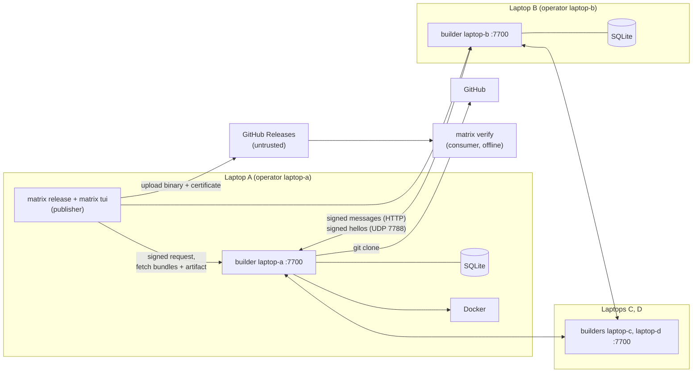
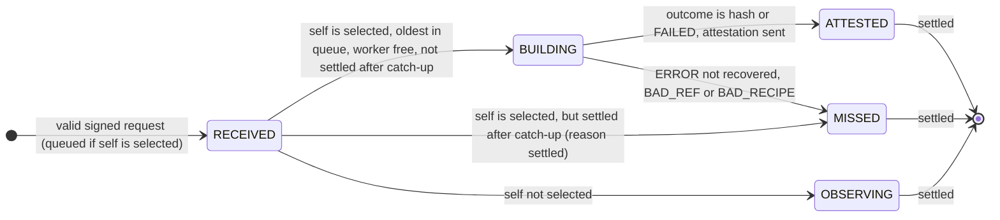

# RFC-0001: Matrix
### Byzantine-tolerant release gating for Go publishers

| | |
|---|---|
| **Status** | Draft (rev 5, replaces rev 4) |
| **Date** | 1 November 2026 |
| **Stack** | Python 3.11+, SQLite, Textual, aiohttp, PyNaCl, Docker, git. tinc or WireGuard optional (§7.13). |
| **Hosts** | Linux laptops (x86-64 or arm64), or Windows laptops running Matrix inside WSL2 with mirrored networking (§7.13). macOS is untested. |
| **Scope** | 12-hour hackathon MVP |

## 1. Summary

Matrix is a peer-to-peer network of builders that a software publisher runs on **independent infrastructure**. When a maintainer tags a release, every builder independently builds the tagged commit and signs the hash of what it built. A release is **certified** only when **f+1 distinct builders** signed the same hash. The binary then ships with a certificate that any consumer can check offline.

There is no central server, no single build machine and no single signing key. With n = 4 builders and f = 1 (a quarter), as in the demo:

- **Safety** (never certifying a binary that no honest builder produced from the tagged commit) holds while up to f builders lie, stall, equivocate or collude.
- **Liveness** (certifying a release) additionally tolerates s = R − f − T = 1 honest builder that crashes, fails or goes offline.
- **Consumers** need no network access to Matrix: the certificate is self-contained.
- The fault unit is an **operator** (an infrastructure domain: a CI provider, a cloud account, a laptop). In the demo each laptop is one operator running one builder, so one compromised laptop is one malicious builder, the whole f (see A2).
- **Zero configuration on one LAN.** `matrix up` on each laptop runs a founding ceremony that creates the shared genesis with no authority and no file editing (§7.16). Builders then locate each other through signed UDP hellos (§7.15), so DHCP address changes do not matter. Membership stays fixed by genesis.

**Core idea:** builds are deterministic, so the system never has to *agree* on an answer. It only has to *count matching answers*. Any hash signed by f+1 distinct builders includes at least one honest builder, so an honest build really produced it. One hacked build machine can no longer publish anything.

## 2. Motivation

A publisher's build machine is a single point of trust. Whoever controls it controls what every user installs, and the source repository gives no hint that anything is wrong.

- **SolarWinds (2020):** an implant on SolarWinds' build server swapped a source file during builds. The repository stayed clean, and the poisoned Orion update was signed with SolarWinds' real key and shipped to thousands of customers. Orion is closed-source, so no outside party could have rebuilt it to notice. A gate inside the publisher's own pipeline, where several independent builders must produce the same binary before anything ships, would have blocked the release: the compromised builder's hash would have stood alone.
- **Stolen signing keys and CI credentials** have the same effect. With one signing key, one theft is enough to ship anything.

What publishers have today does not remove the single point:

- **Build provenance** (SLSA provenance, GitHub Artifact Attestations) is signed by the same build platform that made the file. If that platform is compromised, it certifies its own output.
- **Public rebuilders** (Debian and Arch reproducible-builds efforts, Google's OSS Rebuild) only cover open-source code after release, and depend on consumers checking.

Matrix moves the check **before** release, works for closed-source code, and replaces "trust our build machine" with "trust that at most a quarter of our independent builders are compromised".

## 3. Goals and non-goals

### Goals

- **G1.** Build Go binaries from `repo + tag + commit` on independent builders, using the recipe stored in the tagged commit.
- **G2.** Certify a release only with T = f+1 matching signed hashes, so up to f faulty builders cannot certify a wrong binary (safety), with up to s further crashed or offline honest builders tolerated (liveness). The demo uses n = 4, f = 1, T = 2, s = 1.
- **G3.** Run with no central server or coordinator. Any builder accepts release requests and serves results. The tool that starts a release has no authority.
- **G4.** Ship a self-contained certificate with each binary. Consumers verify offline with only the pinned genesis file.
- **G5.** Accept release requests only when signed by an authorised release signer listed in genesis, for an allowed repository.
- **G6.** Provide a Textual TUI that shows builders, release progress and evidence.
- **G7.** Provide a CLI usable in CI on both sides: `matrix release` in the publisher's pipeline (which must reach the builders) and `matrix verify` in any consumer's pipeline (which needs no network).
- **G8.** Zero-config founding and discovery on one LAN: one command per laptop (`matrix up`) creates the genesis through a unanimous ceremony with a human-compared short code, and builders find each other's current addresses through signed hellos.

### Non-goals (MVP)

- Languages other than Go, and builds with cgo.
- More than one binary per release request. Archives (tar.gz, zip) and embedded build timestamps.
- Dynamic membership. Builders and release signers are fixed in a genesis file. A disconnect is not a leave; adding or removing a member means re-founding (§8.3).
- Discovery across networks (routed subnets, NAT, the internet). Hellos are LAN broadcasts; other deployments put static `addr`s in genesis.
- Consensus, leaders, blockchains, tokens or credits.
- Proving that source code is safe. Matrix proves *binary = tagged source*, nothing more.
- Defending against a malicious maintainer, a malicious commit, or a compromised repository account (moved tags).
- Compromised-toolchain defence (Trusting Trust). All builders use the same pinned image.
- Builders run by third parties. In this mode every builder belongs to the publisher (see §10, *Matrix public*).
- A single threshold signature in the certificate. The MVP certificate carries T separate signatures.

## 4. Terminology, assumptions and threat model

### Terms

| Term | Meaning |
|---|---|
| **Builder** | A Matrix node with an Ed25519 identity listed in genesis |
| **Operator** | The infrastructure domain that runs one or more builders: a CI provider, a cloud account with its own admins and credentials, or (in the demo) one laptop |
| **Release signer** | A maintainer or CI identity whose Ed25519 key is listed in genesis and may request releases |
| **Release request** | `{v, repo_url, commit, tag}`, signed by a release signer. Its ID is the SHA-256 of the request body's canonical JSON |
| **Recipe** | `matrix.toml` in the tagged commit: image, package, target, ldflags, output name |
| **Selected set** | The R builders deterministically chosen for a request (in the MVP R = n, so every builder) |
| **Attestation** | A builder's signed `{request_id, result}` |
| **Result** | Hex SHA-256 of the built binary, or the literal `FAILED` (a deterministic build failure only, see §7.10) |
| **Bundle** | The signed request plus all attestations a builder has stored for it |
| **Quorum result** | A result attested by at least T distinct selected builders that did not equivocate |
| **Certificate** | `<output>.matrix.json`: the genesis hash, the signed request and ≥ T matching attestations. Ships next to the binary |
| **Hello** | A builder's signed UDP announcement of its current address `{genesis_hash, addr, seq}` (§7.15) |
| **Address book** | In-memory map `node_id → (addr, seq, last_seen)` built from accepted hellos. A builder is **online** while its last accepted hello is younger than `ONLINE_WINDOW_S` |
| **Founding ceremony** | `matrix up`: laptops announce self-signed founder records, build the same genesis, compare its **short code** aloud and endorse it unanimously (§7.16) |

### Parameters

| Name | Value | Rule |
|---|---|---|
| `n` | 4 | `n ≥ 4f` (problem statement). One builder per laptop in the demo. |
| `f` | 1 | Maximum number of malicious builders. The ceremony sets `f = n // 4`. |
| `R` (replicas) | 4 | `2f + 1 ≤ R ≤ n`. The MVP uses every builder (`R = n`), so selection is the identity. |
| `T` (threshold) | 2 | `f + 1` ensures ≥ 1 honest signer per quorum result |
| slack `s` | 1 | `R − f − T`: honest builders that may fail without losing liveness |
| Max builders per operator | 1 | Must be ≤ f, so one compromised operator stays within the fault budget. The ceremony makes each laptop its own operator with one builder. |
| `BUILD_TIMEOUT` | 150 s | Covers clone, dependency download and build. **Measure in hour 1** on every laptop. |
| `REQUEST_TTL` | 3600 s | After this, a request takes no new build work |
| `SYNC_INTERVAL` | 10 s | Anti-entropy pull period |
| `MAX_CONCURRENT_BUILDS` | 1 per builder | Every other selected request waits in a persistent SQLite queue, oldest first; nothing is shed (§7.6) |
| Max artifact size | 64 MiB | Larger outputs are an `ERROR` |
| Artifact retention | 24 h | Builders keep their own outputs for download |
| API port | TCP 7700 | One builder per laptop; `matrix up` listens on `0.0.0.0:7700`. Networks on one machine use 7700 + k. |
| `DISCOVERY_PORT` | UDP 7788 | Hellos and ceremony messages (§7.15, §7.16) |
| `HELLO_INTERVAL_S` | 5 s | Hello broadcast period |
| `ONLINE_WINDOW_S` | 15 s | A builder is online if its last accepted hello is younger |
| `MAX_HELLO` | 512 bytes | Larger datagrams are dropped unparsed |
| `MAX_CEREMONY` | 1024 bytes | Founder and endorse datagrams (a founder message is about 600 bytes); larger ones are dropped unparsed |
| `FOUNDER_INTERVAL_S` | 2 s | Founder and endorse rebroadcast period |
| `CEREMONY_TIMEOUT_S` | 300 s | The ceremony aborts without every endorsement |
| tinc subnet | `10.77.0.0/24` | Only with the optional tinc layer (§7.13) |
| Demo profile | `build_timeout_s 45`, `sync_interval_s 5` | Set in the demo's `network.toml` (single-machine dev networks: `genesis.demo.json`). Different values give a different genesis hash, so consumers must pin the hash of the network they use. |

The rules are general. A larger network follows them unchanged; for example the single-machine development network uses n = 8, f = 2, R = 8, T = 3, s = 3 with two builders per simulated operator.

### Assumptions

1. **A1:** Honest builders run the published code, and their builds are deterministic for a valid recipe. Environmental errors (network, timeout, out-of-memory, disk, Docker) are reported as abstentions, never as `FAILED`.
2. **A2:** At most f builders are **malicious**: lying, equivocating, stalling or colluding. Crashed or offline honest builders are not counted in f; they only cost liveness (budget s). Builders that share an operator fail together, so no operator may run more than f builders. In the demo the unit of compromise is the laptop: one compromised laptop = 1 malicious builder = the whole f.
3. **A3:** Private keys of honest builders are not stolen, and no credential is shared across operators. Ed25519 signatures cannot be forged.
4. **A4:** Messages between honest builders arrive within about one `SYNC_INTERVAL` in the normal case. **Safety never depends on this.** Liveness does.
5. **A5:** Consumers obtain `genesis.json` from a channel they already trust (for example the repository at a signed commit, or the publisher's website) and pin its SHA-256. A genesis file downloaded from the release page itself proves nothing, because whoever can swap the binary there can swap the genesis too.
6. **A6:** During the founding ceremony the team compares the short code over a channel an attacker cannot alter (reading it aloud in one room), and each user confirms only if the code matches and the founder list shows exactly the expected laptops.

### Threat model

| Adversary | In scope? |
|---|---|
| Compromised builder machines (up to f), including colluding ones and ones that inject code into their builds | Yes. This is the main use case. |
| A compromised uploader or release page that swaps the binary or the certificate | Yes. Consumers detect it with `matrix verify` (§7.11). |
| Replaying an older release's binary and certificate (downgrade) | Yes. `verify` requires the expected repo and tag. |
| A compromised CI job or stolen release-signer key | Partly. It can request builds of tags that already exist in an allowed repo, nothing more: builders check the repo allowlist and that the tag resolves to the commit. |
| A request flood from a release signer | Partly. The ingest cap and the single build slot protect builder resources, not liveness: queued requests are delayed, and those that settle or expire while queued cost no build. |
| A malicious repository trying to run code or exhaust resources during the build | Yes (ldflags allowlist, hardened container, pinned toolchain, resource limits) |
| A malicious LAN, hotspot or tinc peer dropping, delaying or misrouting traffic, or jamming the network | Yes (liveness only; all messages are signed). No protocol prevents jamming. |
| Forged or replayed hellos, or hellos from non-members | Yes. Dropped by the receiver checks (§7.15); a hello can never add a member. |
| A member advertising a wrong address | Yes. It can only advertise its own address, so it only makes itself unreachable (liveness, never safety). |
| A rogue device on the LAN during the founding ceremony | Yes. It appears as an extra founder row and changes the short code, or it is absent from the list; the team refuses to confirm, and any listed member can veto (§7.16). |
| Knocking honest builders offline to shrink the membership | Yes. Disconnect is not leave; membership never shrinks (§8.3). |
| A passive eavesdropper on a plain LAN | Partly. It learns which releases are built and their results (no confidentiality without tinc or WireGuard). It cannot alter anything. |
| A malicious builder serving a wrong artifact or malformed bundle | Yes. Clients check every hash and signature locally. |
| Cross-network replay of signed messages | Yes (domain-separated signatures, §7.4) |
| A malicious maintainer, malicious commit, or moved tag after account takeover | No |
| A compromised pinned Go toolchain image | No (shared single point of failure) |
| More than f builders compromised, for example through a credential shared across operators | No. Deployment must keep operators independent. |
| A team that confirms the short code without comparing it | No (A6) |
| A container escape from the build sandbox | Mitigated by hardening (§7.10); residual risk accepted |

## 5. Design decisions

| # | Decision | Choice | Why | Rejected alternative |
|---|---|---|---|---|
| D1 | Agreement mechanism | **None.** Count f+1 matching signed results. | Deterministic outputs make the correct answer self-identifying. There is no leader, no view change and no log. | PBFT or HotStuff: heavy, and unnecessary for deterministic compute |
| D2 | Where the check happens | **Before release**, inside the publisher's pipeline | Blocks a poisoned release instead of detecting it later; works for closed-source code; a clear owner pays for it | Public rebuilders after release: needs outside operators and consumer action (kept as future work, §10) |
| D3 | Membership | Static `genesis.json` with builders, operators, release signers and allowed repos | Prevents Sybil attacks; zero protocol for joins and leaves. The ceremony (D25) only automates *creating* the static list. | Dynamic join: needs reconfiguration, which needs consensus |
| D4 | Who can start a release | Only requests signed by a genesis release signer, for an allowed repo | Stops anyone on the network, including a malicious builder, from triggering builds | Anonymous requests (rev 3): fine for public rebuilders, wrong for a publisher's gate |
| D5 | Where the recipe lives | `matrix.toml` in the tagged commit | The recipe is reviewed and versioned with the code. A compromised CI config cannot change how builders build. | Recipe in the request: whoever sends the request controls the build |
| D6 | Network | **Plain LAN** by default (one hotspot or travel router); tinc or WireGuard optional for privacy | No coordinator and nothing to configure. Integrity comes from signatures (D7); plain LAN loses only confidentiality. It does not get around venue client isolation (§7.13). | tinc as the default (rev 4): host files and stable IPs to distribute; Headscale: a central control server |
| D7 | Trust in the network | **None.** Every message is Ed25519-signed at the application layer, with domain separation. | A malicious network peer can only drop or delay messages, never forge them | Relying on transport authentication (tinc, WireGuard): not transferable to consumers |
| D8 | Dissemination | Push to all peers, plus a periodic pull sync: gossip with full fanout (push-pull anti-entropy) | With n this small, a full mesh is trivial; the pull repairs dropped pushes. Every node knows the whole member list and talks to every member directly. | Gossip-based membership or a DHT: open or partial views enable Sybil, eclipse, routing poisoning and forged failure rumours (§8.3) |
| D9 | Who builds | Rendezvous hashing over **all** genesis builders; MVP sets R = n | Every builder and client computes the same set with no coordination | Excluding suspected builders: local views diverge, so selections diverge |
| D10 | Replication | T = f+1; R ≥ 2f+1, MVP R = n | R = 2f+1 leaves zero tolerance for honest failure. R = n gives slack s = n − 2f − 1 (1 in the demo, 3 with n = 8). | R = 2f+1: one honest hiccup blocks the release |
| D11 | Anti-copying | **None.** Builders attest directly; no commit-reveal. | Every builder belongs to the publisher, so there is no reward for copying. A builder that copies the correct hash causes no harm; a builder that copies is malicious and counts toward f anyway. Dropping commit-reveal removes the reveal deadline that made every release with a stalled builder wait out a full window. | Commit-reveal (rev 3): best-effort only, and costly in latency |
| D12 | Certificate | T separate builder signatures, packaged with the signed request | Consumers verify offline; no single signing key exists to steal | One release signing key: one theft ships anything. Threshold signatures (FROST): future work, §10 |
| D13 | Language | **Go only**, `CGO_ENABLED=0` | Reproducible with `-trimpath`. With an ldflags allowlist, `GOTOOLCHAIN=local`, a fixed module proxy and a hardened container, the build runs no repo-supplied program. | Rust (`build.rs` runs code); Python (build hooks) |
| D14 | Build sandbox | Docker, pinned single-platform image digest from a genesis allowlist, network off during build, unprivileged, resource-limited | Hermetic and simple; recipes cannot choose arbitrary images | Bare-metal builds: not reproducible across machines |
| D15 | Artifact delivery | Builders keep their own outputs; `matrix release` downloads one and checks its hash against the quorum result | Any honest signer can supply the binary; no builder has to be trusted for the bytes | A designated publisher builder: a single point of failure |
| D16 | Upload | Untrusted. Whoever uploads to GitHub Releases has no power to forge a certificate. | Keeps the release page out of the trust base | Trusting the uploader |
| D17 | Storage | SQLite per builder | Zero operations; one file | Postgres: a server to run |
| D18 | Serialization | Canonical JSON: sorted keys, `(",", ":")` separators, UTF-8, no floats in signed bodies | Deterministic bytes to sign | CBOR or protobuf: an extra dependency |
| D19 | HTTP | aiohttp for both server and client | Asyncio-native, one dependency, works with Textual | FastAPI + uvicorn + httpx: three dependencies |
| D20 | UI | Textual TUI | Terminal-native, fast to build, good for a live demo | A web dashboard: more code |
| D21 | Faulty builders | Recorded as **evidence**; never auto-excluded | Keeps selection identical everywhere (see D9) | Auto-eviction: requires agreement on evictions |
| D22 | Failure semantics | `FAILED` is a vote only for deterministic build failures; environmental errors abstain | Otherwise an honest flake plus f malicious builders can manufacture `BUILD_FAILED` | Treating every error as `FAILED` |
| D23 | Verifying the request | Consumers check the request's release-signer signature **and** that its repo and tag are the ones they expect | Stops a valid certificate for another repo or an older tag from being passed off as this release | Trusting the request inside the certificate without checks |
| D24 | Locating members | Signed UDP hellos and an in-memory address book (§7.15); `addr` optional in genesis | The transport was always untrusted, so addresses do not affect security. The network survives DHCP changes without changing the genesis hash. | `addr` in genesis and tinc host files (rev 4): an IP change alters the genesis hash and invalidates the network |
| D25 | Creating genesis | Unanimous founding ceremony (`matrix up`) with a human-compared short code (§7.16) | No authority: every member signs for itself and anyone can veto. Short-code comparison is the standard peer trust bootstrap (Bluetooth pairing, Signal safety numbers). | Hand-assembled genesis (rev 4): one person collects the keys and is trusted to assemble them |
| D26 | Membership churn | Disconnect ≠ leave; membership changes only by re-founding (genesis epochs later, §10) | Stops the shrink-to-quorum attack; offline members only delay | Dropping unresponsive members: an attacker knocks honest laptops offline until its own nodes form a quorum |
| D27 | Demo deployment | One builder per laptop: n = 4, f = 1, R = 4, T = 2 | Matches the 4 real laptops; still tolerates one malicious and one offline builder | 8 builders, two per laptop, f = 2 (rev 4) |
| D28 | Build backlog | One build at a time; every other request queued in SQLite, nothing shed; catch up on peers' votes before building (§7.6) | No honest work is dropped; the backlog is bounded by the ingest cap and `REQUEST_TTL`; settled requests cost no build | Shedding beyond one queued request (rev 4): drops honest work and spends slack |
| D29 | Build logs | Served to loopback callers only | Least exposure: logs reveal host details. Votes stay public for verifiability. | Log readable by any caller (rev 4) |

## 6. High-level design

### 6.1 Components

| Component | Responsibility |
|---|---|
| **Builder daemon** (`matrix-node`) | Accepts and forwards signed requests, builds when selected, attests, stores attestations and artifacts, serves bundles and artifacts |
| **Builder** | Clones the repo, verifies commit and tag, reads and validates the recipe, runs the hardened Docker build, hashes and keeps the output, classifies the outcome |
| **Store** | SQLite tables for requests (including the build queue), attestations, own builds and evidence |
| **Protocol engine** | Validates envelopes, drives the per-request state machine and evidence detection |
| **Verdict** | A pure function `(request, envelopes, genesis) → verdict`, shared by builders, `release` and `verify` |
| **Discovery** (`discovery.py`) | Broadcasts the node's signed hello, verifies peers' hellos, keeps the in-memory address book that the peer client uses |
| **Founding ceremony** (`matrix up`) | Creates genesis on each laptop from self-signed founder announcements, a human-compared short code and unanimous endorsements, then starts the node |
| **Release CLI** (`matrix release`) | Signs and submits a request, waits for a quorum, downloads and checks the artifact, writes the binary and certificate |
| **Verify CLI** (`matrix verify`) | Checks a binary against its certificate offline, sets exit codes |
| **TUI** (`matrix tui`) | Live view of builders, releases, per-builder results and evidence |
| **tinc or WireGuard** (optional) | Encrypted transport for privacy; untrusted |

### 6.2 Architecture



Each laptop runs one builder process on port 7700 with its own Docker. All four laptops share one LAN (a phone hotspot) and find each other's current addresses through signed hellos on UDP 7788. Laptop A is also the publisher: it runs `matrix release` and `matrix tui`, and builds like every other laptop. In production each operator is a separate CI provider or cloud account instead of a laptop, and genesis carries static `addr`s, because LAN broadcasts do not cross networks.

### 6.3 Release lifecycle

**Founding (once per network).** Each laptop runs `matrix up` (§7.16). It generates its keys if absent and announces itself as a founder. When the expected laptops are listed, the users seal; every laptop builds the same genesis and shows its short code. The team reads the code aloud, each user confirms, and each laptop broadcasts its endorsement. With an endorsement from every listed node, genesis becomes active and each laptop starts its builder. Later runs of `matrix up` skip the ceremony.

**Running.** Each builder broadcasts a signed hello every `HELLO_INTERVAL_S`; peers update their address books (§7.15). A builder that disconnects stays a member. When it returns, its newer hello updates its address everywhere and pull sync fetches what it missed.

**Releasing:**

```mermaid
sequenceDiagram
    participant M as matrix release
    participant A as Any f+1 builders
    participant All as All n builders
    participant GH as GitHub Releases
    participant U as Consumer
    M->>A: POST signed request (id = sha256(canonical request))
    A->>All: forward if new
    All->>All: queue, catch up on peers' votes, clone, check tag, read matrix.toml, docker build, hash, keep artifact
    All->>All: ATTEST {request_id, result}, signed; pull sync repairs gaps
    M->>A: GET bundles from f+1 builders, merge, verdict
    M->>A: GET artifact by agreed hash, check hash
    M->>GH: upload binary + certificate
    U->>GH: download binary + certificate
    U->>U: matrix verify offline against pinned genesis
```

### 6.4 Verdicts

The verdict function returns one of four states. `release` and `verify` map them to exit codes.

| State | Condition |
|---|---|
| `AGREED(hash)` | Exactly one result reaches T and it is a hash |
| `BUILD_FAILED` | Exactly one result reaches T and it is `FAILED` |
| `NOT_REPRODUCIBLE` | Two different results each reach T, **or** no result can still reach T (unattested builders counted as possible votes) |
| `PENDING` | None of the above |

**`matrix release` exit codes**

| Outcome | Condition | Exit |
|---|---|---|
| `CERTIFIED` | `AGREED(h)`, an artifact with hash `h` was downloaded, and the binary and certificate were written | 0 |
| `NOT_REPRODUCIBLE` | The release is blocked; fix the recipe | 2 |
| `PENDING` | Still `PENDING` (or no matching artifact could be downloaded) when `--wait` expires | 3 |
| Error | Bad input, invalid genesis, unreachable builders, bad key | 4 |
| `BUILD_FAILED` | The release is blocked; the code does not compile | 5 |

**`matrix verify` exit codes**

| Outcome | Condition | Exit |
|---|---|---|
| `REPRODUCED` | Valid certificate (§7.11), `AGREED(h)`, and `h = sha256(file)` | 0 |
| `MISMATCH` | Valid certificate and `AGREED(h)`, but `h ≠ sha256(file)`: the binary was swapped | 1 |
| `INVALID_CERT` | Wrong genesis hash, request not signed by a release signer, repo, tag or commit not as expected, or the certificate's attestations do not give `AGREED` | 2 |
| Error | Unreadable file, invalid genesis, malformed input | 4 |

Only exit code 0 means success, for both commands. CI must treat everything else as failure (fail closed).

Two different results cannot both reach T unless two honest builders built different outputs: each quorum contains an honest signer, and honest builds are deterministic (A1). That situation blocks the release as `NOT_REPRODUCIBLE`.

`release` certifies as soon as one result reaches T. Safety does not need uniqueness: a hash with T signers was built by an honest builder from the tagged commit, whatever later builders report. If an honest builder later reports a different hash, it is recorded as `DISAGREE` evidence and shown to the publisher as a reproducibility warning.

## 7. Low-level design

### 7.1 Repository layout

```
matrix/
  canon.py      # canonical_json(), sha256_hex()
  crypto.py     # keygen, sign(), verify() via PyNaCl (domain-separated)
  genesis.py    # load and validate genesis.json
  model.py      # dataclasses: Request, Recipe, Envelope, Certificate (strict parse)
  select.py     # rendezvous selection
  verdict.py    # pure verdict function (shared by builders and both CLIs)
  store.py      # SQLite access
  builder.py    # git and Docker build, recipe validation, outcome classification
  protocol.py   # message handling, state machine, evidence
  net.py        # aiohttp server, peer push, pull sync
  discovery.py  # signed UDP hellos, address book, announcer and listener; discovery constants
  faults.py     # demo fault modes
  node.py       # matrix-node entrypoint
  cli.py        # matrix entrypoint (up, release, status, verify, evidence, tui, keygen); founding ceremony
  tui.py        # Textual app
tests/
network.toml        # founding parameters for `matrix up` (§7.16), identical on every laptop
genesis.json        # optional static-addr genesis files for single-machine networks
genesis.demo.json   #   (scripts/dev_genesis.py; dev and rehearsal)
```

Dependencies: `pynacl`, `aiohttp`, `textual`. `tomllib`, `socket` and `asyncio` are in the Python 3.11 standard library. Host prerequisites: Docker and git; tinc or WireGuard only for the optional privacy layer.

### 7.2 Genesis file

```json
{
  "network_id": "matrix-acme-2026",
  "f": 1,
  "replicas": 4,
  "threshold": 2,
  "build_timeout_s": 150,
  "request_ttl_s": 3600,
  "sync_interval_s": 10,
  "allowed_repos": ["https://github.com/acme/hello"],
  "allowed_images": {
    "go1.23": "golang@sha256:<linux/amd64 single-platform digest>"
  },
  "allowed_goos": ["linux", "darwin", "windows"],
  "allowed_goarch": ["amd64", "arm64"],
  "release_signers": [
    {"id": "laptop-c-rel", "pubkey": "<ed25519 hex>"},
    {"id": "laptop-a-rel", "pubkey": "<ed25519 hex>"},
    {"id": "laptop-d-rel", "pubkey": "<ed25519 hex>"},
    {"id": "laptop-b-rel", "pubkey": "<ed25519 hex>"}
  ],
  "nodes": [
    {"id": "laptop-b", "operator": "laptop-b", "pubkey": "<ed25519 hex>"},
    {"id": "laptop-d", "operator": "laptop-d", "pubkey": "<ed25519 hex>"},
    {"id": "laptop-a", "operator": "laptop-a", "pubkey": "<ed25519 hex>"},
    {"id": "laptop-c", "operator": "laptop-c", "pubkey": "<ed25519 hex>"}
  ]
}
```

- **The founding ceremony writes this file** (§7.16); nobody edits it. Network parameters come from `network.toml`; `nodes` and `release_signers` come from the founders and are sorted by public key, which is why the names above look unordered.
- `addr` (`"host:port"`) is **optional** on each node. Ceremony genesis omits it, because DHCP on a hotspot changes IPs and an IP inside genesis would change the genesis hash. Builders find each other through hellos instead (§7.15). Single-machine genesis files from `scripts/dev_genesis.py` (Docker Compose, the local test harness) keep static `addr`s, for example `{"id": "builder1", "operator": "laptopA", "addr": "127.0.0.1:7700", "pubkey": "..."}`. Addresses are not security relevant: the transport is untrusted.
- The image digest is the **single-platform** manifest, not the multi-arch manifest list. Containers run with `--platform linux/amd64`, so an arm64 laptop emulates. Otherwise laptops could pull different toolchain binaries.
- Allowlists live in genesis, so every builder applies the same validation rules.
- In production, `operator` names a real infrastructure domain (for example `github-actions`, `gitlab-ci`, `aws-account-2`, `onprem-rack`). Operators must not share admins or credentials.

At startup a builder checks, and refuses to start otherwise:

- `n ≥ 4f`, `2f+1 ≤ replicas ≤ n`, `threshold == f+1`
- `build_timeout_s < request_ttl_s`
- every node has an `operator`, and no operator has more than `f` nodes
- node IDs and release-signer IDs are unique across both lists, and all public keys are distinct
- `allowed_repos`, `allowed_images`, `allowed_goos`, `allowed_goarch` and `release_signers` are non-empty
- `addr`, where present, is `host:port`

The `genesis_hash` (SHA-256 of canonical genesis) is exchanged in `/v1/health` and in every hello, and peers with a different hash are ignored. This is hygiene only; every signature already binds the genesis hash (§7.4).

Files under `~/.matrix/` (another directory with `matrix up --home DIR`):

| Path | Content |
|---|---|
| `keys/node.key` | The builder's Ed25519 seed, 64 hex, mode 0600. Generated locally if absent; **never leaves the laptop**. |
| `keys/release.key` | The laptop's release-signer seed, same rules |
| `genesis.json` | The active genesis written by the ceremony |
| `genesis.sha256` | The pinned genesis hash |
| `endorsements.json` | Every member's signed endorsement of that hash |
| `data/` | The builder's SQLite store, artifacts and logs |

### 7.3 Recipe and release request

Recipe (`matrix.toml`, committed in the repository and read from the tagged commit):

```toml
[build]
image   = "go1.23"            # key into genesis allowed_images
package = "./cmd/hello"
goos    = "linux"
goarch  = "amd64"
ldflags = "-s -w -buildid="
output  = "hello"
```

Release request body:

```json
{
  "v": 1,
  "repo_url": "https://github.com/acme/hello",
  "commit": "<40 lowercase hex>",
  "tag": "v1.2.0"
}
```

`request_id = sha256_hex(canonical_json(request))`. The request travels inside a `release` envelope signed by a release signer (§7.4). The same tag and commit always give the same ID, so repeated releases are deduplicated.

Request validation (all use `re.fullmatch` with `re.ASCII`; any unknown key is rejected):

- `repo_url` is exactly one of `allowed_repos`.
- `commit` is 40 **lowercase** hex characters.
- `tag` matches `[A-Za-z0-9_.+-]{1,64}`. Builders verify that it resolves to `commit` (§7.10).
- Total request envelope size ≤ 4 KiB.

Recipe validation (done by the builder after checkout; a failure is `BAD_RECIPE`, an abstention):

- The file exists at the repository root, parses as TOML, has exactly one `[build]` table with exactly the keys above, and is ≤ 4 KiB.
- `image` is a key in `allowed_images`; `goos` is in `allowed_goos`; `goarch` is in `allowed_goarch`.
- `package` matches `\./[A-Za-z0-9_./-]*` and has no `..` component.
- `ldflags` is empty or matches `token(" " token)*` where `token` is one of `-s`, `-w`, `-buildid=`, or `-X <importpath.name>=<value>` with `value` matching `[A-Za-z0-9_./:@+-]{0,128}`. This is an **allowlist**; anything else, including `-extld`, `-linkmode` and `-extldflags`, is rejected. Total length ≤ 512.
- `output` matches `[A-Za-z0-9_.-]{1,64}`.

Because every honest builder reads the same file from the same commit and applies the same rules, honest builders agree on whether a recipe is valid.

### 7.4 Signed envelope

```json
{
  "v": 1,
  "type": "attest",
  "signer": "laptop-c",
  "body": {"request_id": "<hex>", "result": "<hex or FAILED>"},
  "sig": "<ed25519 hex>"
}
```

- Signed bytes: `b"matrix/v1\0" + genesis_hash_hex.encode("ascii") + b"\0" + canonical_json({"v", "type", "signer", "body"})`, where `canonical_json` returns UTF-8 bytes. The prefix gives domain separation, so a signature from another network or message format cannot be replayed.
- `sig = Ed25519.sign(sk, signed_bytes)`
- `msg_id = sha256_hex(canonical_json(envelope))`

Envelope types:

| Type | Signer | Body |
|---|---|---|
| `release` | A genesis release signer | The release request (§7.3) |
| `attest` | A genesis builder | `{request_id, result}`; `result` is 64 lowercase hex or `"FAILED"` |

The UDP messages `hello` (§7.15) and `endorse` (§7.16) use the same signed-bytes construction with the builder's genesis key, but are parsed only by discovery and ceremony code; `Envelope.parse` rejects them (rule 1). Because `type` is inside the signed bytes, no signature transfers between message types. `founder` (§7.16) uses its own prefix, because no genesis hash exists yet.

`Envelope.parse(raw, genesis)` returns an envelope or `None` and **never raises**. It requires:

1. Exactly the expected keys, correct types, `v == 1`, `type` in {release, attest}, total size ≤ 4 KiB for `release` and ≤ 1 KiB for `attest`.
2. Body keys and formats exactly as specified.
3. `signer` is a release signer for `release`, and a builder for `attest`.
4. The signature is valid over the domain-separated bytes.

A builder stores an `attest` envelope only if, in addition:

5. The request is known. Unknown requests are first fetched from the peer that pushed the attestation (`GET /v1/requests/{id}`), and the signed request must hash to `request_id`.
6. The signer is in that request's selected set.
7. The signer has fewer than 2 stored attestations for this request. Two are enough to prove equivocation; the cap stops a malicious signer from bloating the store and bundles.

### 7.5 Selection

```python
def selected(request_id: str, nodes: list[Node], r: int) -> list[str]:
    scored = sorted(
        nodes,
        key=lambda n: sha256_hex(f"{request_id}:{n.pubkey}".encode()),
    )
    return [n.id for n in scored[:r]]
```

Selection is identical on every builder and client. In the MVP, R = n and the set is every builder.

Grinding: with R < n, whoever chooses the request could steer selection towards slow or malicious builders. Requests are now signed by release signers and fixed by tag and commit, so there is little room to grind, and the MVP uses R = n anyway. Safety never depends on selection, because any T-signed result contains an honest signer. Networks with R < n must size R with slack: `R ≥ 2f + 1 + s`.

### 7.6 Protocol state machine

Each builder tracks every request as an observer. A builder in the selected set also builds:



`SHED` (rev 4) is no longer written. It stays a valid `phase` value in the schema (§7.8), so older databases still load.

A request is **settled** locally when `verdict()` over the local store is anything but `PENDING`, or when it is older than `REQUEST_TTL`. Settlement stops **new build work** only. The builder keeps accepting attestations and pulling the request's bundle until `t0 + REQUEST_TTL`, so late attestations still produce evidence. Stored data is kept.

Rules for a builder `X` handling request `q`, where `t0` is X's local receipt time of `q`:

1. **Forward.** On first receipt of a valid signed request, store it with `t0` and push it to all peers. A builder accepts at most 20 new requests per minute in total, from any source; beyond that it answers 429. Requests fetched by pull sync count toward the same cap, and any over the cap are fetched again on a later sync.
2. **Admit.** If X is selected, it builds one request at a time (`MAX_CONCURRENT_BUILDS`) and **queues every other request in SQLite** (phase `RECEIVED`, oldest `t0` first). Nothing is shed, and the queue survives restarts. The backlog is bounded by the ingest cap (rule 1) and `REQUEST_TTL`: a request older than the TTL is settled and never built. **Catch up before building:** X first pulls `q`'s bundle from every peer through the normal attestation validation (§7.4) and re-runs `verdict()`. If `q` settled meanwhile (while queued, or while X was offline), X marks it `MISSED` (reason `settled`) and does not build it. Peers' phases and verdicts are never trusted, only signed attestations.
3. **Build.** Run the builder with `BUILD_TIMEOUT`. Its outcome is one of:
   - `hash`: `result` is the binary's SHA-256, and the binary is kept under `artifacts/<hash>`.
   - `FAILED`: a deterministic failure only (§7.10). `result` is `"FAILED"`.
   - `ERROR`: an environmental failure. Retry up to 2 times while `now + BUILD_TIMEOUT < t0 + REQUEST_TTL`. If it still fails, mark `MISSED`; **never attest**.
   - `BAD_REF`: the commit or tag is missing, or the tag does not resolve to `commit`. No retry; mark `MISSED`; **never attest**.
   - `BAD_RECIPE`: `matrix.toml` is missing or fails validation (§7.3). No retry; mark `MISSED`; **never attest**.
4. **Attest.** Persist `result` (and, for a hash, the artifact) and commit the SQLite transaction **before** broadcasting the signed attestation. A builder never signs two different results for the same request. On restart it re-sends its stored attestation and never rebuilds a request it has already attested.
5. **Store attestations** from selected signers whenever they arrive, in any order. Verdict and evidence detection re-run on every new attestation.
6. **Record evidence:**
   - `EQUIVOCATION`: two different attestations from the same signer for `q`. Hard proof, transferable to anyone.
   - `DISAGREE`: an attestation whose result differs from the quorum result. Soft signal, since it may be honest nondeterminism; anyone can rebuild to check.
   - `STALL`: a selected builder with no attestation by `t0 + 2 × BUILD_TIMEOUT`. Soft signal.

### 7.7 Verdict function

```python
def verdict(request_env, envelopes, genesis) -> Verdict:
    req = Envelope.parse(request_env, genesis)  # caller decides which request to evaluate
    if not req or req.type != "release" or not valid_request(req.body, genesis):
        return INVALID
    rid = request_id(req.body)
    sel = set(selected(rid, genesis.nodes, genesis.replicas))

    seen = defaultdict(set)  # signer -> distinct results
    for raw in envelopes:
        e = Envelope.parse(raw, genesis)  # None unless schema, formats and signature are valid
        if e and e.type == "attest" and e.body.request_id == rid and e.signer in sel:
            seen[e.signer].add(e.body.result)

    results = {s: next(iter(rs)) for s, rs in seen.items() if len(rs) == 1}  # equivocators dropped
    counts = Counter(results.values())
    quorum = [r for r, k in counts.items() if k >= genesis.threshold]
    outstanding = len(sel) - len(results)

    if len(quorum) > 1:
        return NOT_REPRODUCIBLE  # two quorums => two honest builders disagree
    if quorum:
        return BUILD_FAILED if quorum[0] == "FAILED" else AGREED(quorum[0])
    if max(counts.values(), default=0) + outstanding < genesis.threshold:
        return NOT_REPRODUCIBLE  # no result can still reach T
    return PENDING
```

The function is total: malformed or hostile input is ignored, never raised. `outstanding` counts equivocators and builders that have not attested as possible votes, which can only delay a verdict, never invent one.

`matrix release` merges bundles from ≥ f+1 builders (2 with n = 4) on distinct operators, by taking the union of attestations deduplicated by `msg_id`, and passes the request it signed itself. A malicious builder can omit attestations but cannot forge them, so the union from f+1 builders contains everything at least one honest builder holds.

### 7.8 SQLite schema

```sql
CREATE TABLE requests (
  id           TEXT PRIMARY KEY,
  envelope     TEXT NOT NULL,          -- signed release envelope, canonical JSON
  received_at  REAL NOT NULL,          -- local t0; the build queue is RECEIVED rows by received_at
  phase        TEXT NOT NULL           -- RECEIVED|BUILDING|ATTESTED|MISSED|SHED|OBSERVING (SHED no longer written)
);

CREATE TABLE attestations (            -- only accepted envelopes (§7.4)
  msg_id       TEXT PRIMARY KEY,
  request_id   TEXT NOT NULL REFERENCES requests(id),
  signer       TEXT NOT NULL,
  result       TEXT NOT NULL,
  envelope     TEXT NOT NULL,          -- canonical JSON
  received_at  REAL NOT NULL
);
CREATE INDEX attestations_req ON attestations(request_id, signer);

CREATE TABLE my_builds (
  request_id    TEXT PRIMARY KEY REFERENCES requests(id),
  result        TEXT,                  -- hash or FAILED; NULL while building or after ERROR
  artifact_path TEXT,                  -- artifacts/<hash> for a hash result
  error         TEXT,                  -- last ERROR, BAD_REF or BAD_RECIPE reason
  log_path      TEXT,
  started_at    REAL,
  finished_at   REAL
);

CREATE TABLE evidence (
  id           INTEGER PRIMARY KEY,
  kind         TEXT NOT NULL,          -- EQUIVOCATION|DISAGREE|STALL
  signer       TEXT NOT NULL,
  request_id   TEXT NOT NULL,
  proof        TEXT,                   -- JSON array of envelopes; NULL for STALL
  created_at   REAL NOT NULL,
  UNIQUE (kind, signer, request_id)
);
```

Use WAL mode with `synchronous=FULL` and a single writer task. Only the builder process touches the database; the TUI reads through the HTTP API. The address book is not stored (§7.15).

### 7.9 HTTP API (per builder, TCP 7700)

`matrix up` listens on `0.0.0.0:7700`. The API has no authentication: the transport is untrusted by design, and everything that matters is signed.

| Method and route | Purpose | Response |
|---|---|---|
| `GET /v1/health` | Builder ID, version, genesis hash | 200 |
| `GET /v1/peers` | The latest accepted hello envelope per node from this builder's address book (§7.15). Untrusted: clients re-verify every hello against genesis before using an address. | 200 `{now, hellos: [...]}` |
| `POST /v1/requests` | Submit or forward a signed release envelope | 202 `{id}`; 400 if invalid; 403 if the signer or repo is not allowed; 429 over the ingest cap |
| `GET /v1/requests?since=<unix>` | Requests received since a time on **this builder's** clock | 200 `{now, requests: [{id, phase}]}` |
| `GET /v1/requests/{id}` | Signed request envelope and local phase | 200 / 404 |
| `POST /v1/messages` | Push a signed attestation | 202; 400 if invalid |
| `GET /v1/requests/{id}/bundle` | `{request, envelopes}`: the signed request plus **all stored attestations** | 200 / 404 |
| `GET /v1/requests/{id}/log` | Last 64 KiB of this builder's own build log. **Loopback callers only** (127.0.0.1, ::1); any other caller gets 404 `not_found`. | 200 / 404 |
| `GET /v1/artifacts/{sha256}` | Raw bytes of an artifact this builder built itself | 200 `application/octet-stream` / 404 |
| `GET /v1/evidence?since=<unix>` | Evidence records | 200 |

Limits: `POST /v1/requests` body ≤ 4 KiB; `POST /v1/messages` body ≤ 1 KiB; at most 20 new requests per minute per builder in total. `GET /v1/artifacts` validates the hash format, looks it up in `my_builds`, and never joins user input onto a path.

Build logs reveal host details (paths, uids, toolchain output), so they stay on their own laptop. Signed requests, attestations, bundles and evidence stay public on purpose: anyone must be able to recount the votes.

To reach a peer, the client uses its address-book entry, else its genesis `addr` if present, else skips it as unreachable until a hello arrives (§7.15).

**Pull sync**, every `SYNC_INTERVAL`, for each peer:

1. `GET /v1/requests?since=cursor - 60`, where `cursor` is the `now` value that peer returned on the previous pull (0 at startup). Because the cursor comes from the peer's own clock, clock skew between laptops cannot hide requests. Fetch unknown requests.
2. For each request still inside `REQUEST_TTL`, settled or not, `GET /bundle` and process every attestation through the normal validation path.

A builder that was offline catches up the same way on its next pulls, and its peers pull its attestations from it.

### 7.10 Builder

Each build runs in a work directory `work/<request_id>/{src,out,gomod}`. Every Docker command uses the common flags `--platform linux/amd64 --user <uid>:<gid> --cap-drop ALL --security-opt no-new-privileges --memory 2g --cpus 1 --pids-limit 512 --name mx-<node_id>-<rid8>-<attempt>-<step> -e HOME=/tmp -e GOTOOLCHAIN=local -e "GOFLAGS=-mod=readonly -modcacherw"`.

- `<uid>` and `<gid>` come from `os.getuid()` and `os.getgid()`.
- Limits are per container. 2 GiB and 1 CPU keep an 8 GB laptop usable, also when several builders share one machine (the single-machine dev network). Measure in hour 1 and raise only if builds need it.
- `-modcacherw` keeps the module cache writable. By default Go makes it read-only, and deleting `work/<id>` would then fail.
- Before step 1, check that at least 2 GiB of disk is free; otherwise the outcome is `ERROR`.

```bash
# 1. Source (host; time- and size-capped, no submodules, no prompts)
export GIT_TERMINAL_PROMPT=0
git clone --filter=blob:none --no-checkout "$REPO" src
git -C src checkout --detach "$COMMIT"
test "$(git -C src rev-parse HEAD)" = "$COMMIT"
test "$(git -C src rev-parse "refs/tags/$TAG^{commit}")" = "$COMMIT"

# 1b. Recipe (host, Python): read src/matrix.toml with tomllib and validate it (§7.3)

# 2. Dependencies (network on, source read-only; Go verifies go.sum and the checksum DB;
#    explicit proxy, no "direct" fallback, so no VCS tool ever runs)
docker run --rm $COMMON -v "$PWD/src:/src:ro" -v "$PWD/gomod:/go/pkg/mod" -w /src \
  -e GOPROXY=https://proxy.golang.org -e GOSUMDB=sum.golang.org \
  "$IMAGE" go mod download

# 3. Build (network off, read-only source and modules)
docker run --rm $COMMON --network none \
  -v "$PWD/src:/src:ro" -v "$PWD/gomod:/go/pkg/mod:ro" -v "$PWD/out:/out" \
  -e CGO_ENABLED=0 -e GOOS="$GOOS" -e GOARCH="$GOARCH" \
  -e GOPROXY=off -e GOCACHE=/tmp/gocache -w /src \
  "$IMAGE" go build -trimpath -buildvcs=false -ldflags "$LDFLAGS" \
  -o "/out/$OUTPUT" "$PACKAGE"

# 4. Hash and keep (host): sha256 of out/$OUTPUT, size ≤ 64 MiB,
#    copy to artifacts/<hash>.tmp, fsync, rename to artifacts/<hash>, fsync the directory
```

Outcome classification:

| Situation | Outcome |
|---|---|
| Step 3 `go build` exits 1, its stderr contains none of the environmental markers in the next row, and an immediate rerun of step 3 alone fails the same way (same exit code, same stderr once the work-directory path is removed) | `FAILED` |
| Step 3 exits 1 but stderr contains `signal: killed`, `cannot allocate memory`, `no space left on device` or `resource temporarily unavailable`; or the rerun's stderr differs; or the rerun cannot finish within `BUILD_TIMEOUT` | `ERROR`: abstain, retry (§7.6 rule 3) |
| Clone succeeded but `commit` is missing, or `tag` is missing or does not resolve to `commit` | `BAD_REF`: abstain, no retry |
| `matrix.toml` missing or invalid | `BAD_RECIPE`: abstain, no retry |
| Clone or fetch network error, proxy error, **any step 2 failure**, timeout, out-of-memory (137), Docker error (125 to 127), disk full, output larger than 64 MiB | `ERROR`: abstain, retry |
| Success | the hash |

When the kernel kills a compiler subprocess for memory, `go build` prints `signal: killed` and exits 1, not 137, because only the child died. Without the markers and the rerun, an honest builder short of memory would vote `FAILED`, and f malicious builders plus one such flake would produce a false `BUILD_FAILED`. Rerunning step 3 for a real compile error takes seconds, because it fails early.

`FAILED` is reserved for deterministic build failures of a valid source reference and recipe. Invalid input never becomes a vote: the verdict stays `PENDING` (fail closed) and the reason is visible in the build log and `my_builds.error`. Step 2 failures are always `ERROR`, so a `go.sum` mismatch becomes `PENDING`, not `BUILD_FAILED`.

- Commands run via `asyncio.create_subprocess_exec` with argument lists, never shell strings.
- Docker container names include the node ID and attempt number, so builders sharing one Docker host (the single-machine dev network) never collide, and a retry never collides with a container left by a killed attempt. Before each attempt, run `docker rm -f` on that attempt's names.
- Stdout and stderr go to `log_path` (`logs/<request_id>.log`, outside `work/`), capped at 1 MiB. Clone is capped in time and size.
- On timeout, the builder terminates whatever step is running. Host commands (`git`) are started in their own process group (`start_new_session=True`) and the whole group is sent SIGTERM, then SIGKILL after 5 s. Docker steps additionally get `docker kill` on the named container, because killing the `docker run` client does not stop the container. The outcome is `ERROR`.
- Before the hackathon, pre-pull the pinned image on every laptop.
- `work/<id>` is removed in a `finally` block after **every** terminal outcome of an attempt. Each retry starts from an empty work directory. Containers run as the host user and the module cache stays writable, so `rm -rf work/<id>` works. Only the capped log and, for a hash, `artifacts/<hash>` are kept. Artifacts older than 24 hours are deleted at startup and hourly.

### 7.11 Release and verify CLI

```
matrix up       [--name N] [--home DIR] [--refound] [--advertise HOST:PORT]
                [--allow-faults --fault MODE [--patch FILE] [--hash HEX]]
matrix keygen   --out maintainer.key
matrix release  --repo URL --tag T --commit SHA [--key FILE] [--wait 600] [--out dist/]
matrix status   ID
matrix verify   FILE --cert FILE.matrix.json --repo URL --tag T [--commit SHA]
matrix evidence [--since 1h]
matrix tui
```

`matrix up` runs the founding ceremony and then the builder (§7.16).

**Defaults.** Genesis: `--genesis`, else `$MATRIX_GENESIS`, else `~/.matrix/genesis.json`. Pin: `~/.matrix/genesis.sha256`. Release key: `~/.matrix/keys/release.key`.

**Finding builders.** `release`, `status`, `evidence` and `tui` use a builder's genesis `addr` when present. Otherwise they ask the local builder: `GET http://<--node, default $MATRIX_NODE or 127.0.0.1:7700>/v1/peers`, verify every hello against genesis with the §7.15 receiver checks, and use the addresses of the hellos that pass. The local builder is not trusted for this: it can hide addresses (liveness), not forge them.

**`matrix release`**

1. Builds the request, signs it with the release-signer key, and computes `request_id` itself.
2. Submits it to f+1 builders on distinct operators, preferring online ones in genesis order (n = 4: 2 builders), so at least one honest builder forwards it.
3. Polls bundles from ≥ f+1 builders, merges them, and runs `verdict()` with its own signed request until the result is not `PENDING` or `--wait` expires.
4. On `AGREED(h)`: downloads `GET /v1/artifacts/h` from builders whose attestation says `h`, trying the next one until the bytes hash to `h`.
5. Writes `dist/<output>` and `dist/<output>.matrix.json`, prints the per-builder table, and exits with the code from §6.4.

The certificate:

```json
{
  "v": 1,
  "genesis_hash": "<hex>",
  "request": { "...": "signed release envelope" },
  "attestations": [ "... every collected attest envelope whose result is h (at least T)" ]
}
```

Uploading the two files to GitHub Releases is an ordinary CI step (`gh release upload`). The uploader is untrusted.

**`matrix verify`**, fully offline (it never opens a socket), using genesis (default `~/.matrix/genesis.json`) checked against the pinned hash (default `~/.matrix/genesis.sha256`):

1. Parse the certificate strictly. `genesis_hash` must equal the pinned genesis hash.
2. The request envelope must be validly signed by a genesis release signer, and its `repo_url` and `tag` must equal `--repo` and `--tag` (and `commit` must equal `--commit` if given). This blocks a valid certificate for another project or an older, vulnerable tag.
3. Run `verdict()` on the certificate's request and attestations. Anything other than `AGREED(h)` is `INVALID_CERT`.
4. Compare `h` with `sha256(FILE)`: `REPRODUCED` or `MISMATCH`.

`verify` contacts no builder. A consumer's CI only needs the binary, the certificate and the pinned genesis.

Example publisher CI step (on a runner that can reach the builders, triggered by a tag push):

```bash
matrix release --repo https://github.com/acme/hello --tag "$TAG" --commit "$SHA" \
  --key "$RELEASE_KEY" --wait 600 --out dist/ || exit 1
gh release upload "$TAG" dist/hello dist/hello.matrix.json
```

Example consumer CI step (no access to the builders needed):

```bash
curl -LO https://github.com/acme/hello/releases/download/v1.2.0/hello
curl -LO https://github.com/acme/hello/releases/download/v1.2.0/hello.matrix.json
matrix verify hello --cert hello.matrix.json \
  --repo https://github.com/acme/hello --tag v1.2.0 || exit 1
```

### 7.12 TUI (Textual)

| Screen | Contents | Keys |
|---|---|---|
| **Builders** | n rows: ID, operator, address, online/offline (a verified hello younger than `ONLINE_WINDOW_S`), last seen, genesis-hash match | `b` |
| **Releases** | ID (short), `repo@tag`, phase, attestations x/R, quorum progress x/T, verdict | `r`, `Enter` for detail |
| **Detail** | Per builder: attested result, matches quorum? (green/red), build log tail (the laptop's own builder only: the log endpoint answers loopback callers only) | `l` for log |
| **Evidence** | Kind, signer, release, time; `Enter` shows the proof JSON | `e` |

The TUI polls the local builder's API every second, including `/v1/peers` for the Builders screen, and verifies every hello against genesis before showing it. It reads no database and holds no state of its own.

### 7.13 Transport: plain LAN, optional tinc

**Default: plain LAN.** All laptops join one LAN, for example a phone hotspot or a travel router. Builders listen on TCP 7700 and discovery uses UDP 7788 broadcasts; both must be allowed inbound. Windows laptops run Matrix inside WSL2 with mirrored networking and inbound traffic allowed for WSL (setup in `docs/OPS.md`).

- Plain LAN loses only confidentiality: anyone on the network can see which releases are built and their results. Signatures still protect integrity, so safety is unaffected.
- Venue Wi-Fi and some hotspots isolate clients from each other, which blocks both broadcasts and HTTP. Check that the laptops can reach each other before the demo. An iPhone hotspot uses a /28 subnet, enough for 4 laptops plus the phone.
- Discovery needs one broadcast domain. Builders on different networks use static `addr`s in genesis.

**Optional privacy layer: tinc** (or WireGuard). Nothing above the transport changes. Netname `matrix`, one daemon per laptop:

```
# /etc/tinc/matrix/tinc.conf
Name = laptopA
Mode = router
AddressFamily = ipv4
StrictSubnets = yes
ConnectTo = laptopB
ConnectTo = laptopC
ConnectTo = laptopD

# /etc/tinc/matrix/hosts/laptopA
Address = <LAN IP>
Subnet = 10.77.0.1/32
-----BEGIN RSA PUBLIC KEY----- ...
```

- tinc host files are exchanged out of band; they are not part of genesis.
- `tinc-up` assigns `10.77.0.x/24` to the interface.
- Every laptop uses `ConnectTo` toward every other laptop for a direct full mesh.
- Start each builder with `--advertise 10.77.0.x:7700`, so its hellos (still broadcast on the LAN) point peers at its tinc address, and allow TCP 7700 only on the tinc interface.
- tinc and WireGuard encrypt the transport; **plain LAN does not**.

### 7.14 Fault modes (demo only)

Enabled with `--fault MODE` on `matrix-node`, or passed through by `matrix up`. Builders refuse fault flags unless started with `--allow-faults`. With f = 1, **run at most one faulty builder at a time**: two faulty builders reach T = 2 together and could certify a fake hash, which is exactly the f bound.

| Mode | Behavior |
|---|---|
| `inject --patch FILE` | Applies a patch to the source before building, then attests the resulting hash. This is the SolarWinds case: a compromised build machine producing a backdoored binary. |
| `lie` | Attests a random hash |
| `collude --hash H` | Attests a shared fixed hash `H`. With f = 1 a single colluder is just a liar; collusion within the budget needs a network with f ≥ 2 (the dev network). |
| `stall` | Never attests |
| `crash` | Exits when a request arrives (an honest failure: spends slack, not f) |
| `equivocate` | Sends different attestations to different peers |
| `bad-artifact` | Attests honestly but serves corrupted bytes from `/v1/artifacts` |

### 7.15 Address discovery

Module `matrix/discovery.py`, standard library only (`socket`, `asyncio`). Genesis fixes *who* the members are; discovery only finds *where* they are now. Addresses are not security relevant, because the transport is untrusted (D7).

- Each builder broadcasts its signed hello to `255.255.255.255:7788` (`DISCOVERY_PORT`) at startup, every `HELLO_INTERVAL_S` = 5 s, and immediately when its advertised address changes.
- On a valid hello from a member whose address is new or changed, a builder also replies with its own hello by unicast, so a joining or moved builder learns everyone quickly.
- Advertised address: `--advertise HOST:PORT` if given, else the builder's own LAN IP (the source address the OS picks for the broadcast) with its listen port.
- `matrix-node --no-discovery` turns discovery off (used by the local integration harness, whose genesis has static `addr`s).

Hello (canonical JSON, at most `MAX_HELLO` = 512 bytes):

```json
{
  "v": 1,
  "type": "hello",
  "signer": "laptop-b",
  "body": {"genesis_hash": "<64 hex>", "addr": "172.20.10.3:7700", "seq": 1793491200000},
  "sig": "<128 hex>"
}
```

- `addr` is `<IPv4>:<port>`. `seq` is the sender's Unix time in milliseconds.
- `sig` is Ed25519 with the node's genesis key over the §7.4 signed bytes: `b"matrix/v1\0" + genesis_hash + b"\0" + canonical_json(unsigned)`.

Receiver checks, cheapest first. On any failure the datagram is dropped silently; the parser never raises.

1. Size ≤ 512 bytes; strict parse (duplicate keys rejected), exactly the keys above, `type == "hello"`.
2. `signer` is a node in our genesis.
3. `body.genesis_hash` equals ours.
4. `seq` is strictly greater than the last accepted `seq` for that signer (anti-replay).
5. The signature verifies with that node's genesis public key.

Then the **address book** is updated: `node_id → (addr, seq, last_seen)`, where `last_seen` is the local receipt time. A builder is **online** if its last accepted hello is less than `ONLINE_WINDOW_S` = 15 s old (three hello intervals). The address book is in memory only and refills within `HELLO_INTERVAL_S` after a restart. `GET /v1/peers` serves the latest accepted hello per node (§7.9).

Address resolution for outgoing HTTP (`PeerClient`): the address-book entry, else the genesis `addr` if present, else unreachable.

Security:

- A stranger's hello fails check 2, one for another network check 3, a replay check 4, a forged one check 5.
- A member signs only its own hello, so the worst it can do is advertise a wrong address for itself. That only makes itself unreachable: liveness, never safety.
- A hello carries no votes, requests or membership. It cannot add a node or change what any vote means.
- Per-packet work is bounded: size, parsing and membership are checked before the signature, so each datagram costs at most one Ed25519 verification, and none for non-members.
- A LAN attacker can always jam the network. That is a liveness attack no protocol prevents.

### 7.16 Founding ceremony (`matrix up`)

One command per laptop creates a network: no files to edit, no authority. Membership stays static (D3): the ceremony creates the list once and never changes it.

**Inputs**

- `network.toml`, checked into the repository and identical on every laptop with the same checkout:

  ```toml
  [network]
  name            = "matrix-acme-2026"                 # becomes genesis network_id
  allowed_repos   = ["https://github.com/acme/hello"]
  allowed_images  = { "go1.23" = "golang@sha256:<linux/amd64 single-platform digest>" }
  allowed_goos    = ["linux", "darwin", "windows"]
  allowed_goarch  = ["amd64", "arm64"]
  build_timeout_s = 45                                 # demo profile
  request_ttl_s   = 3600
  sync_interval_s = 5                                  # demo profile
  ```

- The laptop's name: `--name`, default the hostname, lowercased, invalid characters replaced by `-`, at most 24 characters. It must match `[A-Za-z0-9_-]{1,24}`.
- Keys: `~/.matrix/keys/node.key` and `~/.matrix/keys/release.key` (64 hex seed, mode 0600), generated locally if absent. They **never leave the laptop**.

**1. Announce.** Every `FOUNDER_INTERVAL_S` = 2 s, each laptop broadcasts on UDP 7788:

```json
{
  "v": 1,
  "type": "founder",
  "signer": "<node pubkey hex>",
  "body": {"network_id": "matrix-acme-2026", "id": "laptop-a", "pubkey": "<node pubkey hex>",
           "release_pubkey": "<release pubkey hex>", "params_hash": "<64 hex>"},
  "sig": "<128 hex>"
}
```

- Signed with the node key over `b"matrix/v1-founder\0" + network_id + b"\0" + canonical_json(unsigned)`. No genesis exists yet, so the network name takes the place of the genesis hash. The self-signature proves possession of the key; `signer` must equal `body.pubkey`.
- `params_hash` = SHA-256 of the canonical JSON of the `network.toml` values.
- The screen lists founders as they appear (name and a short key fingerprint) and flags any founder whose `params_hash` differs from ours.

**2. Seal.** Each user presses Enter when the expected laptops are listed. Sealing is refused unless there are at least 4 founders, their ids are unique and every `params_hash` matches. Each laptop then builds genesis **deterministically**:

- network parameters from `network.toml`; `network_id` = `[network] name`;
- `nodes` sorted by pubkey as `{id: name, operator: name, pubkey}`, with no `addr`;
- `release_signers` sorted by their own `pubkey` (the release key) as `{id: name + "-rel", pubkey: release_pubkey}`;
- `f = n // 4`, `replicas = n`, `threshold = f + 1`.

The same founders give a byte-identical canonical genesis, so the same hash on every laptop. The result must pass the §7.2 startup checks.

**3. Compare.** The short code is the first 16 hex characters of the genesis hash, upper case, grouped in fours: `3F2A-9C1D-77E0-41B8`. Its 64 bits are too many to grind during a one-minute ceremony. The team reads it aloud, and every user confirms with `y` if it matches and the list shows exactly the expected laptops. This human comparison is the trust root, as in Bluetooth pairing or Signal safety numbers. Without a central authority it cannot be removed, only made quick.

**4. Endorse.** After `y`, each laptop broadcasts every 2 s:

```json
{"v": 1, "type": "endorse", "signer": "laptop-a", "body": {"genesis_hash": "<64 hex>"}, "sig": "<128 hex>"}
```

signed with the node key in the normal domain (`b"matrix/v1\0" + genesis_hash + b"\0"`, §7.4). Genesis becomes **active only with a valid endorsement from every node listed in it** (unanimity: anyone can veto). If the endorsements are not all in within `CEREMONY_TIMEOUT_S` = 300 s, `matrix up` aborts and writes nothing.

**5. Start.** Write `~/.matrix/genesis.json`, `~/.matrix/genesis.sha256` (the pin) and `~/.matrix/endorsements.json`, then start the builder in the same process: its id is the genesis node whose pubkey is ours, it listens on `0.0.0.0:7700`, its data directory is `~/.matrix/data`, and discovery is on.

**Later runs and options**

- Later runs of `matrix up` find `~/.matrix/genesis.json` and skip the ceremony. After founding, ceremony messages are ignored.
- `matrix up --refound` creates a new network with a new genesis hash. Old certificates still verify against their old pinned hash.
- `--home DIR` uses `DIR` instead of `~/.matrix`, for example to run a second identity on one machine.
- `--advertise HOST:PORT` is passed to discovery (§7.15).
- Fault flags pass through for the demo: `matrix up --allow-faults --fault MODE [--patch FILE] [--hash HEX]`. They stay inert without `--allow-faults`.
- Consumers pin the genesis hash obtained through a trusted channel (A5), plus a copy of `genesis.json`. The publisher publishes both.

**Attacks on the ceremony**

- A rogue device on the hotspot either is not in a laptop's list, or shows up there as an extra row and changes that laptop's short code. The team refuses to confirm.
- A rogue that announces a member's name with its own key creates a duplicate id, so sealing is refused. It cannot sign with a member's key.
- A founder with a different `network.toml` is flagged, and sealing is refused.
- An endorsement binds one exact genesis hash, so it cannot count for a different founder set.
- After founding, a stranger's founder messages are ignored and its hellos fail the §7.15 checks.

## 8. Security guarantees and failure handling

### 8.1 Guarantees

Safety holds with ≤ f malicious builders. Liveness additionally needs enough honest builders to answer.

| Property | Argument |
|---|---|
| **No poisoned release** | A certificate needs T = f+1 matching attestations, so at least one signer is honest, so an honest build of the tagged commit produced that hash (A1). A compromised builder that injects code produces a hash that stands alone. |
| **No swapped download** | A swapped binary gets `MISMATCH`; a swapped or forged certificate gets `INVALID_CERT`. The uploader and release page are outside the trust base. |
| **No downgrade** | `verify` requires the expected repo and tag, so an older release's valid certificate does not pass for a newer tag. |
| **No single key to steal** | Certification needs T builder keys on different operators. A stolen release-signer key can only request builds of existing tags. |
| **Liveness** | R − f = 3 honest builders build; any T = 2 of them suffice. Releases still certify with s = 1 honest builder crashed, offline or failing (A4), for example one malicious and one offline builder. |
| **No false failure from a flake** | Environmental errors abstain, and `FAILED` needs T votes, so f malicious builders plus any number of honest hiccups cannot produce `BUILD_FAILED` from a build that honest builders complete. |
| **Uniqueness** | Two results both reaching T mean two honest builders built different outputs, so the release is blocked as `NOT_REPRODUCIBLE`. |
| **Robust clients** | `Envelope.parse`, `verdict`, certificate parsing and hello parsing never raise on hostile input. |
| **No coordinator** | Selection, validation and the verdict are local pure functions. `matrix release` has no authority: a malicious one can only fail to publish. |
| **No founding authority** | Every member contributes its own self-signed key, every listed member must endorse the exact genesis hash, and the team compares the 64-bit short code (A6). |
| **Discovery cannot change membership or votes** | Hellos come only from genesis members, are signed, and only move the signer's own address; a wrong address hurts only its signer. |
| **Network attacks cost liveness only** | All messages, including hellos and endorsements, are signed with domain separation; network peers can only drop, delay or jam them. |
| **Equivocation is provable** | Two signed conflicting attestations form a transferable proof. |

### 8.2 Failure handling

| Failure | Behavior |
|---|---|
| Builder crash or restart | State is in SQLite. On restart: remove leftover `work/*` and `mx-<node_id>-*` containers, re-read requests (queued ones stay queued), re-send stored attestations, never rebuild an attested request, then pull-sync from cursor 0. The address book refills from hellos within `HELLO_INTERVAL_S`. |
| Laptop offline or compromised | Offline: one silent builder; liveness spends s = 1. It shows offline after `ONLINE_WINDOW_S` and stays a member. Compromised: its builder is malicious, which is the whole f. |
| Laptop rejoins, possibly with a new DHCP IP | Its fresh hello (higher `seq`) updates every address book within about `HELLO_INTERVAL_S`; pull sync fetches the requests and attestations it missed, and queued requests that settled meanwhile are not built. |
| Forged, replayed or foreign hello | Dropped silently by the receiver checks (§7.15). |
| Receiver restarts | Its `seq` memory is empty, so one replayed old hello may be accepted until the signer's next hello replaces it (liveness only). |
| Sender's clock steps back | Its hellos carry a lower `seq` and are dropped until its clock passes the last accepted `seq`; its last known address stays in the book (liveness only). |
| Broadcasts blocked (firewall, client isolation, WSL not mirrored) | Founders and builders do not appear, or show offline. Nothing becomes insecure, only unreachable; fix the network (`docs/OPS.md`). |
| Short codes differ | The laptops saw different founders or have different `network.toml` files. Nobody confirms; fix and rerun `matrix up`. |
| Ceremony incomplete | Without every endorsement within `CEREMONY_TIMEOUT_S`, `matrix up` aborts and writes nothing. |
| GitHub or the module proxy unreachable | Environmental `ERROR`: builders retry, then abstain. The release stays `PENDING` and can be re-run later. It is never `BUILD_FAILED`. |
| Real compile error | Honest builders all attest `FAILED`; the release is blocked with `BUILD_FAILED` (exit 5). |
| Invalid `matrix.toml` | Every honest builder abstains with `BAD_RECIPE`; the release stays `PENDING` and the reason is in the logs. |
| A builder serves a corrupted artifact | `matrix release` rejects the bytes and tries the next attesting builder. |
| Request flood | Per-builder ingest cap (429) and one build slot. Other requests wait in the SQLite queue; those that settle or pass `REQUEST_TTL` while queued are never built. |
| Nondeterministic build | `NOT_REPRODUCIBLE` if two quorums form before certification; otherwise `DISAGREE` evidence warns the publisher. |
| Release page tampered after publishing | Consumers get `MISMATCH` or `INVALID_CERT`. |
| Duplicate request | Deduplicated by content ID; a repeated release returns the existing result. |
| Disk fills up | `work/<id>` is deleted after every attempt, artifacts expire after 24 h, and a free-disk check runs before each build. |

### 8.3 Membership, discovery and dissemination

- **Membership is fixed by genesis.** The ceremony only creates the static list, and hellos only locate its members.
- **Disconnect ≠ leave.** An offline member is a silent voter: it can delay, never mislead. The member list never shrinks on disconnect. Shrinking would let an attacker knock honest laptops offline until its own nodes form a quorum.
- **Reconnect** needs no protocol: a fresh hello with a higher `seq` updates every address book, pull sync fetches missed requests and attestations, and after a restart the builder re-sends its own stored attestations and never rebuilds.
- **Adding or removing a member means re-founding** (`matrix up --refound`), which creates a new network. Genesis epochs are future work (§10).
- **Dissemination** is gossip with full fanout: push to every member plus pull anti-entropy (D8). Gossip-based *membership* and DHTs are rejected: they rely on open or partial views, which enable Sybil identities, eclipse attacks, routing poisoning and forged failure rumours. Every Matrix node knows the complete member list from genesis and talks to every member directly, so none of these applies.

## 9. Testing, demo, build plan and cut list

### 9.1 Tests

| Level | What |
|---|---|
| Unit | Canonical JSON stability; sign and verify round-trip, including cross-network replay rejection; selection determinism; strict-parse tests for requests, recipes, envelopes and certificates; verdict table tests for every state in §6.4; `verify` tests for wrong genesis, unsigned request, wrong repo, wrong tag and too few attestations; optional genesis `addr` |
| Discovery | Hello receiver checks: oversize, unknown or missing keys, non-member signer, wrong genesis hash, replayed or older `seq`, bad signature, all dropped without raising; address-book update and the `ONLINE_WINDOW_S` boundary; resolution order (address book, genesis `addr`, unreachable); `/v1/peers` output re-verifies; log endpoint 404 for non-loopback callers |
| Ceremony | With fake sockets: founder parsing and self-signature; the same founders in any arrival order give a byte-identical genesis; seal refused with fewer than 4 founders, duplicate ids or a differing `params_hash`; short-code format; activation only with every member's endorsement; abort after `CEREMONY_TIMEOUT_S` with nothing written; an extra rogue founder changes the short code; later runs skip the ceremony |
| Verdict model check | Enumerate every assignment for the selected builders, for (n, f) = (4, 1) and (8, 2): each honest builder attests the true hash or abstains; each malicious builder (≤ f) abstains, attests `FAILED`, one of two fake hashes or the true hash, or equivocates. Assert: (a) `AGREED` only ever names the true hash; (b) if ≥ T honest builders attested the true hash the verdict is `AGREED(true)`; (c) the function never raises |
| Fuzz | Random malformed envelopes, bundles, certificates and hellos through the parsers, `verdict` and `verify` |
| Integration (one machine) | 4 builders on `127.0.0.1:7700–7703` (`scripts/dev_genesis.py --nodes 4`, static `addr`s, `--no-discovery`), using the demo profile; scripted fault matrix `{inject, lie, collude, stall, crash, equivocate, bad-artifact}` × 1 builder; one case with 1 malicious plus 1 crashed honest builder (still certifies) and one with 3 crashed (stays `PENDING`); a queued request settled by peers is not built |
| Reproducibility | Same recipe built on all 4 laptops yields an identical hash and a measured `BUILD_TIMEOUT`. **Do this in hour 1.** |
| End to end | 4 laptops × 1 builder on the phone hotspot: found with `matrix up`, certify a real tag, upload, verify on a machine with no network; switch one laptop's Wi-Fi off and on and watch it rejoin with its new IP |

The single-machine Docker Compose network (8 builders, f = 2, `scripts/dev_genesis.py`, static `addr`s) remains the development and rehearsal environment.

### 9.2 Demo (about 5 minutes, 4 laptops on a phone hotspot, one builder each, demo profile)

Every laptop runs a builder through `matrix up`. Laptop A is also the publisher: it runs `matrix release` and `matrix tui`. Releasing the same tag again returns the existing result (the request ID is the hash of repo, commit and tag), so each scene uses its own tag of the sample repo: `v1.2.0` to `v1.2.5` (identical code; the version is set through ldflags in `matrix.toml`; `v1.2.4` and `v1.2.5` are spares), plus `v0.9.0-broken` and `v0.9.1-norecipe`. The backdoor patch applies to every `v1.2.x` tag. Hashes are recorded per tag.

| # | Scene | What judges see |
|---|---|---|
| 1 | **Zero-config founding.** All 4 laptops run `matrix up`. | They find each other; the team reads the short code aloud and everyone confirms. The TUI on laptop A shows 4 builders online. |
| 2 | **Happy path.** `matrix release` for `v1.2.0` on laptop A. | Builds on all 4 laptops; quorum 2/2; `CERTIFIED`. `matrix verify` on a laptop with Wi-Fi off: `REPRODUCED`. |
| 3 | **SolarWinds.** Laptop C restarts its builder with `--allow-faults --fault inject --patch examples/faults/backdoor.patch`. Release `v1.2.1`. | Laptop C's hash stands alone and is flagged `DISAGREE`; the honest hash certifies. The backdoor never ships. |
| 4 | **Imposter on the hotspot.** A rogue process (`matrix up --home /tmp/rogue --name laptop-b`) with a fresh key tries to join or impersonate a member. | Its founder and hello messages are rejected (not in genesis, bad signature). The TUI still shows exactly the 4 founders. |
| 5 | **Swapped download.** Replace the binary with the backdoored one from scene 3. | `verify`: `MISMATCH`, exit 1. Then swap in an older tag's certificate: `INVALID_CERT`, exit 2. |
| 6 | **A laptop drops off.** Release `v1.2.2`; switch off laptop D's Wi-Fi mid-release. | D shows offline after about 15 s; the release still certifies with 3 of 4. Wi-Fi back on: D rejoins with its new IP within about 5 s and catches up. |
| 7 | **Caught cheater.** Laptop B runs with `--fault equivocate`. Release `v1.2.3`. | The Evidence screen shows two conflicting signed attestations, a proof anyone can check. |

Reset between scenes: restart the faulty laptop's builder without fault flags. Never run more than one faulty builder at a time (f = 1): two colluding builders reach T = 2 and could certify a fake hash, which is exactly the f bound; say so on stage. The rev 4 "whole laptop colludes" scene is gone: with one builder per laptop, a hacked laptop is a single faulty builder (scene 3).

### 9.3 12-hour plan (team of 3–4)

| Hours | Track A (protocol) | Track B (build and net) | Track C (release and UX) |
|---|---|---|---|
| 0–1 | `canon`, `crypto`, `genesis`, `model` | Hotspot reachability on all laptops (UDP 7788, TCP 7700; tinc optional); pre-pull image; cross-laptop determinism; measure build time | Sample Go repo with `matrix.toml`; tags; `network.toml` |
| 1–4 | `select`, `verdict` + table, model-check and fuzz tests | `store.py`, `builder.py` (hardened, recipe validation, artifacts) | `cli.py keygen`, `release` (sign, submit, poll) |
| 4–6 | `protocol.py` state machine and build queue (on top of `store.py`) | `net.py` push, bundle and artifact endpoints, pull sync | `release` artifact download and certificate; `verify` |
| 6–8 | Evidence detection | `faults.py`; `discovery.py` (hellos, address book, `/v1/peers`) | `tui.py` Builders and Releases |
| 8–10 | Integration fault matrix (f = 1) | Hardening, restart recovery | `matrix up` ceremony; TUI Detail and Evidence; CI examples |
| 10–11.5 | End-to-end on the hotspot with `matrix up`, all together | | |
| 11.5–12 | Rehearse the demo twice with the demo profile | | |

### 9.4 Cut list (drop first to last)

1. Demo scene 4 (imposter on the hotspot)
2. The ceremony's live founder screen (`matrix up` prints the founders and the short code as plain lines)
3. TUI Evidence screen (the CLI still prints evidence)
4. `bad-artifact` and `equivocate` fault modes
5. Artifact download: `matrix release --file PATH` instead takes a locally built binary and certifies it only if its hash equals the quorum result
6. Address discovery, and with it the ceremony: fall back to a genesis with static `addr`s assembled from public keys only, with fixed IPs on the router
7. Pull sync (rely on push and short demo runs; restart recovery then degrades)

**Never cut:** signatures, signed release requests, strict parsing, the verdict function and its model-check test, the builder (including hardening and outcome classification), selection, certificate verification and the exit codes. While discovery and the ceremony are in: the hello receiver checks, the short-code confirmation and unanimous endorsement.

## 10. Open questions and future work

- **Threshold signatures.** Builders hold shares of one key (for example FROST over Ed25519), so a certificate is a single standard signature that existing tools can check.
- **Standard formats.** Emit the certificate as an in-toto or SLSA provenance attestation so existing policy engines can consume it.
- **Matrix public.** The same protocol with builders run by independent organisations (universities, foundations, distros) for open-source releases. Third-party operators may need anti-copying measures again, ideally verifiable ones (signed records of which attestations a builder had seen).
- **Watcher mode.** Builders fetch published release assets and raise an alarm if the published file does not match the certificate.
- **Signed tags.** Require the git tag itself to be signed by a release signer.
- **Multiple targets per release.** One request producing a set of binaries for several `goos`/`goarch` pairs.
- **Retries.** Should a `BUILD_FAILED` or long-`PENDING` release be retryable via a `round` field that is part of the request ID?
- **Genesis epochs.** Membership changes without re-founding: a new genesis version signed by a majority of the current operators, chained to its predecessor by a `prev` hash with a monotonic epoch number. Until then, adding or removing a member means re-founding (§8.3).
- **More languages.** Rust and Python, once sandboxing for build-time code execution is designed.
- **Toolchain diversity.** Independent Go toolchain sources, so one poisoned image cannot fool every builder.
- **Transparency log.** An append-only, hash-chained log of certificates, so a publisher cannot quietly certify and later deny a release.

## Appendix A. Changes from rev 4

Rev 5 changes the deployment and automates how the static member list is created and how members are located. The security core is unchanged: Ed25519 envelopes, domain separation, canonical JSON, strict parsers that never raise, `verdict()`, selection, the f+1 threshold, `n ≥ 4f`, at most f builders per operator, the hardened builder, persist-before-broadcast, certificates, offline `matrix verify` and all exit codes. Static membership (D3) and push plus pull sync (D8) stay.

| Rev 4 | Rev 5 | Why |
|---|---|---|
| 8 builders, two per laptop: n = 8, f = 2, T = 3 | One builder per laptop: n = 4, f = 1, R = 4, T = 2; every laptop is its own operator | Matches the 4 real laptops; still tolerates one malicious and one offline builder |
| `addr` required in genesis; tinc host files carry addresses | Signed UDP hellos on port 7788 and an in-memory address book (§7.15); `addr` optional | Survives DHCP changes without changing the genesis hash; addresses carry no security |
| Hand-assembled genesis | `matrix up` founding ceremony: self-signed founders, deterministic genesis, short code, unanimous endorsements; files under `~/.matrix/` (§7.16) | No authority and no file editing; anyone can veto |
| tinc full mesh as the default transport | Plain LAN by default; tinc or WireGuard optional (§7.13) | Integrity comes from signatures; plain LAN loses only privacy |
| One queued request per builder; the rest shed | Persistent SQLite queue, oldest first, nothing shed; catch up on peers' votes before building (§7.6 rule 2) | No honest work is dropped; settled requests cost no build |
| Build log readable by any caller | Log served to loopback callers only; new `GET /v1/peers` (§7.9) | Logs reveal host details; votes stay public |
| `release` submits to and polls 3 builders | f+1 builders on distinct operators, preferring online ones in genesis order; addresses from genesis or verified hellos (§7.11) | Follows f; works without addresses in genesis |
| Membership changes unspecified | Disconnect ≠ leave; changes only by re-founding; genesis epochs as future work (§8.3, §10) | Stops the shrink-to-quorum attack |
| Push plus pull sync | Same, stated as push-pull anti-entropy with full fanout; gossip membership and DHTs rejected (D8, §8.3) | Sybil, eclipse and routing poisoning need open or partial views |
| Demo: 6 scenes, including a whole laptop colluding | 7 scenes, including zero-config founding, an imposter and a laptop that drops off and rejoins; at most one faulty builder at a time (§9.2) | A hacked laptop is one faulty builder; two colluders exceed f |
| Windows hosts unsupported | Windows laptops run Matrix inside WSL2 with mirrored networking | The team's laptops |

## Appendix B. Changes from rev 3

Rev 4 changes the product: rev 3 was a public rebuilder network that consumers query after release. Rev 4 is a release gate inside the publisher's pipeline. The counting rule, verdict logic, builder hardening and network design carry over.

| Rev 3 | Rev 4 | Why |
|---|---|---|
| Independent public rebuilders | The publisher's builders on independent infrastructure (operators) | Clear owner and buyer; works for closed-source code such as SolarWinds Orion |
| Detects tampering after release | Blocks a poisoned release before it ships, and still detects later tampering | Prevention, not just detection |
| Anonymous requests carrying the recipe | Requests signed by genesis release signers, for allowed repos only; recipe read from `matrix.toml` in the tagged commit | Nobody on the mesh can trigger builds; a compromised CI config cannot change how builders build |
| Commit-reveal with a commit window and reveal grace | Direct signed attestations | Copying gives no advantage among a publisher's own builders; removes a full-window wait whenever a builder stalls |
| Consumers fetch bundles from the mesh | Consumers verify a self-contained certificate offline | Consumer CI no longer needs mesh access |
| Client trusted only its own request | `verify` checks the request's signature plus the expected repo and tag | The request now ships in the certificate, so it must be authenticated and pinned to stop downgrades |
| Rebuilders kept no outputs | Builders keep artifacts for 24 h and serve them by hash | `matrix release` gets the binary from any honest signer |
| `REPRODUCED` / `MISMATCH` exit codes for one command | Separate exit codes for `release` (gate) and `verify` (consumer) | Two different jobs |
| `copy` fault mode | `inject` and `bad-artifact` fault modes | `inject` demonstrates the SolarWinds attack directly |
| No per-operator limit | Startup check: no operator runs more than f builders | One compromised operator must stay within the fault budget |
