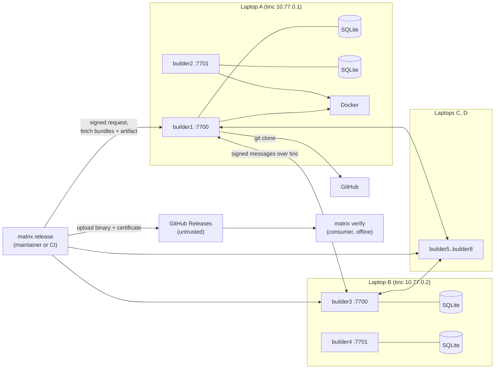
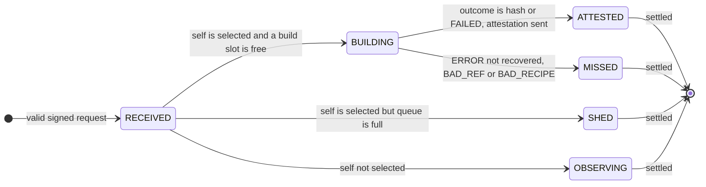

# RFC-0001: Matrix
### Byzantine-tolerant release gating for Go publishers

| | |
|---|---|
| **Status** | Draft (rev 4, replaces rev 3) |
| **Date** | 31 October 2026 |
| **Stack** | Python 3.11+, SQLite, tinc, Textual, aiohttp, PyNaCl, Docker, git |
| **Hosts** | Linux laptops (x86-64 or arm64). macOS is untested; Windows hosts are not supported. |
| **Scope** | 12-hour hackathon MVP |

## 1. Summary

Matrix is a peer-to-peer network of builders that a software publisher runs on **independent infrastructure**. When a maintainer tags a release, every builder independently builds the tagged commit and signs the hash of what it built. A release is **certified** only when **f+1 distinct builders** signed the same hash. The binary then ships with a certificate that any consumer can check offline.

There is no central server, no single build machine and no single signing key. With n = 8 builders and f = 2 (a quarter):

- **Safety** (never certifying a binary that no honest builder produced from the tagged commit) holds while up to f builders lie, stall, equivocate or collude.
- **Liveness** (certifying a release) additionally tolerates s = R − f − T = 3 honest builders that crash or fail.
- **Consumers** need no network access to Matrix: the certificate is self-contained.
- The fault unit is an **operator** (an infrastructure domain: a CI provider, a cloud account, a laptop). In the demo, two builders share one laptop, so one compromised laptop spends the whole safety budget (see A2).

**Core idea:** builds are deterministic, so the system never has to *agree* on an answer. It only has to *count matching answers*. Any hash signed by f+1 distinct builders includes at least one honest builder, so an honest build really produced it. One hacked build machine can no longer publish anything.

## 2. Motivation

A publisher's build machine is a single point of trust. Whoever controls it controls what every user installs, and the source repository gives no hint that anything is wrong.

- **SolarWinds (2020):** an implant on SolarWinds' build server swapped a source file during builds. The repository stayed clean, and the poisoned Orion update was signed with SolarWinds' real key and shipped to thousands of customers. Orion is closed-source, so no outside party could have rebuilt it to notice. A gate inside the publisher's own pipeline, where several independent builders must produce the same binary before anything ships, would have blocked the release: the compromised builder's hash would have stood alone.
- **Stolen signing keys and CI credentials** have the same effect. With one signing key, one theft is enough to ship anything.

What publishers have today does not remove the single point:

- **Build provenance** (SLSA provenance, GitHub Artifact Attestations) is signed by the same build platform that made the file. If that platform is compromised, it certifies its own output.
- **Public rebuilders** (Debian and Arch reproducible-builds efforts, Google's OSS Rebuild) only cover open-source code after release, and depend on consumers checking.

Matrix moves the check **before** release, works for closed-source code, and replaces "trust our build machine" with "trust that at most a quarter of our independent builders are compromised".

## 3. Goals and non-goals

### Goals

- **G1.** Build Go binaries from `repo + tag + commit` on independent builders, using the recipe stored in the tagged commit.
- **G2.** Certify a release only with T = f+1 = 3 matching signed hashes, so up to f = 2 faulty builders out of n = 8 cannot certify a wrong binary (safety), with up to s = 3 further crashed honest builders tolerated (liveness).
- **G3.** Run with no central server or coordinator. Any builder accepts release requests and serves results. The tool that starts a release has no authority.
- **G4.** Ship a self-contained certificate with each binary. Consumers verify offline with only the pinned genesis file.
- **G5.** Accept release requests only when signed by an authorised release signer listed in genesis, for an allowed repository.
- **G6.** Provide a Textual TUI that shows builders, release progress and evidence.
- **G7.** Provide a CLI usable in CI on both sides: `matrix release` in the publisher's pipeline (which must reach the mesh) and `matrix verify` in any consumer's pipeline (which needs no network).

### Non-goals (MVP)

- Languages other than Go, and builds with cgo.
- More than one binary per release request. Archives (tar.gz, zip) and embedded build timestamps.
- Dynamic membership. Builders and release signers are fixed in a genesis file.
- Consensus, leaders, blockchains, tokens or credits.
- Proving that source code is safe. Matrix proves *binary = tagged source*, nothing more.
- Defending against a malicious maintainer, a malicious commit, or a compromised repository account (moved tags).
- Compromised-toolchain defence (Trusting Trust). All builders use the same pinned image.
- Builders run by third parties. In this mode every builder belongs to the publisher (see §10, *Matrix public*).
- A single threshold signature in the certificate. The MVP certificate carries T separate signatures.

## 4. Terminology, assumptions and threat model

### Terms

| Term | Meaning |
|---|---|
| **Builder** | A Matrix node with an Ed25519 identity listed in genesis |
| **Operator** | The infrastructure domain that runs one or more builders: a CI provider, a cloud account with its own admins and credentials, or (in the demo) one laptop |
| **Release signer** | A maintainer or CI identity whose Ed25519 key is listed in genesis and may request releases |
| **Release request** | `{v, repo_url, commit, tag}`, signed by a release signer. Its ID is the SHA-256 of the request body's canonical JSON |
| **Recipe** | `matrix.toml` in the tagged commit: image, package, target, ldflags, output name |
| **Selected set** | The R builders deterministically chosen for a request (in the MVP R = n, so every builder) |
| **Attestation** | A builder's signed `{request_id, result}` |
| **Result** | Hex SHA-256 of the built binary, or the literal `FAILED` (a deterministic build failure only, see §7.10) |
| **Bundle** | The signed request plus all attestations a builder has stored for it |
| **Quorum result** | A result attested by at least T = 3 distinct selected builders that did not equivocate |
| **Certificate** | `<output>.matrix.json`: the genesis hash, the signed request and ≥ T matching attestations. Ships next to the binary |

### Parameters

| Name | Value | Rule |
|---|---|---|
| `n` | 8 | `n ≥ 4f` (problem statement) |
| `f` | 2 | Maximum number of malicious builders |
| `R` (replicas) | 8 | `2f + 1 ≤ R ≤ n`. The MVP uses every builder, so selection is the identity. |
| `T` (threshold) | 3 | `f + 1` ensures ≥ 1 honest signer per quorum result |
| slack `s` | 3 | `R − f − T`: honest builders that may fail without losing liveness |
| Max builders per operator | 2 | Must be ≤ f, so one compromised operator stays within the fault budget |
| `BUILD_TIMEOUT` | 150 s | Covers clone, dependency download and build. **Measure in hour 1** with two builds running at once per laptop. |
| `REQUEST_TTL` | 3600 s | After this, a request takes no new build work |
| `SYNC_INTERVAL` | 10 s | Anti-entropy pull period |
| `MAX_CONCURRENT_BUILDS` | 1 per builder | One queued request at most; the rest are shed (§7.6) |
| Max artifact size | 64 MiB | Larger outputs are an `ERROR` |
| Artifact retention | 24 h | Builders keep their own outputs for download |
| API port | 7700 + k | The k-th builder on a laptop (7700, 7701); bound to the mesh IP only |
| tinc subnet | `10.77.0.0/24` | One IP per laptop |
| Demo profile | `genesis.demo.json` | `build_timeout_s 45`, `sync_interval_s 5`. It has a different genesis hash, so consumers must pin the demo hash while using it. |

### Assumptions

1. **A1:** Honest builders run the published code, and their builds are deterministic for a valid recipe. Environmental errors (network, timeout, out-of-memory, disk, Docker) are reported as abstentions, never as `FAILED`.
2. **A2:** At most f builders are **malicious**: lying, equivocating, stalling or colluding. Crashed or offline honest builders are not counted in f; they only cost liveness (budget s). Builders that share an operator fail together, so no operator may run more than f builders. In the demo the unit of compromise is the laptop: one compromised laptop = 2 malicious builders = the whole f.
3. **A3:** Private keys of honest builders are not stolen, and no credential is shared across operators. Ed25519 signatures cannot be forged.
4. **A4:** Messages between honest builders arrive within about one `SYNC_INTERVAL` in the normal case. **Safety never depends on this.** Liveness does.
5. **A5:** Consumers obtain `genesis.json` from a channel they already trust (for example the repository at a signed commit, or the publisher's website) and pin its SHA-256. A genesis file downloaded from the release page itself proves nothing, because whoever can swap the binary there can swap the genesis too.

### Threat model

| Adversary | In scope? |
|---|---|
| Compromised builder machines (up to f), including colluding ones and ones that inject code into their builds | Yes. This is the main use case. |
| A compromised uploader or release page that swaps the binary or the certificate | Yes. Consumers detect it with `matrix verify` (§7.11). |
| Replaying an older release's binary and certificate (downgrade) | Yes. `verify` requires the expected repo and tag. |
| A compromised CI job or stolen release-signer key | Partly. It can request builds of tags that already exist in an allowed repo, nothing more: builders check the repo allowlist and that the tag resolves to the commit. |
| A request flood from a release signer | Partly. The ingest cap and build shedding protect builder resources, not liveness. |
| A malicious repository trying to run code or exhaust resources during the build | Yes (ldflags allowlist, hardened container, pinned toolchain, resource limits) |
| A malicious tinc peer dropping or misrouting traffic | Yes (liveness only; all messages are signed) |
| A malicious builder serving a wrong artifact or malformed bundle | Yes. Clients check every hash and signature locally. |
| Cross-network replay of signed messages | Yes (domain-separated signatures, §7.4) |
| A malicious maintainer, malicious commit, or moved tag after account takeover | No |
| A compromised pinned Go toolchain image | No (shared single point of failure) |
| More than f builders compromised, for example through a credential shared across operators | No. Deployment must keep operators independent. |
| A container escape from the build sandbox | Mitigated by hardening (§7.10); residual risk accepted |

## 5. Design decisions

| # | Decision | Choice | Why | Rejected alternative |
|---|---|---|---|---|
| D1 | Agreement mechanism | **None.** Count f+1 matching signed results. | Deterministic outputs make the correct answer self-identifying. There is no leader, no view change and no log. | PBFT or HotStuff: heavy, and unnecessary for deterministic compute |
| D2 | Where the check happens | **Before release**, inside the publisher's pipeline | Blocks a poisoned release instead of detecting it later; works for closed-source code; a clear owner pays for it | Public rebuilders after release: needs outside operators and consumer action (kept as future work, §10) |
| D3 | Membership | Static `genesis.json` with builders, operators, release signers and allowed repos | Prevents Sybil attacks; zero protocol for joins and leaves | Dynamic join: needs reconfiguration, which needs consensus |
| D4 | Who can start a release | Only requests signed by a genesis release signer, for an allowed repo | Stops anyone on the mesh, including a malicious builder, from triggering builds | Anonymous requests (rev 3): fine for public rebuilders, wrong for a publisher's gate |
| D5 | Where the recipe lives | `matrix.toml` in the tagged commit | The recipe is reviewed and versioned with the code. A compromised CI config cannot change how builders build. | Recipe in the request: whoever sends the request controls the build |
| D6 | Network | **tinc** full mesh with `StrictSubnets`, running over a shared LAN | No coordinator; encrypted transport and stable per-laptop IPs; one config per laptop. It does not get around venue client isolation (§7.13). | Headscale (has a central control server); plain LAN (unencrypted, addresses change between venues) |
| D7 | Trust in the network | **None.** Every message is Ed25519-signed at the application layer, with domain separation. | A malicious tinc peer can only drop or delay messages, never forge them | Relying on tinc's tunnel authentication: not transferable to consumers |
| D8 | Dissemination | Push to all peers, plus a periodic pull sync | With n = 8, a full mesh is trivial; the pull repairs dropped pushes | Gossip libraries or a DHT: overkill at n = 8 |
| D9 | Who builds | Rendezvous hashing over **all** genesis builders; MVP sets R = n | Every builder and client computes the same set with no coordination | Excluding suspected builders: local views diverge, so selections diverge |
| D10 | Replication | T = f+1; R ≥ 2f+1, MVP R = n = 8 | R = 2f+1 = 5 leaves zero tolerance for honest failure. R = 8 gives slack s = 3. | R = 2f+1: one honest hiccup blocks the release |
| D11 | Anti-copying | **None.** Builders attest directly; no commit-reveal. | Every builder belongs to the publisher, so there is no reward for copying. A builder that copies the correct hash causes no harm; a builder that copies is malicious and counts toward f anyway. Dropping commit-reveal removes the reveal deadline that made every release with a stalled builder wait out a full window. | Commit-reveal (rev 3): best-effort only, and costly in latency |
| D12 | Certificate | T separate builder signatures, packaged with the signed request | Consumers verify offline; no single signing key exists to steal | One release signing key: one theft ships anything. Threshold signatures (FROST): future work, §10 |
| D13 | Language | **Go only**, `CGO_ENABLED=0` | Reproducible with `-trimpath`. With an ldflags allowlist, `GOTOOLCHAIN=local`, a fixed module proxy and a hardened container, the build runs no repo-supplied program. | Rust (`build.rs` runs code); Python (build hooks) |
| D14 | Build sandbox | Docker, pinned single-platform image digest from a genesis allowlist, network off during build, unprivileged, resource-limited | Hermetic and simple; recipes cannot choose arbitrary images | Bare-metal builds: not reproducible across machines |
| D15 | Artifact delivery | Builders keep their own outputs; `matrix release` downloads one and checks its hash against the quorum result | Any honest signer can supply the binary; no builder has to be trusted for the bytes | A designated publisher builder: a single point of failure |
| D16 | Upload | Untrusted. Whoever uploads to GitHub Releases has no power to forge a certificate. | Keeps the release page out of the trust base | Trusting the uploader |
| D17 | Storage | SQLite per builder | Zero operations; one file | Postgres: a server to run |
| D18 | Serialization | Canonical JSON: sorted keys, `(",", ":")` separators, UTF-8, no floats in signed bodies | Deterministic bytes to sign | CBOR or protobuf: an extra dependency |
| D19 | HTTP | aiohttp for both server and client | Asyncio-native, one dependency, works with Textual | FastAPI + uvicorn + httpx: three dependencies |
| D20 | UI | Textual TUI | Terminal-native, fast to build, good for a live demo | A web dashboard: more code |
| D21 | Faulty builders | Recorded as **evidence**; never auto-excluded | Keeps selection identical everywhere (see D9) | Auto-eviction: requires agreement on evictions |
| D22 | Failure semantics | `FAILED` is a vote only for deterministic build failures; environmental errors abstain | Otherwise an honest flake plus 2 malicious builders can manufacture `BUILD_FAILED` | Treating every error as `FAILED` |
| D23 | Verifying the request | Consumers check the request's release-signer signature **and** that its repo and tag are the ones they expect | Stops a valid certificate for another repo or an older tag from being passed off as this release | Trusting the request inside the certificate without checks |

## 6. High-level design

### 6.1 Components

| Component | Responsibility |
|---|---|
| **Builder daemon** (`matrix-node`) | Accepts and forwards signed requests, builds when selected, attests, stores attestations and artifacts, serves bundles and artifacts |
| **Builder** | Clones the repo, verifies commit and tag, reads and validates the recipe, runs the hardened Docker build, hashes and keeps the output, classifies the outcome |
| **Store** | SQLite tables for requests, attestations, own builds and evidence |
| **Protocol engine** | Validates envelopes, drives the per-request state machine and evidence detection |
| **Verdict** | A pure function `(request, envelopes, genesis) → verdict`, shared by builders, `release` and `verify` |
| **Release CLI** (`matrix release`) | Signs and submits a request, waits for a quorum, downloads and checks the artifact, writes the binary and certificate |
| **Verify CLI** (`matrix verify`) | Checks a binary against its certificate offline, sets exit codes |
| **TUI** (`matrix tui`) | Live view of builders, releases, per-builder results and evidence |
| **tinc** | Encrypted mesh between laptops; untrusted transport |

### 6.2 Architecture



Each laptop runs one tinc daemon and two builder processes on different ports. In production each operator is a separate CI provider or cloud account instead of a laptop.

### 6.3 Release lifecycle

```mermaid
sequenceDiagram
    participant M as matrix release
    participant A as Any 3 builders
    participant All as All 8 builders
    participant GH as GitHub Releases
    participant U as Consumer
    M->>A: POST signed request (id = sha256(canonical request))
    A->>All: forward if new
    All->>All: clone, check tag, read matrix.toml, docker build, hash, keep artifact
    All->>All: ATTEST {request_id, result}, signed; pull sync repairs gaps
    M->>A: GET bundles from 3 builders, merge, verdict
    M->>A: GET artifact by agreed hash, check hash
    M->>GH: upload binary + certificate
    U->>GH: download binary + certificate
    U->>U: matrix verify offline against pinned genesis
```

### 6.4 Verdicts

The verdict function returns one of four states. `release` and `verify` map them to exit codes.

| State | Condition |
|---|---|
| `AGREED(hash)` | Exactly one result reaches T and it is a hash |
| `BUILD_FAILED` | Exactly one result reaches T and it is `FAILED` |
| `NOT_REPRODUCIBLE` | Two different results each reach T, **or** no result can still reach T (unattested builders counted as possible votes) |
| `PENDING` | None of the above |

**`matrix release` exit codes**

| Outcome | Condition | Exit |
|---|---|---|
| `CERTIFIED` | `AGREED(h)`, an artifact with hash `h` was downloaded, and the binary and certificate were written | 0 |
| `NOT_REPRODUCIBLE` | The release is blocked; fix the recipe | 2 |
| `PENDING` | Still `PENDING` (or no matching artifact could be downloaded) when `--wait` expires | 3 |
| Error | Bad input, invalid genesis, unreachable builders, bad key | 4 |
| `BUILD_FAILED` | The release is blocked; the code does not compile | 5 |

**`matrix verify` exit codes**

| Outcome | Condition | Exit |
|---|---|---|
| `REPRODUCED` | Valid certificate (§7.11), `AGREED(h)`, and `h = sha256(file)` | 0 |
| `MISMATCH` | Valid certificate and `AGREED(h)`, but `h ≠ sha256(file)`: the binary was swapped | 1 |
| `INVALID_CERT` | Wrong genesis hash, request not signed by a release signer, repo, tag or commit not as expected, or the certificate's attestations do not give `AGREED` | 2 |
| Error | Unreadable file, invalid genesis, malformed input | 4 |

Only exit code 0 means success, for both commands. CI must treat everything else as failure (fail closed).

Two different results cannot both reach T unless two honest builders built different outputs: each quorum contains an honest signer, and honest builds are deterministic (A1). That situation blocks the release as `NOT_REPRODUCIBLE`.

`release` certifies as soon as one result reaches T. Safety does not need uniqueness: a hash with T signers was built by an honest builder from the tagged commit, whatever later builders report. If an honest builder later reports a different hash, it is recorded as `DISAGREE` evidence and shown to the publisher as a reproducibility warning.

## 7. Low-level design

### 7.1 Repository layout

```
matrix/
  canon.py      # canonical_json(), sha256_hex()
  crypto.py     # keygen, sign(), verify() via PyNaCl (domain-separated)
  genesis.py    # load and validate genesis.json
  model.py      # dataclasses: Request, Recipe, Envelope, Certificate (strict parse)
  select.py     # rendezvous selection
  verdict.py    # pure verdict function (shared by builders and both CLIs)
  store.py      # SQLite access
  builder.py    # git and Docker build, recipe validation, outcome classification
  protocol.py   # message handling, state machine, evidence
  net.py        # aiohttp server, peer push, pull sync
  faults.py     # demo fault modes
  node.py       # matrix-node entrypoint
  cli.py        # matrix entrypoint (release, status, verify, evidence, tui, keygen)
  tui.py        # Textual app
tests/
genesis.json
genesis.demo.json
```

Dependencies: `pynacl`, `aiohttp`, `textual`. `tomllib` is in the Python 3.11 standard library. Host prerequisites: Docker, git and tinc.

### 7.2 Genesis file

```json
{
  "network_id": "matrix-acme-2026",
  "f": 2,
  "replicas": 8,
  "threshold": 3,
  "build_timeout_s": 150,
  "request_ttl_s": 3600,
  "sync_interval_s": 10,
  "allowed_repos": ["https://github.com/acme/hello"],
  "allowed_images": {
    "go1.23": "golang@sha256:<linux/amd64 single-platform digest>"
  },
  "allowed_goos": ["linux", "darwin", "windows"],
  "allowed_goarch": ["amd64", "arm64"],
  "release_signers": [
    {"id": "maintainer-alice", "pubkey": "<ed25519 hex>"},
    {"id": "ci-release", "pubkey": "<ed25519 hex>"}
  ],
  "nodes": [
    {"id": "builder1", "operator": "laptopA", "addr": "10.77.0.1:7700", "pubkey": "<ed25519 hex>"},
    {"id": "builder2", "operator": "laptopA", "addr": "10.77.0.1:7701", "pubkey": "<ed25519 hex>"}
  ]
}
```

- **The `nodes` list above is abbreviated.** A real genesis lists all n = 8 builders (`builder3` to `builder8` on laptops B to D, `10.77.0.2` to `10.77.0.4`, ports 7700 and 7701).
- The image digest is the **single-platform** manifest, not the multi-arch manifest list. Containers run with `--platform linux/amd64`, so an arm64 laptop emulates. Otherwise laptops could pull different toolchain binaries.
- Allowlists live in genesis, so every builder applies the same validation rules.
- In production, `operator` names a real infrastructure domain (for example `github-actions`, `gitlab-ci`, `aws-account-2`, `onprem-rack`). Operators must not share admins or credentials.

At startup a builder checks, and refuses to start otherwise:

- `n ≥ 4f`, `2f+1 ≤ replicas ≤ n`, `threshold == f+1`
- `build_timeout_s < request_ttl_s`
- every node has an `operator`, and no operator has more than `f` nodes
- node IDs and release-signer IDs are unique across both lists, and all public keys are distinct
- `allowed_repos`, `allowed_images`, `allowed_goos`, `allowed_goarch` and `release_signers` are non-empty

The `genesis_hash` (SHA-256 of canonical genesis) is exchanged in `/v1/health`, and peers with a different hash are ignored. This is hygiene only; every signature already binds the genesis hash (§7.4).

### 7.3 Recipe and release request

Recipe (`matrix.toml`, committed in the repository and read from the tagged commit):

```toml
[build]
image   = "go1.23"            # key into genesis allowed_images
package = "./cmd/hello"
goos    = "linux"
goarch  = "amd64"
ldflags = "-s -w -buildid="
output  = "hello"
```

Release request body:

```json
{
  "v": 1,
  "repo_url": "https://github.com/acme/hello",
  "commit": "<40 lowercase hex>",
  "tag": "v1.2.0"
}
```

`request_id = sha256_hex(canonical_json(request))`. The request travels inside a `release` envelope signed by a release signer (§7.4). The same tag and commit always give the same ID, so repeated releases are deduplicated.

Request validation (all use `re.fullmatch` with `re.ASCII`; any unknown key is rejected):

- `repo_url` is exactly one of `allowed_repos`.
- `commit` is 40 **lowercase** hex characters.
- `tag` matches `[A-Za-z0-9_.+-]{1,64}`. Builders verify that it resolves to `commit` (§7.10).
- Total request envelope size ≤ 4 KiB.

Recipe validation (done by the builder after checkout; a failure is `BAD_RECIPE`, an abstention):

- The file exists at the repository root, parses as TOML, has exactly one `[build]` table with exactly the keys above, and is ≤ 4 KiB.
- `image` is a key in `allowed_images`; `goos` is in `allowed_goos`; `goarch` is in `allowed_goarch`.
- `package` matches `\./[A-Za-z0-9_./-]*` and has no `..` component.
- `ldflags` is empty or matches `token(" " token)*` where `token` is one of `-s`, `-w`, `-buildid=`, or `-X <importpath.name>=<value>` with `value` matching `[A-Za-z0-9_./:@+-]{0,128}`. This is an **allowlist**; anything else, including `-extld`, `-linkmode` and `-extldflags`, is rejected. Total length ≤ 512.
- `output` matches `[A-Za-z0-9_.-]{1,64}`.

Because every honest builder reads the same file from the same commit and applies the same rules, honest builders agree on whether a recipe is valid.

### 7.4 Signed envelope

```json
{
  "v": 1,
  "type": "attest",
  "signer": "builder3",
  "body": {"request_id": "<hex>", "result": "<hex or FAILED>"},
  "sig": "<ed25519 hex>"
}
```

- Signed bytes: `b"matrix/v1\0" + genesis_hash_hex.encode("ascii") + b"\0" + canonical_json({"v", "type", "signer", "body"})`, where `canonical_json` returns UTF-8 bytes. The prefix gives domain separation, so a signature from another network or message format cannot be replayed.
- `sig = Ed25519.sign(sk, signed_bytes)`
- `msg_id = sha256_hex(canonical_json(envelope))`

Envelope types:

| Type | Signer | Body |
|---|---|---|
| `release` | A genesis release signer | The release request (§7.3) |
| `attest` | A genesis builder | `{request_id, result}`; `result` is 64 lowercase hex or `"FAILED"` |

`Envelope.parse(raw, genesis)` returns an envelope or `None` and **never raises**. It requires:

1. Exactly the expected keys, correct types, `v == 1`, `type` in {release, attest}, total size ≤ 4 KiB for `release` and ≤ 1 KiB for `attest`.
2. Body keys and formats exactly as specified.
3. `signer` is a release signer for `release`, and a builder for `attest`.
4. The signature is valid over the domain-separated bytes.

A builder stores an `attest` envelope only if, in addition:

5. The request is known. Unknown requests are first fetched from the peer that pushed the attestation (`GET /v1/requests/{id}`), and the signed request must hash to `request_id`.
6. The signer is in that request's selected set.
7. The signer has fewer than 2 stored attestations for this request. Two are enough to prove equivocation; the cap stops a malicious signer from bloating the store and bundles.

### 7.5 Selection

```python
def selected(request_id: str, nodes: list[Node], r: int) -> list[str]:
    scored = sorted(
        nodes,
        key=lambda n: sha256_hex(f"{request_id}:{n.pubkey}".encode()),
    )
    return [n.id for n in scored[:r]]
```

Selection is identical on every builder and client. In the MVP, R = n and the set is every builder.

Grinding: with R < n, whoever chooses the request could steer selection towards slow or malicious builders. Requests are now signed by release signers and fixed by tag and commit, so there is little room to grind, and the MVP uses R = n anyway. Safety never depends on selection, because any T-signed result contains an honest signer. Networks with R < n must size R with slack: `R ≥ 2f + 1 + s`.

### 7.6 Protocol state machine

Each builder tracks every request as an observer. A builder in the selected set also builds:



A request is **settled** locally when `verdict()` over the local store is anything but `PENDING`, or when it is older than `REQUEST_TTL`. Settlement stops **new build work** only. The builder keeps accepting attestations and pulling the request's bundle until `t0 + REQUEST_TTL`, so late attestations still produce evidence. Stored data is kept.

Rules for a builder `X` handling request `q`, where `t0` is X's local receipt time of `q`:

1. **Forward.** On first receipt of a valid signed request, store it with `t0` and push it to all peers. A builder accepts at most 20 new requests per minute in total, from any source; beyond that it answers 429. Requests fetched by pull sync count toward the same cap, and any over the cap are fetched again on a later sync.
2. **Admit.** If X is selected, it builds one request at a time (`MAX_CONCURRENT_BUILDS`) and may hold one queued request. Any further request is **shed**: no build, no attestation, phase `SHED`. Shedding is an honest abstention and spends liveness slack.
3. **Build.** Run the builder with `BUILD_TIMEOUT`. Its outcome is one of:
   - `hash`: `result` is the binary's SHA-256, and the binary is kept under `artifacts/<hash>`.
   - `FAILED`: a deterministic failure only (§7.10). `result` is `"FAILED"`.
   - `ERROR`: an environmental failure. Retry up to 2 times while `now + BUILD_TIMEOUT < t0 + REQUEST_TTL`. If it still fails, mark `MISSED`; **never attest**.
   - `BAD_REF`: the commit or tag is missing, or the tag does not resolve to `commit`. No retry; mark `MISSED`; **never attest**.
   - `BAD_RECIPE`: `matrix.toml` is missing or fails validation (§7.3). No retry; mark `MISSED`; **never attest**.
4. **Attest.** Persist `result` (and, for a hash, the artifact) and commit the SQLite transaction **before** broadcasting the signed attestation. A builder never signs two different results for the same request. On restart it re-sends its stored attestation and never rebuilds a request it has already attested.
5. **Store attestations** from selected signers whenever they arrive, in any order. Verdict and evidence detection re-run on every new attestation.
6. **Record evidence:**
   - `EQUIVOCATION`: two different attestations from the same signer for `q`. Hard proof, transferable to anyone.
   - `DISAGREE`: an attestation whose result differs from the quorum result. Soft signal, since it may be honest nondeterminism; anyone can rebuild to check.
   - `STALL`: a selected builder with no attestation by `t0 + 2 × BUILD_TIMEOUT`. Soft signal.

### 7.7 Verdict function

```python
def verdict(request_env, envelopes, genesis) -> Verdict:
    req = Envelope.parse(request_env, genesis)  # caller decides which request to evaluate
    if not req or req.type != "release" or not valid_request(req.body, genesis):
        return INVALID
    rid = request_id(req.body)
    sel = set(selected(rid, genesis.nodes, genesis.replicas))

    seen = defaultdict(set)  # signer -> distinct results
    for raw in envelopes:
        e = Envelope.parse(raw, genesis)  # None unless schema, formats and signature are valid
        if e and e.type == "attest" and e.body.request_id == rid and e.signer in sel:
            seen[e.signer].add(e.body.result)

    results = {s: next(iter(rs)) for s, rs in seen.items() if len(rs) == 1}  # equivocators dropped
    counts = Counter(results.values())
    quorum = [r for r, k in counts.items() if k >= genesis.threshold]
    outstanding = len(sel) - len(results)

    if len(quorum) > 1:
        return NOT_REPRODUCIBLE  # two quorums => two honest builders disagree
    if quorum:
        return BUILD_FAILED if quorum[0] == "FAILED" else AGREED(quorum[0])
    if max(counts.values(), default=0) + outstanding < genesis.threshold:
        return NOT_REPRODUCIBLE  # no result can still reach T
    return PENDING
```

The function is total: malformed or hostile input is ignored, never raised. `outstanding` counts equivocators and builders that have not attested as possible votes, which can only delay a verdict, never invent one.

`matrix release` merges bundles from ≥ f+1 = 3 builders, preferably on distinct operators, by taking the union of attestations deduplicated by `msg_id`, and passes the request it signed itself. A malicious builder can omit attestations but cannot forge them, so the union from three builders contains everything at least one honest builder holds.

### 7.8 SQLite schema

```sql
CREATE TABLE requests (
  id           TEXT PRIMARY KEY,
  envelope     TEXT NOT NULL,          -- signed release envelope, canonical JSON
  received_at  REAL NOT NULL,          -- local t0
  phase        TEXT NOT NULL           -- RECEIVED|BUILDING|ATTESTED|MISSED|SHED|OBSERVING
);

CREATE TABLE attestations (            -- only accepted envelopes (§7.4)
  msg_id       TEXT PRIMARY KEY,
  request_id   TEXT NOT NULL REFERENCES requests(id),
  signer       TEXT NOT NULL,
  result       TEXT NOT NULL,
  envelope     TEXT NOT NULL,          -- canonical JSON
  received_at  REAL NOT NULL
);
CREATE INDEX attestations_req ON attestations(request_id, signer);

CREATE TABLE my_builds (
  request_id    TEXT PRIMARY KEY REFERENCES requests(id),
  result        TEXT,                  -- hash or FAILED; NULL while building or after ERROR
  artifact_path TEXT,                  -- artifacts/<hash> for a hash result
  error         TEXT,                  -- last ERROR, BAD_REF or BAD_RECIPE reason
  log_path      TEXT,
  started_at    REAL,
  finished_at   REAL
);

CREATE TABLE evidence (
  id           INTEGER PRIMARY KEY,
  kind         TEXT NOT NULL,          -- EQUIVOCATION|DISAGREE|STALL
  signer       TEXT NOT NULL,
  request_id   TEXT NOT NULL,
  proof        TEXT,                   -- JSON array of envelopes; NULL for STALL
  created_at   REAL NOT NULL,
  UNIQUE (kind, signer, request_id)
);
```

Use WAL mode with `synchronous=FULL` and a single writer task. Only the builder process touches the database; the TUI reads through the HTTP API.

### 7.9 HTTP API (per builder, bound to its mesh IP)

| Method and route | Purpose | Response |
|---|---|---|
| `GET /v1/health` | Builder ID, version, genesis hash | 200 |
| `POST /v1/requests` | Submit or forward a signed release envelope | 202 `{id}`; 400 if invalid; 403 if the signer or repo is not allowed; 429 over the ingest cap |
| `GET /v1/requests?since=<unix>` | Requests received since a time on **this builder's** clock | 200 `{now, requests: [{id, phase}]}` |
| `GET /v1/requests/{id}` | Signed request envelope and local phase | 200 / 404 |
| `POST /v1/messages` | Push a signed attestation | 202; 400 if invalid |
| `GET /v1/requests/{id}/bundle` | `{request, envelopes}`: the signed request plus **all stored attestations** | 200 / 404 |
| `GET /v1/requests/{id}/log` | Last 64 KiB of this builder's own build log | 200 / 404 |
| `GET /v1/artifacts/{sha256}` | Raw bytes of an artifact this builder built itself | 200 `application/octet-stream` / 404 |
| `GET /v1/evidence?since=<unix>` | Evidence records | 200 |

Limits: `POST /v1/requests` body ≤ 4 KiB; `POST /v1/messages` body ≤ 1 KiB; at most 20 new requests per minute per builder in total. `GET /v1/artifacts` validates the hash format, looks it up in `my_builds`, and never joins user input onto a path.

**Pull sync**, every `SYNC_INTERVAL`, for each peer:

1. `GET /v1/requests?since=cursor - 60`, where `cursor` is the `now` value that peer returned on the previous pull (0 at startup). Because the cursor comes from the peer's own clock, clock skew between laptops cannot hide requests. Fetch unknown requests.
2. For each request still inside `REQUEST_TTL`, settled or not, `GET /bundle` and process every attestation through the normal validation path.

### 7.10 Builder

Each build runs in a work directory `work/<request_id>/{src,out,gomod}`. Every Docker command uses the common flags `--platform linux/amd64 --user <uid>:<gid> --cap-drop ALL --security-opt no-new-privileges --memory 2g --cpus 1 --pids-limit 512 --name mx-<node_id>-<rid8>-<attempt>-<step> -e HOME=/tmp -e GOTOOLCHAIN=local -e "GOFLAGS=-mod=readonly -modcacherw"`.

- `<uid>` and `<gid>` come from `os.getuid()` and `os.getgid()`.
- Two builders per laptop can build at once, so limits are per container. 2 GiB and 1 CPU each keeps an 8 GB laptop usable. Measure in hour 1 and raise only if builds need it.
- `-modcacherw` keeps the module cache writable. By default Go makes it read-only, and deleting `work/<id>` would then fail.
- Before step 1, check that at least 2 GiB of disk is free; otherwise the outcome is `ERROR`.

```bash
# 1. Source (host; time- and size-capped, no submodules, no prompts)
export GIT_TERMINAL_PROMPT=0
git clone --filter=blob:none --no-checkout "$REPO" src
git -C src checkout --detach "$COMMIT"
test "$(git -C src rev-parse HEAD)" = "$COMMIT"
test "$(git -C src rev-parse "refs/tags/$TAG^{commit}")" = "$COMMIT"

# 1b. Recipe (host, Python): read src/matrix.toml with tomllib and validate it (§7.3)

# 2. Dependencies (network on, source read-only; Go verifies go.sum and the checksum DB;
#    explicit proxy, no "direct" fallback, so no VCS tool ever runs)
docker run --rm $COMMON -v "$PWD/src:/src:ro" -v "$PWD/gomod:/go/pkg/mod" -w /src \
  -e GOPROXY=https://proxy.golang.org -e GOSUMDB=sum.golang.org \
  "$IMAGE" go mod download

# 3. Build (network off, read-only source and modules)
docker run --rm $COMMON --network none \
  -v "$PWD/src:/src:ro" -v "$PWD/gomod:/go/pkg/mod:ro" -v "$PWD/out:/out" \
  -e CGO_ENABLED=0 -e GOOS="$GOOS" -e GOARCH="$GOARCH" \
  -e GOPROXY=off -e GOCACHE=/tmp/gocache -w /src \
  "$IMAGE" go build -trimpath -buildvcs=false -ldflags "$LDFLAGS" \
  -o "/out/$OUTPUT" "$PACKAGE"

# 4. Hash and keep (host): sha256 of out/$OUTPUT, size ≤ 64 MiB,
#    copy to artifacts/<hash>.tmp, fsync, rename to artifacts/<hash>, fsync the directory
```

Outcome classification:

| Situation | Outcome |
|---|---|
| Step 3 `go build` exits 1, its stderr contains none of the environmental markers in the next row, and an immediate rerun of step 3 alone fails the same way (same exit code, same stderr once the work-directory path is removed) | `FAILED` |
| Step 3 exits 1 but stderr contains `signal: killed`, `cannot allocate memory`, `no space left on device` or `resource temporarily unavailable`; or the rerun's stderr differs; or the rerun cannot finish within `BUILD_TIMEOUT` | `ERROR`: abstain, retry (§7.6 rule 3) |
| Clone succeeded but `commit` is missing, or `tag` is missing or does not resolve to `commit` | `BAD_REF`: abstain, no retry |
| `matrix.toml` missing or invalid | `BAD_RECIPE`: abstain, no retry |
| Clone or fetch network error, proxy error, **any step 2 failure**, timeout, out-of-memory (137), Docker error (125 to 127), disk full, output larger than 64 MiB | `ERROR`: abstain, retry |
| Success | the hash |

When the kernel kills a compiler subprocess for memory, `go build` prints `signal: killed` and exits 1, not 137, because only the child died. Without the markers and the rerun, an honest builder short of memory would vote `FAILED`, and two malicious builders plus one such flake would produce a false `BUILD_FAILED`. Rerunning step 3 for a real compile error takes seconds, because it fails early.

`FAILED` is reserved for deterministic build failures of a valid source reference and recipe. Invalid input never becomes a vote: the verdict stays `PENDING` (fail closed) and the reason is visible in the build log and `my_builds.error`. Step 2 failures are always `ERROR`, so a `go.sum` mismatch becomes `PENDING`, not `BUILD_FAILED`.

- Commands run via `asyncio.create_subprocess_exec` with argument lists, never shell strings.
- Docker container names include the node ID and attempt number, so two builders on one laptop never collide, and a retry never collides with a container left by a killed attempt. Before each attempt, run `docker rm -f` on that attempt's names.
- Stdout and stderr go to `log_path` (`logs/<request_id>.log`, outside `work/`), capped at 1 MiB. Clone is capped in time and size.
- On timeout, the builder terminates whatever step is running. Host commands (`git`) are started in their own process group (`start_new_session=True`) and the whole group is sent SIGTERM, then SIGKILL after 5 s. Docker steps additionally get `docker kill` on the named container, because killing the `docker run` client does not stop the container. The outcome is `ERROR`.
- Before the hackathon, pre-pull the pinned image on every laptop.
- `work/<id>` is removed in a `finally` block after **every** terminal outcome of an attempt. Each retry starts from an empty work directory. Containers run as the host user and the module cache stays writable, so `rm -rf work/<id>` works. Only the capped log and, for a hash, `artifacts/<hash>` are kept. Artifacts older than 24 hours are deleted at startup and hourly.

### 7.11 Release and verify CLI

```
matrix keygen   --out maintainer.key
matrix release  --repo URL --tag T --commit SHA --key maintainer.key [--wait 600] [--out dist/]
matrix status   ID
matrix verify   FILE --cert FILE.matrix.json --repo URL --tag T [--commit SHA]
matrix evidence [--since 1h]
matrix tui
```

**`matrix release`**

1. Builds the request, signs it with the release-signer key, and computes `request_id` itself.
2. Submits it to 3 builders (f+1) on different operators, so at least one honest builder forwards it.
3. Polls bundles from ≥ 3 builders, merges them, and runs `verdict()` with its own signed request until the result is not `PENDING` or `--wait` expires.
4. On `AGREED(h)`: downloads `GET /v1/artifacts/h` from builders whose attestation says `h`, trying the next one until the bytes hash to `h`.
5. Writes `dist/<output>` and `dist/<output>.matrix.json`, prints the per-builder table, and exits with the code from §6.4.

The certificate:

```json
{
  "v": 1,
  "genesis_hash": "<hex>",
  "request": { "...": "signed release envelope" },
  "attestations": [ "... every collected attest envelope whose result is h (at least T)" ]
}
```

Uploading the two files to GitHub Releases is an ordinary CI step (`gh release upload`). The uploader is untrusted.

**`matrix verify`**, fully offline, using `~/.matrix/genesis.json` checked against a pinned hash:

1. Parse the certificate strictly. `genesis_hash` must equal the pinned genesis hash.
2. The request envelope must be validly signed by a genesis release signer, and its `repo_url` and `tag` must equal `--repo` and `--tag` (and `commit` must equal `--commit` if given). This blocks a valid certificate for another project or an older, vulnerable tag.
3. Run `verdict()` on the certificate's request and attestations. Anything other than `AGREED(h)` is `INVALID_CERT`.
4. Compare `h` with `sha256(FILE)`: `REPRODUCED` or `MISMATCH`.

`verify` contacts no builder. A consumer's CI only needs the binary, the certificate and the pinned genesis.

Example publisher CI step (on a runner that has joined the mesh, triggered by a tag push):

```bash
matrix release --repo https://github.com/acme/hello --tag "$TAG" --commit "$SHA" \
  --key "$RELEASE_KEY" --wait 600 --out dist/ || exit 1
gh release upload "$TAG" dist/hello dist/hello.matrix.json
```

Example consumer CI step (no mesh needed):

```bash
curl -LO https://github.com/acme/hello/releases/download/v1.2.0/hello
curl -LO https://github.com/acme/hello/releases/download/v1.2.0/hello.matrix.json
matrix verify hello --cert hello.matrix.json \
  --repo https://github.com/acme/hello --tag v1.2.0 || exit 1
```

### 7.12 TUI (Textual)

| Screen | Contents | Keys |
|---|---|---|
| **Builders** | 8 rows grouped by operator: ID, address, reachable, genesis-hash match, last seen | `b` |
| **Releases** | ID (short), `repo@tag`, phase, attestations x/R, quorum progress x/T, verdict | `r`, `Enter` for detail |
| **Detail** | Per builder: attested result, matches quorum? (green/red), build log tail (local builder only) | `l` for log |
| **Evidence** | Kind, signer, release, time; `Enter` shows the proof JSON | `e` |

The TUI polls the local builder's API every second, and each peer's `/v1/health` for the Builders screen. It reads no database and holds no state of its own.

### 7.13 tinc setup

Netname `matrix`, one daemon per laptop:

```
# /etc/tinc/matrix/tinc.conf
Name = laptopA
Mode = router
AddressFamily = ipv4
StrictSubnets = yes
ConnectTo = laptopB
ConnectTo = laptopC
ConnectTo = laptopD

# /etc/tinc/matrix/hosts/laptopA
Address = <LAN IP>
Subnet = 10.77.0.1/32
-----BEGIN RSA PUBLIC KEY----- ...
```

- Host files are distributed with genesis.
- `tinc-up` assigns `10.77.0.x/24` to the interface.
- Every laptop uses `ConnectTo` toward every other laptop for a direct full mesh.
- Builder API ports are reachable only on the tinc interface.
- Venue Wi-Fi often isolates clients from each other. Use a travel router or phone tethering. If tinc is not up on all laptops by hour 2, fall back to plain LAN or WireGuard; nothing above the transport changes. tinc and WireGuard encrypt the transport; **plain LAN does not**, so anyone on the network can see which releases are being built and the results. Signatures still protect integrity, so safety is unaffected.

### 7.14 Fault modes (demo only)

Enabled with `--fault MODE`. Builders refuse fault flags unless started with `--allow-faults`.

| Mode | Behavior |
|---|---|
| `inject --patch FILE` | Applies a patch to the source before building, then attests the resulting hash. This is the SolarWinds case: a compromised build machine producing a backdoored binary. |
| `lie` | Attests a random hash |
| `collude --hash H` | Attests a shared fixed hash `H` |
| `stall` | Never attests |
| `crash` | Exits when a request arrives (an honest failure: spends slack, not f) |
| `equivocate` | Sends different attestations to different peers |
| `bad-artifact` | Attests honestly but serves corrupted bytes from `/v1/artifacts` |

## 8. Security guarantees and failure handling

### 8.1 Guarantees

Safety holds with ≤ f malicious builders. Liveness additionally needs enough honest builders to answer.

| Property | Argument |
|---|---|
| **No poisoned release** | A certificate needs T = f+1 matching attestations, so at least one signer is honest, so an honest build of the tagged commit produced that hash (A1). A compromised builder that injects code produces a hash that stands alone. |
| **No swapped download** | A swapped binary gets `MISMATCH`; a swapped or forged certificate gets `INVALID_CERT`. The uploader and release page are outside the trust base. |
| **No downgrade** | `verify` requires the expected repo and tag, so an older release's valid certificate does not pass for a newer tag. |
| **No single key to steal** | Certification needs T builder keys on different operators. A stolen release-signer key can only request builds of existing tags. |
| **Liveness** | R − f = 6 honest builders build; any T = 3 of them suffice. Releases still certify with up to s = 3 honest builders crashed, shed or failing (A4). |
| **No false failure from a flake** | Environmental errors abstain, and `FAILED` needs T votes, so f malicious builders plus any number of honest hiccups cannot produce `BUILD_FAILED` from a build that honest builders complete. |
| **Uniqueness** | Two results both reaching T mean two honest builders built different outputs, so the release is blocked as `NOT_REPRODUCIBLE`. |
| **Robust clients** | `Envelope.parse`, `verdict` and certificate parsing never raise on hostile input. |
| **No coordinator** | Selection, validation and the verdict are local pure functions. `matrix release` has no authority: a malicious one can only fail to publish. |
| **Network attacks cost liveness only** | All messages are signed with domain separation; tinc peers can only drop or delay them. |
| **Equivocation is provable** | Two signed conflicting attestations form a transferable proof. |

### 8.2 Failure handling

| Failure | Behavior |
|---|---|
| Builder crash or restart | State is in SQLite. On restart: remove leftover `work/*` and `mx-<node_id>-*` containers, re-read requests, re-send stored attestations, never rebuild an attested request, then pull-sync. |
| Laptop offline or compromised | Offline: two crashed builders; liveness spends 2 of s = 3 slack. Compromised: both builders are malicious, which is the whole f. |
| GitHub or the module proxy unreachable | Environmental `ERROR`: builders retry, then abstain. The release stays `PENDING` and can be re-run later. It is never `BUILD_FAILED`. |
| Real compile error | Honest builders all attest `FAILED`; the release is blocked with `BUILD_FAILED` (exit 5). |
| Invalid `matrix.toml` | Every honest builder abstains with `BAD_RECIPE`; the release stays `PENDING` and the reason is in the logs. |
| A builder serves a corrupted artifact | `matrix release` rejects the bytes and tries the next attesting builder. |
| Request flood | Per-builder ingest cap (429) and one build slot with one queued request; the rest are shed. |
| Nondeterministic build | `NOT_REPRODUCIBLE` if two quorums form before certification; otherwise `DISAGREE` evidence warns the publisher. |
| Release page tampered after publishing | Consumers get `MISMATCH` or `INVALID_CERT`. |
| Duplicate request | Deduplicated by content ID; a repeated release returns the existing result. |
| Disk fills up | `work/<id>` is deleted after every attempt, artifacts expire after 24 h, and a free-disk check runs before each build. |

## 9. Testing, demo, build plan and cut list

### 9.1 Tests

| Level | What |
|---|---|
| Unit | Canonical JSON stability; sign and verify round-trip, including cross-network replay rejection; selection determinism; strict-parse tests for requests, recipes, envelopes and certificates; verdict table tests for every state in §6.4; `verify` tests for wrong genesis, unsigned request, wrong repo, wrong tag and too few attestations |
| Verdict model check | Enumerate every assignment for the 8 selected builders: each honest builder attests the true hash or abstains; each malicious builder (≤ 2) abstains, attests `FAILED`, one of two fake hashes or the true hash, or equivocates. Assert: (a) `AGREED` only ever names the true hash; (b) if ≥ 3 honest builders attested the true hash the verdict is `AGREED(true)`; (c) the function never raises |
| Fuzz | Random malformed envelopes, bundles and certificates through the parsers, `verdict` and `verify` |
| Integration (one machine) | 8 builders on `127.0.0.1:7700–7707` without tinc, using the demo profile; scripted fault matrix `{inject, lie, collude, stall, crash, equivocate, bad-artifact}` × up to 2 builders, placed on the same simulated laptop (same `operator`) and on different ones; one case with 2 malicious plus 3 crashed honest builders (still certifies) and one with 4 crashed (stays `PENDING`) |
| Reproducibility | Same recipe built on all 4 laptops, two builds at once per laptop, yields an identical hash and a measured `BUILD_TIMEOUT`. **Do this in hour 1.** |
| End to end | 4 laptops × 2 builders over tinc: certify a real tag, upload, verify on a fifth machine with no mesh access |

### 9.2 Demo (about 4 minutes, 4 laptops, 8 builders, demo profile)

| # | Scene | What judges see |
|---|---|---|
| 1 | **Happy path.** Push tag `v1.2.0`; `matrix release` runs. | TUI fills in 8 attestations; quorum 3/3; `CERTIFIED`. `matrix verify` on a separate machine: `REPRODUCED`. |
| 2 | **SolarWinds.** Set builder3 to `inject` a backdoor patch. Release `v1.2.1`. | builder3's hash stands alone and is flagged `DISAGREE`; the honest hash certifies. The backdoor never ships. |
| 3 | **A whole laptop is hacked.** Set builder5 and builder6 (laptop C) to `collude` on the backdoored hash. | Two matching fake attestations, still below 3. The release certifies the honest binary. |
| 4 | **Swapped download.** Replace the binary on the release page with the backdoored one. | `verify`: `MISMATCH`, exit 1. Then swap in an older release's certificate: `INVALID_CERT`, exit 2. |
| 5 | **A laptop dies.** Pull laptop D's cable mid-release. | Two builders gone; the release still certifies. |
| 6 | **Caught cheater.** Set builder2 to `equivocate`. | The Evidence screen shows two signed conflicting attestations, a proof anyone can check. |

Reset fault modes between scenes. Scene 3 uses one laptop's two builders, which is exactly the whole fault budget; say so on stage.

### 9.3 12-hour plan (team of 3–4)

| Hours | Track A (protocol) | Track B (build and net) | Track C (release and UX) |
|---|---|---|---|
| 0–1 | `canon`, `crypto`, `genesis`, `model` | tinc up on all laptops (fallback: LAN or WireGuard by hour 2); pre-pull image; cross-laptop determinism; measure build time | Sample Go repo with `matrix.toml`; tags; release-signer keys |
| 1–4 | `select`, `verdict` + table, model-check and fuzz tests | `store.py`, `builder.py` (hardened, recipe validation, artifacts) | `cli.py keygen`, `release` (sign, submit, poll) |
| 4–6 | `protocol.py` state machine (on top of `store.py`) | `net.py` push, bundle and artifact endpoints, pull sync | `release` artifact download and certificate; `verify` |
| 6–8 | Evidence detection | `faults.py` | `tui.py` Builders and Releases |
| 8–10 | Integration fault matrix | Hardening, restart recovery | TUI Detail and Evidence; CI examples |
| 10–11.5 | End-to-end over tinc, all together | | |
| 11.5–12 | Rehearse the demo twice with `genesis.demo.json` | | |

### 9.4 Cut list (drop first to last)

1. TUI Evidence screen (the CLI still prints evidence)
2. `bad-artifact` and `equivocate` fault modes
3. Artifact download: `matrix release --file PATH` instead takes a locally built binary and certifies it only if its hash equals the quorum result
4. Pull sync (rely on push and short demo runs; restart recovery then degrades)

**Never cut:** signatures, signed release requests, strict parsing, the verdict function and its model-check test, the builder (including hardening and outcome classification), selection, certificate verification and the exit codes.

## 10. Open questions and future work

- **Threshold signatures.** Builders hold shares of one key (for example FROST over Ed25519), so a certificate is a single standard signature that existing tools can check.
- **Standard formats.** Emit the certificate as an in-toto or SLSA provenance attestation so existing policy engines can consume it.
- **Matrix public.** The same protocol with builders run by independent organisations (universities, foundations, distros) for open-source releases. Third-party operators may need anti-copying measures again, ideally verifiable ones (signed records of which attestations a builder had seen).
- **Watcher mode.** Builders fetch published release assets and raise an alarm if the published file does not match the certificate.
- **Signed tags.** Require the git tag itself to be signed by a release signer.
- **Multiple targets per release.** One request producing a set of binaries for several `goos`/`goarch` pairs.
- **Retries.** Should a `BUILD_FAILED` or long-`PENDING` release be retryable via a `round` field that is part of the request ID?
- **Membership changes.** New genesis versions signed by a quorum of operators.
- **More languages.** Rust and Python, once sandboxing for build-time code execution is designed.
- **Toolchain diversity.** Independent Go toolchain sources, so one poisoned image cannot fool every builder.
- **Transparency log.** An append-only, hash-chained log of certificates, so a publisher cannot quietly certify and later deny a release.

## Appendix A. Changes from rev 3

Rev 4 changes the product: rev 3 was a public rebuilder network that consumers query after release. Rev 4 is a release gate inside the publisher's pipeline. The counting rule, verdict logic, builder hardening and network design carry over.

| Rev 3 | Rev 4 | Why |
|---|---|---|
| Independent public rebuilders | The publisher's builders on independent infrastructure (operators) | Clear owner and buyer; works for closed-source code such as SolarWinds Orion |
| Detects tampering after release | Blocks a poisoned release before it ships, and still detects later tampering | Prevention, not just detection |
| Anonymous requests carrying the recipe | Requests signed by genesis release signers, for allowed repos only; recipe read from `matrix.toml` in the tagged commit | Nobody on the mesh can trigger builds; a compromised CI config cannot change how builders build |
| Commit-reveal with a commit window and reveal grace | Direct signed attestations | Copying gives no advantage among a publisher's own builders; removes a full-window wait whenever a builder stalls |
| Consumers fetch bundles from the mesh | Consumers verify a self-contained certificate offline | Consumer CI no longer needs mesh access |
| Client trusted only its own request | `verify` checks the request's signature plus the expected repo and tag | The request now ships in the certificate, so it must be authenticated and pinned to stop downgrades |
| Rebuilders kept no outputs | Builders keep artifacts for 24 h and serve them by hash | `matrix release` gets the binary from any honest signer |
| `REPRODUCED` / `MISMATCH` exit codes for one command | Separate exit codes for `release` (gate) and `verify` (consumer) | Two different jobs |
| `copy` fault mode | `inject` and `bad-artifact` fault modes | `inject` demonstrates the SolarWinds attack directly |
| No per-operator limit | Startup check: no operator runs more than f builders | One compromised operator must stay within the fault budget |