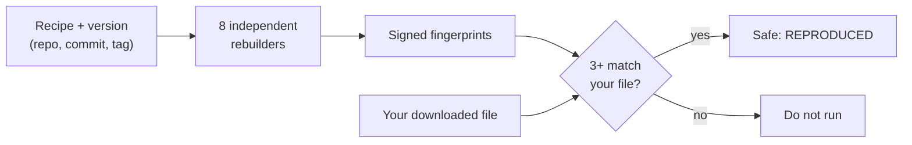
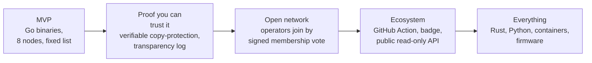

# Matrix
### Don't trust the build. Count the witnesses.

*A network of independent rebuilders that checks that the program you downloaded really came from the code it claims to.*

---

## 1. The problem in one minute

When you download a program from GitHub, you are trusting a machine you can't see.

A developer writes code. Somewhere, a build machine turns that code into the program you download. Nobody checks that step. If an attacker gets into the build machine, or swaps the file after the fact, the code on GitHub still looks clean, and the program you run is not what the code says.

This has already happened. In the **SolarWinds** attack (2020), the source code was clean and the build system was compromised. The poisoned program went to thousands of organisations. Nobody could tell by looking at the code.

Today you either trust the publisher's build machine or you rebuild everything yourself. Almost nobody rebuilds.

## 2. The idea in 30 seconds

Think of a recipe and a cake.

- The **recipe** is the code, at an exact version.
- The **cake** is the program you downloaded.
- Each cake has a **fingerprint** (a short code that changes if even one crumb changes).

If the recipe is exact, every kitchen should bake an identical cake with an identical fingerprint. So we ask **eight independent kitchens** to bake it, and each one writes down its cake's fingerprint and signs it.

You then check your own cake's fingerprint against theirs:

- If **three or more kitchens** wrote down the same fingerprint as your cake, you're good.
- Otherwise, something is wrong. You don't run it.

Why three? We assume **at most two** kitchens might cheat. Three matching answers always include at least one honest kitchen. So a matching fingerprint is the real one.

That's it. **No boss, no central server, no voting machine.** We don't need everyone to *agree*. We only *count matching answers*.

## 3. How it works, step by step

### Step 1: Ask for a check
You say: *"Rebuild this project, this exact version."* The request is a tiny note: repository, exact commit, version tag, and build settings. Its ID is a fingerprint of the note itself. Anyone sending the same note gets the same ID, so repeats are merged, not duplicated.

### Step 2: The request spreads
You hand it to three nodes. Any honest one passes it to everybody. There's no central server: every node can take requests and answer questions.

### Step 3: Everyone builds on their own
Each rebuilder:

1. Downloads the code at the exact version and checks it is really that version.
2. Builds it inside a **locked box** (a container with no internet, no special powers, fixed tools and strict limits).
3. Fingerprints the result.

Because the box and recipe are identical everywhere, honest builders produce **identical results**. That's what makes counting possible.

### Step 4: Seal the answer, then show it
Before anyone shows their answer, they publish a **sealed envelope**: a scrambled version of the answer plus a secret random number. Once everyone has sealed, they open the envelopes. This stops a lazy rebuilder from just copying someone else's answer. If it tries to seal late, honest nodes notice and flag it.

(We're upfront about this: in the MVP it's an honesty check, not a proof. See *Edge cases*.)

### Step 5: Everything is signed
Every message carries the sender's digital signature. A signature can't be forged, so nobody on the network can pretend to be someone else, and the network itself doesn't have to be trusted.

### Step 6: You check, on your own computer
Your computer collects the signed messages from at least three nodes, checks every signature itself, counts, and compares with your file. **You don't have to trust any node.** If a node lies or sends you junk, your computer ignores it.

You get one of these verdicts:

| Verdict | In plain words | CI exit code |
|---|---|---|
| **REPRODUCED** | Your file is exactly what the code builds into. | 0 |
| **MISMATCH** | The honest builders agree, and your file is different. Don't run it. | 1 |
| **NOT_REPRODUCIBLE** | The builders get different results from the same recipe. The project can't be verified. | 2 |
| **PENDING** | Not enough answers yet. | 3 |
| **ERROR** | Bad input, or the nodes can't be reached. | 4 |
| **BUILD_FAILED** | The code genuinely doesn't compile. | 5 |

**Only "REPRODUCED" passes.** Everything else stops the pipeline. When in doubt, the system says no.

## 4. Why the numbers work

| What | Number | Why |
|---|---|---|
| Rebuilders | **8** | Enough that a few going wrong doesn't matter |
| Cheaters we can survive | **2** | A quarter of the network |
| Matching answers needed | **3** | One more than the cheaters, so one is always honest |
| Honest builders that can fail and we still get an answer | **3** | 8 nodes, minus 2 cheaters, minus the 3 we need leaves 3 spare |

Two cheaters can lie as loudly as they like. They can't reach three matching answers on their own, and any three answers contain an honest one.

## 5. What if...? (edge cases in plain words)

### Cheating

| What if... | What happens |
|---|---|
| **One builder lies** | Its answer doesn't match the others. It stands alone and is ignored. The disagreement is recorded as a warning. |
| **Two builders lie together** | Still only two matching answers. We need three, so they can't win. |
| **A builder tells different people different things** | Each message is signed. Two signed, conflicting messages are **proof** of cheating that anybody can verify. That builder's answer is thrown out. |
| **A builder pretends to be someone else** | Every message is signed with a key listed in the founding document. A forgery is rejected. |
| **Someone replays old signed messages from another network** | Every signature is tied to this particular network, so messages from elsewhere don't verify. |
| **A builder just copies what others say** | Everyone commits to their answer in a sealed envelope first. A late copier is flagged. *Honest limit:* the flag is a warning, not a court-grade proof, and a copier still counts as one of the allowed cheaters. Making it provable is on the roadmap (below). |
| **A node sends the client junk or a different request's results** | The client builds the request itself and reads signatures itself. It never accepts a node's word. Malformed data is ignored and can't crash it. |

### Honest trouble

| What if... | What happens |
|---|---|
| **A builder crashes or its laptop dies** | It just doesn't answer. We have spare builders. Three honest ones can fail and we still get an answer. |
| **GitHub is down** | Builders can't download the code, so they say nothing. Result: "pending", never "failed". An outage can't be mistaken for a bad build. |
| **A builder has a one-off glitch** | A glitch is treated as silence, never as a vote. One flaky laptop plus two cheaters can't produce a fake "build failed" verdict. |
| **A node restarts mid-build** | It keeps its state on disk, never changes its answer, and resumes where it left off. |
| **Messages arrive late or out of order** | Nothing is thrown away because of timing. Late messages are kept and counted. A periodic catch-up sweep fills in anything missed. |
| **The project's build isn't reproducible** | Builders get different answers, and the verdict is "not reproducible". That's an honest signal to the maintainers: fix your build. |
| **A real compile error** | All honest builders hit the same error, so the verdict is "build failed", with logs. |

### Hostile requests

| What if... | What happens |
|---|---|
| **A malicious repo tries to run code on our machines** | Builds run in a locked box: no internet during the build, no admin rights, memory and CPU caps, a pinned toolchain, and only a short list of approved build flags. The build tool doesn't execute the project's own scripts. |
| **Someone floods the network with requests** | Each node accepts a limited number per minute and builds one thing at a time. Extra requests are politely skipped, not queued forever. |
| **Someone sends a junk or weirdly formatted request** | Strict rules reject it: exact repo URL shape, exact commit format, approved flags only, size limits. |
| **The version tag has been moved to different code** | Builders check that the tag really points at the stated commit. If not, the build counts as failed. |

### The network

| What if... | What happens |
|---|---|
| **Someone eavesdrops or tampers on the wire** | The network is encrypted, and every message is signed anyway. Tampering gets detected. |
| **A network peer drops our messages** | At worst, slower. A catch-up sweep every few seconds repairs gaps. Safety never depends on the network behaving. |
| **Two builders run on the same laptop** | We count the laptop as one unit that can fail or be compromised. That's why the demo budget is "up to one laptop goes wrong", and why the design leaves spare builders. |

## 6. What we do *not* claim

We prefer a smaller claim that's true to a bigger one that isn't.

- **We prove "binary = source". We do not prove "source = safe".** If a developer commits malicious code, we'll faithfully confirm the malicious binary matches it.
- **A shared toolchain is a shared risk.** Every builder uses the same pinned compiler image. If that image is poisoned, every builder is fooled together.
- **Builders must be independent people.** Eight nodes run by one person is one witness.
- **Moved tags and hijacked repositories are out of scope.** Verify the commit from a source you already trust.
- **The MVP covers Go programs** built as a single binary. Many real releases (archives, embedded dates) need more work.

## 7. Beyond the hackathon: where this goes

**Today:** 8 nodes, 4 laptops, one language, a fixed membership.

**The vision:** a neutral, global *jury of rebuilders* for open-source software. Universities, foundations, distros and companies each run a node. No single one is trusted. Together they are.

| Next | What it gives you |
|---|---|
| **Provable copy-protection** | Each answer carries a signed list of the sealed envelopes the builder had seen. Late copying becomes *provable*, not just flagged. |
| **Transparency log** | Each node keeps a tamper-evident history of what it has seen, so hiding a result gets caught. |
| **A GitHub Action and badge** | "Independently rebuilt by 8 nodes" next to the download button, checked automatically on every release. |
| **Watcher mode** | Nodes automatically fetch published releases and sound the alarm when one doesn't match, before anyone downloads it. |
| **Public read-only API** | CI systems anywhere can check a release without joining our private network. |
| **Open membership** | New operators join through a signed vote of existing ones, not by anybody spinning up nodes (which would let one person fake many witnesses). |
| **More languages** | Rust, Python, JavaScript, once we've designed safe sandboxes for builds that run code. |
| **Toolchain diversity** | Compilers from independent sources, so one poisoned compiler can't fool everyone. |
| **Archive-aware checks** | Compare the program *inside* a zip or tarball, the way real releases ship. |
| **Operator-aware trust** | Count independent *organisations*, not nodes, as the unit of trust. |
| **Scale** | With hundreds of nodes, each request goes to a deterministic subset. Everybody can compute the same subset without asking anyone. |

## 8. Why this is different

| | Who you trust |
|---|---|
| **Download and run** | The publisher's build machine |
| **Signed release / build attestations** | The same build platform that made the file. It certifies itself. |
| **Rebuilder projects for distros and registries** | Mostly a few operators, within one ecosystem |
| **Matrix** | **No single party.** Any 3 of 8 independent rebuilders, and you verify their signatures yourself. |

Our design choices come from one principle: **keep the trust small and checkable.**

- No leader, no blockchain, no tokens, no coordinator.
- Anyone can re-verify any verdict offline, with only the founding document.
- Every failure mode ends in *"don't run it"*, never *"probably fine"*.

## 9. The live demo (3 minutes)

1. **The happy path.** Verify a real Go release across 8 nodes on 4 laptops. The terminal dashboard lights up: builds, sealed answers, opened answers, **REPRODUCED**.
2. **The attack.** Swap one byte in the binary. Verify again: **MISMATCH**, exit code 1. The CI step fails.
3. **Two cheaters.** Turn two nodes into liars who collude on a fake fingerprint. The verdict is still correct, and the dashboard shows who disagreed.
4. **A laptop dies.** Pull a network cable, taking out two nodes. The verdict still arrives.
5. **The caught cheater.** Make a node send conflicting answers. The dashboard shows the signed proof, which any judge can verify.

*What the judges see:* a real attack, a real detection, and a network with nobody in charge that survives people misbehaving and machines failing.

## 10. The one-liner

> **Today you trust the build machine. With Matrix, you trust arithmetic: if three of eight independent witnesses saw the same thing, so did at least one honest one.**
