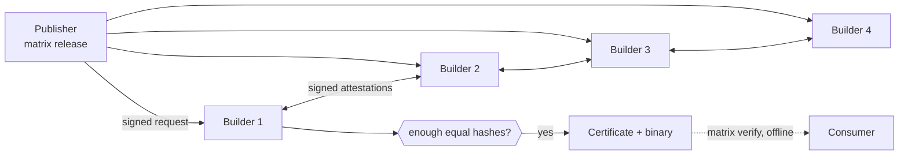

# Matrix

**Release gating for Go binaries, with no single machine to trust.**

A publisher's build machine is a single point of trust: whoever controls it controls what every
user installs. Matrix replaces it with a small network of builders on independent machines. Each
builder builds the tagged commit on its own and signs the hash of what it got. A release is
**certified** only when enough distinct builders signed the **same hash**, so a compromised builder
cannot certify a binary that no honest builder produced from the tagged source.

There is no central server, no single signing key and no consensus protocol. Builds are
deterministic, so the network does not have to *agree* on an answer; it only counts matching
signed answers. Consumers check the resulting certificate offline.

<p align="center">

</p>

## Features

- **Certificates anyone can check offline.** `matrix verify` needs only the binary, its
  certificate and a pinned genesis hash. No network and no trust in the download location.
- **Byzantine fault tolerance.** With `n` builders and `f = n // 4`, a release needs `f+1` matching
  signatures; up to `f` builders may lie, stall, equivocate or collude.
- **Reproducible, hardened builds.** Pinned toolchain image, no network during the build, no
  capabilities, a non-root user, read-only source, resource limits, and gVisor when available.
- **Provable misbehaviour.** A builder that signs two different results for one request leaves
  signed evidence that anyone can re-check.
- **No coordinator, no accounts.** Builders found the network themselves on a LAN with a short
  code compared out loud, find each other through signed hellos, and keep membership fixed by a
  hashed `genesis.json`.
- **Terminal dashboard.** Watch builders and releases live; start releases, verify binaries and
  generate keys from forms.

## How it works



1. **Found the network.** `matrix up` on each machine runs a founding ceremony. Founders appear on
   every screen, one proposes the seal, everyone compares a short code and confirms, and each
   machine endorses the same `genesis.json`. No authority and no file editing.
2. **Release.** The publisher signs a request for `repo @ tag @ commit`. Builders accept it only
   from a release signer listed in genesis, for an allowed repository.
3. **Build.** Each builder clones the commit, reads the recipe (`matrix.toml`) from that same
   commit, and builds inside the pinned image.
4. **Attest.** Each builder signs the resulting hash. Only a deterministic, rerun-confirmed compile
   error counts as a failure; every environmental problem abstains.
5. **Certify.** `f+1` matching signatures make a certificate. At least one signer is honest.
6. **Verify.** Anyone checks the binary against the certificate with only the pinned genesis hash.

Matrix proves that a binary is what the tagged source builds to. It does not prove the source is
safe.

## Installation

Requirements: Linux, macOS, or Windows 11 with WSL2; Git; Docker; [uv](https://docs.astral.sh/uv/).
Builders need UDP 7788 and TCP 7700 reachable from the other machines.

```bash
git clone https://github.com/ChaoticNebula5/Matrix ~/Matrix && cd ~/Matrix
uv sync && . .venv/bin/activate
matrix help
```

Per-machine setup (firewalls, WSL2 mirrored networking, gVisor, network checks and
troubleshooting) is in [docs/OPS.md](docs/OPS.md).

## Quick start

**1. Found a network** (once, on every machine, at the same time, same checkout):

```bash
matrix up --name alice          # bob, carol, dave on the others
```

Founders appear on every screen. When all are listed, one machine presses Enter: it shows the short
code and sends a signed proposal listing the founders. The other machines print the proposal and
what differs from what they heard themselves; type `y` only if the code read aloud matches and the
list is exactly the expected machines. When everyone has endorsed, the builder starts and the
dashboard opens (`q` closes it, the builder keeps running). Later runs skip the ceremony.

Network parameters (allowed repositories, toolchain image digest, timeouts) come from
[`network.toml`](network.toml); every founder must have the same file. A network of 4 or more
machines has `f ≥ 1`. With 2 or 3, `f = 0` and a single builder certifies: use that only for
trying things out.

**2. Release** from a machine whose release key is in genesis (`n` in the dashboard, or):

```bash
matrix release --repo https://github.com/ChaoticNebula5/matrix-hello \
  --tag v1.2.0 --commit fb6881c6e2432fa107ef809af109a9a1344ed2c0 \
  --wait 600 --out dist/
```

The binary and its certificate (`dist/matrix-hello.matrix.json`) are written to `dist/`.

**3. Verify** anywhere, with the network off (`v` in the dashboard, or):

```bash
matrix verify dist/matrix-hello --cert dist/matrix-hello.matrix.json \
  --repo https://github.com/ChaoticNebula5/matrix-hello --tag v1.2.0
```

Only exit code `0` means the file may be used.

## Commands

| Command | What it does |
|---|---|
| `matrix up` | Found the network on first run, then run this machine's builder |
| `matrix release` | Sign a release, wait for the quorum, download the binary and its certificate |
| `matrix status <id>` | Per-builder votes and verdict for one request |
| `matrix evidence` | Signed proof of misbehaviour collected by the builders |
| `matrix tui` | Live dashboard: builders, releases, details, evidence |
| `matrix verify` | Check a binary against its certificate, offline |
| `matrix keygen` | Generate an extra Ed25519 key, for example for CI |

`-v` / `--verbose` on any command logs every step to stderr: UDP packets, HTTP calls, Docker
commands and this machine's live build output. With `-v`, `matrix up` keeps the logs on the console
instead of opening the dashboard.

**Exit codes** (only `0` is success): `0` certified or reproduced, `1` mismatch, `2` invalid
certificate or not reproducible, `3` pending, `4` error, `5` build failed.

**Release bar.** `matrix release` writes a certificate only when more than half of the builders
currently online agree, and never fewer than the genesis threshold `f+1`. `matrix verify` checks the
genesis threshold offline.

### Dashboard

<p align="center">
  
</p>

| Key | Action |
|---|---|
| `b` `r` `e` | Builders, releases, evidence |
| `Enter` | Detail of the selected release or proof |
| `l` | Build log of this machine's builder |
| `n` `v` `k` | New release, verify, keygen forms (same code as the commands) |
| `x` | Reset this machine's builder data (type `RESET`; peers keep their copies) |
| `L` | Leave the network (type `LEAVE`; stops the builder and archives the network files) |
| `q` | Quit |

`x` and `L` are available in the dashboard that `matrix up` opens, because they restart or stop
the builder.

## Security model

- **Safety** holds while at most `f` builders are malicious. **Liveness** additionally tolerates
  honest builders going offline.
- **Membership is static** and fixed by the genesis hash. A disconnected builder is still a member;
  adding or removing one means founding a new network (`matrix up --refound`).
- **The transport is untrusted.** Every message that matters is an Ed25519 signature over canonical
  JSON, domain-separated by the genesis hash. Addresses only locate members.
- **Consumers pin the genesis hash** through a channel they already trust, for example the
  repository at a signed commit, never the release page itself.
- Parsers never raise on hostile input, every environmental error abstains, and builds run
  sandboxed against a pinned image digest.

The full threat model and protocol are in the [RFC](Matrix_RFC_001.md); the invariants that must
not be weakened are listed in [AGENTS.md §13.2](AGENTS.md).

## Testing faulty builders

To exercise the protection, start one builder with a fault mode: `matrix up --allow-faults --fault
MODE [--patch FILE]` (`inject`, `lie`, `collude`, `stall`, `crash`, `equivocate`, `bad-artifact`).
Modes are inert without `--allow-faults`. Never run more than `f` faulty builders at once. The
[demo runbook](docs/DEMO.md) walks through the scenarios with a sample repository.

## Development

```bash
uv sync && . .venv/bin/activate
ruff check . && ruff format --check .
pytest -q                        # unit tests: fast, no Docker, no network
pytest -q -m integration         # needs Docker, the pinned image and the sample repository
```

To run four builders on one machine, generate a development network:

```bash
python scripts/dev_genesis.py --out dev --addrs local --profile demo --nodes 4 \
  --repo https://github.com/ChaoticNebula5/matrix-hello \
  --image golang@sha256:e87b2a5f6df2dff71ea330d55d54f4979eb380ae58a7e3aabc9d53121243e689
```

or use Docker Compose ([AGENTS.md §15.2](AGENTS.md)).

```
matrix/        the package: canon, crypto, genesis, model, select, verdict, protocol,
               store, builder, net, discovery, faults, node, cli, tui
tests/         unit tests; tests/integration needs Docker
docs/          architecture, module contracts, HTTP API, operations and demo runbooks
examples/      sample Go repository, fault patch, publisher and consumer CI
scripts/       development genesis, sample repository builder
network.toml   network parameters every founder must agree on
```

Contributions are welcome. Keep changes small, add tests, and make sure `ruff` and `pytest -q`
pass. Changes to parsing, signing, the verdict or the builder must keep the invariants in
[AGENTS.md](AGENTS.md); changes to the protocol start with the RFC.

## Documentation

| Document | Contents |
|---|---|
| [Matrix_RFC_001.md](Matrix_RFC_001.md) | The specification: protocol, parameters, ceremony, security |
| [docs/OPS.md](docs/OPS.md) | Machine setup, networking, troubleshooting |
| [docs/DEMO.md](docs/DEMO.md) | Demo runbook with sample scenarios |
| [docs/HLD.md](docs/HLD.md), [docs/LLD.md](docs/LLD.md) | Architecture and module contracts |
| [docs/openapi.yaml](docs/openapi.yaml) | The builder HTTP API |
| [examples/ci/](examples/ci/) | Publisher and consumer CI examples |
