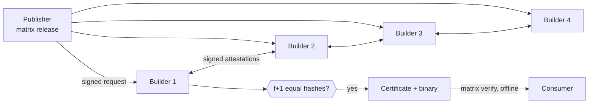

# Matrix

**Byzantine-tolerant release gating for Go binaries.**

A publisher's build machine is a single point of trust: whoever controls it controls what every
user installs (SolarWinds, 2020). Matrix replaces it with a small network of builders on
**independent machines**. Every builder builds the tagged commit on its own and signs the hash of
what it got. A release is **certified** only when **f+1 distinct builders signed the same hash**,
so up to f compromised builders cannot certify a binary that no honest builder produced.

No central server, no single signing key, no consensus protocol. Builds are deterministic, so the
network does not need to *agree*; it only *counts matching answers*. Consumers check the resulting
certificate **offline**.

<p align="center">
  
</p>

> **Status:** 12-hour hackathon MVP. The spec is [Matrix_RFC_001.md](Matrix_RFC_001.md) (rev 5).
> Demo network: 4 laptops on one Wi-Fi, one builder each (n = 4, f = 1, threshold 2).

## How it works



1. **Found the network.** `matrix up` on each laptop runs a founding ceremony: founders find each
   other over the LAN, everyone compares a short code aloud, and the shared `genesis.json` is
   created with no authority and no file editing.
2. **Release.** The publisher signs a request for `repo @ tag @ commit`. Builders accept it only
   from a release signer listed in genesis, for an allowed repo.
3. **Build.** Each builder checks out the commit, reads the recipe (`matrix.toml`) from that same
   commit, and builds inside a pinned, sandboxed Docker image (gVisor when available).
4. **Attest.** Each builder signs the hash and shares it. `FAILED` counts only for a deterministic,
   rerun-confirmed compile error; every environmental problem abstains.
5. **Certify.** f+1 matching signatures make a certificate. At least one of them is honest.
6. **Verify.** Anyone checks the binary against the certificate with only the pinned genesis hash.

Misbehaviour is provable: a builder that signs two different results for one request leaves signed
`EQUIVOCATION` evidence that anyone can re-check.

<table>
  <tr>
    <td></td>
    <td></td>
  </tr>
  <tr>
    <td align="center"><sub>Founding ceremony (<code>matrix up</code>)</sub></td>
    <td align="center"><sub>Certified release (<code>matrix release</code>)</sub></td>
  </tr>
</table>

## Quick start (4 laptops)

Per laptop, once: Linux, macOS, or Windows 11 with WSL2. Full setup (firewall, mirrored networking,
gVisor, hotspot check) is in [docs/OPS.md](docs/OPS.md).

```bash
# needs: git, Docker, uv (https://docs.astral.sh/uv/); ports UDP 7788 and TCP 7700 open
git clone https://github.com/ChaoticNebula5/Matrix ~/Matrix && cd ~/Matrix
uv sync && . .venv/bin/activate
matrix help
```

All laptops on the same Wi-Fi, same commit of this repo (same `network.toml`), at the same time:

```bash
matrix up --name laptop-a        # laptop-b, laptop-c, laptop-d on the others
```

Founders appear on every screen. When all are listed, **one** laptop presses **Enter**: it shows
the **short code** and sends a signed proposal with the founder list. Every other laptop prints
the proposal (who, which founders, what differs from what it heard itself); type `y` there only if
the code read aloud matches and the list is exactly the expected laptops. Lost or reordered
packets only delay it. When all laptops have endorsed, the builder starts and, on a terminal, the
dashboard opens automatically (`q` closes it, the builder keeps running). Later runs skip the
ceremony and the dashboard.

Release from the publisher's laptop (keep `matrix up` running there, and open `matrix tui` in a
second terminal):

```bash
matrix release --repo https://github.com/ChaoticNebula5/matrix-hello \
  --tag v1.2.0 --commit fb6881c6e2432fa107ef809af109a9a1344ed2c0 \
  --wait 600 --out dist/
```

Verify on any machine, with the network off:

```bash
matrix verify dist/matrix-hello --cert dist/matrix-hello.matrix.json \
  --repo https://github.com/ChaoticNebula5/matrix-hello --tag v1.2.0
```

Only exit code **0** means the file may be used.

> **Testing with 2 or 3 laptops:** `matrix up` also seals with 2 or 3 founders, but then f = 0 and
> a single builder alone certifies. Use it to try things out; the demo and anything real need 4.

## Commands

| Command | What it does |
|---|---|
| `matrix up` | Found the network on first run, then run this laptop's builder |
| `matrix release` | Sign a release, wait for the quorum, download the binary and its certificate |
| `matrix status <id>` | Per-builder votes and verdict for one request |
| `matrix evidence` | Signed proof of misbehaviour (equivocation) collected by builders |
| `matrix tui` | Live dashboard: builders, releases, details, evidence |
| `matrix verify` | Check a binary against its certificate, offline |
| `matrix keygen` | Generate an extra Ed25519 key (for example for CI) |

Add `-v` / `--verbose` to any command to log every step (UDP packets, HTTP calls, Docker commands)
to stderr. `matrix tui -v` writes to `~/.matrix/verbose.log`.

Exit codes: `0` certified / reproduced, `1` mismatch, `2` invalid certificate or not
reproducible, `3` pending, `4` error, `5` build failed.

<p align="center">
  
</p>

TUI keys: `b` builders, `r` releases, `Enter` detail, `l` log (this laptop only), `e` evidence,
`q` quit.

## Demo scenes

The runbook is [docs/DEMO.md](docs/DEMO.md); the sample repo is
[matrix-hello](https://github.com/ChaoticNebula5/matrix-hello).

| # | Scene | What judges see |
|---|---|---|
| 1 | Zero-config founding | `matrix up` on 4 laptops, one short code |
| 2 | Happy path | `CERTIFIED`, four equal hashes |
| 3 | SolarWinds | One laptop injects a backdoor; its hash differs and is outvoted |
| 4 | Imposter on the hotspot | A rogue device cannot join or speak for the network |
| 5 | Swapped download | `matrix verify` rejects a binary that is not the certified one |
| 6 | A laptop drops off | Still `CERTIFIED` with 3 of 4 |
| 7 | Caught cheater | A builder equivocates; `EQUIVOCATION` evidence is shown |

Faulty builders for scenes 3 and 7 are started with
`matrix up --allow-faults --fault MODE [--patch FILE]`. Fault modes are inert without
`--allow-faults`. Never run more than one faulty laptop (f = 1).

<p align="center">
  
</p>

## Security model in short

- **Safety** holds while at most f builders lie, stall, equivocate or collude. **Liveness** also
  tolerates one honest builder going offline.
- **Membership is static**, fixed by the genesis hash. Disconnecting is not leaving; adding or
  removing a member means re-founding (`matrix up --refound`).
- **Transport is untrusted.** Everything that matters is an Ed25519 signature over canonical JSON,
  domain-separated by genesis hash. Addresses only *locate* members; nothing depends on them.
- **Consumers pin the genesis hash** through a channel they already trust (for example the
  repository at a signed commit), never the release page.
- Parsers never raise on hostile input, every environmental error abstains, and builds run with
  no network, no capabilities, a read-only source and a pinned image digest.
- Matrix proves *binary = tagged source*. It does not prove the source is safe.

The invariants are listed in [AGENTS.md §13.2](AGENTS.md); the threat model is in the
[RFC](Matrix_RFC_001.md).

## Development

```bash
uv sync && . .venv/bin/activate
ruff check . && ruff format --check .
pytest -q                        # unit tests: fast, no Docker, no network
pytest -q -m integration         # needs Docker, the pinned image, and the pushed sample repo
```

Single machine, no laptops: generate a dev network and run four local builders, or use Docker
Compose.

```bash
python scripts/dev_genesis.py --out dev --addrs local --profile demo --nodes 4 \
  --repo https://github.com/ChaoticNebula5/matrix-hello \
  --image golang@sha256:e87b2a5f6df2dff71ea330d55d54f4979eb380ae58a7e3aabc9d53121243e689
```

See [AGENTS.md §15.2](AGENTS.md) for the Compose workflow.

```
matrix/        the package: canon, crypto, genesis, model, select, verdict, protocol,
               store, builder, net, discovery, faults, node, cli, tui
tests/         unit tests; tests/integration needs Docker
docs/          HLD, LLD, OpenAPI contract, OPS runbook, DEMO runbook
examples/      sample Go repo, backdoor patch, publisher and consumer CI
scripts/       dev genesis, sample repo builder
network.toml   network parameters every founder must agree on
```

## Documentation

| Doc | For |
|---|---|
| [Matrix_RFC_001.md](Matrix_RFC_001.md) | The spec: protocol, parameters, ceremony, security rules |
| [docs/OPS.md](docs/OPS.md) | Per-laptop setup, firewall, hotspot checks, troubleshooting |
| [docs/DEMO.md](docs/DEMO.md) | The 7-scene demo runbook |
| [docs/HLD.md](docs/HLD.md), [docs/LLD.md](docs/LLD.md) | Architecture and module contracts |
| [docs/openapi.yaml](docs/openapi.yaml) | The builder HTTP API |
| [examples/ci/](examples/ci/) | Publisher and consumer CI examples |
| [AGENTS.md](AGENTS.md) | Team workflow and engineering rules |

## Screenshots to add

Put PNGs in `docs/img/` with these names (the README already links them):

| File | Capture |
|---|---|
| `hero.png` | `matrix tui` on the publisher's laptop during a certified release |
| `ceremony.png` | `matrix up` with all four founders listed and the short code |
| `certified.png` | `matrix release` output ending in `CERTIFIED` |
| `tui-builders.png` | TUI Builders screen with 4 online builders |
| `evidence.png` | TUI Evidence screen after scene 7 |

Delete this section once they are in.
