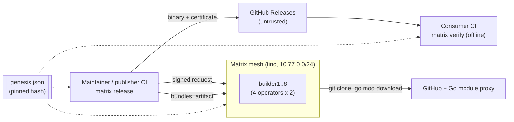
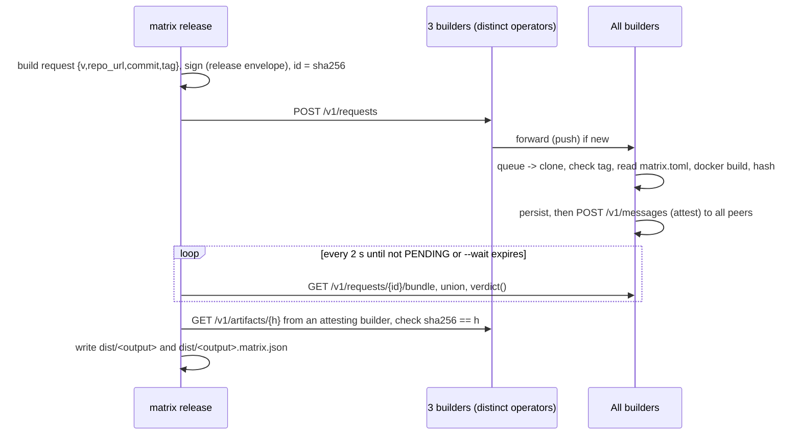
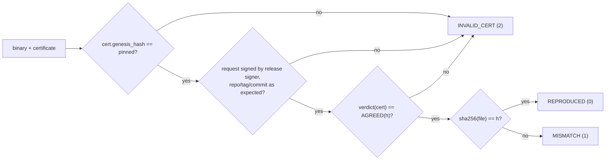

# Matrix — High-Level Design

| | |
|---|---|
| **Source of truth** | [RFC-0001 rev 4](../Matrix_RFC_001.md). If this document disagrees with the RFC, the RFC wins. |
| **Detail** | [LLD](LLD.md), [OpenAPI](openapi.yaml) |
| **Principle** | Keep it simple. Count signed answers; never agree on anything. |

## 1. What Matrix does

A publisher runs 8 builders on 4 independent operators. When a release is tagged, every builder builds the tagged commit in a pinned, sandboxed Go toolchain and signs the SHA-256 of the binary. A release is **certified** when 3 (= f+1) builders signed the same hash. The binary ships with a certificate (`<output>.matrix.json`) that anyone can check offline.

- **Safety:** up to f = 2 malicious builders cannot certify a binary that no honest builder produced.
- **Liveness:** up to s = 3 more honest builders may crash, shed or fail.
- **No coordinator:** every decision is a local pure function over signed data.

## 2. Design principles

1. **Count, don't agree.** Builds are deterministic, so the right answer is the one with f+1 matching signatures. No leader, no consensus, no log.
2. **Trust signatures, not transport.** Every message is an Ed25519 envelope with domain separation. The network, the release page and the uploader are untrusted.
3. **Pure core, thin shell.** `canon`, `crypto`, `genesis`, `model`, `select` and `verdict` are pure and never touch I/O. Everything with side effects (`store`, `builder`, `net`) sits around them.
4. **Fail closed.** Only exit code 0 means success. Environmental errors abstain; they never vote.
5. **Parsers never raise.** Hostile input returns `None`, which means ignore.
6. **Static membership.** One `genesis.json`, pinned by hash, defines everything: builders, operators, release signers, allowlists and parameters.
7. **KISS.** Three runtime dependencies (`pynacl`, `aiohttp`, `textual`). One SQLite file per builder. One build slot per builder. No new frameworks.

## 3. System context



## 4. Components

| Component | Process | Responsibility | Module(s) |
|---|---|---|---|
| Core library | (shared) | Canonical JSON, signing, genesis, strict models, selection, verdict | `canon`, `crypto`, `genesis`, `model`, `select`, `verdict` |
| Builder daemon | `matrix-node` | HTTP API, request forwarding, build queue, attestations, pull sync, evidence | `node`, `net`, `protocol`, `store` |
| Build runner | inside `matrix-node` | git checkout, recipe check, two-step hardened Docker build, hash, artifact, outcome classification | `builder` |
| Fault injector | inside `matrix-node` | Demo-only misbehaviour (`inject`, `lie`, `collude`, `stall`, `crash`, `equivocate`, `bad-artifact`) | `faults` |
| CLI | `matrix` | `keygen`, `release`, `status`, `verify`, `evidence`, `tui` | `cli` |
| TUI | `matrix tui` | Read-only live view over the HTTP API | `tui` |
| Transport | `tincd` | Encrypted mesh with stable IPs. Untrusted. | (ops) |

### Layering

Imports only point downward. A lower layer never imports a higher one.

```
L4  node.py   cli.py   tui.py               entrypoints
L3  net.py    protocol.py   faults.py       side-effecting orchestration
L2  store.py  builder.py                    I/O adapters
L1  verdict.py  select.py  model.py         pure logic
L0  canon.py  crypto.py  genesis.py         pure primitives
```

## 5. Deployment views

### 5.1 Hackathon demo: 4 laptops over tinc

| Laptop (operator) | tinc IP | Builders |
|---|---|---|
| laptopA | 10.77.0.1 | builder1 :7700, builder2 :7701 |
| laptopB | 10.77.0.2 | builder3 :7700, builder4 :7701 |
| laptopC | 10.77.0.3 | builder5 :7700, builder6 :7701 |
| laptopD | 10.77.0.4 | builder7 :7700, builder8 :7701 |

Each builder is a plain `matrix-node` process on the host (Linux), using the host Docker daemon for builds. A fifth machine without mesh access runs `matrix verify`.

### 5.2 Development: one machine with Docker Compose

[docker-compose.yml](../docker-compose.yml) runs the same 8 builders as containers on one compose network. Addresses become `builderN:7700`, and operators are still `laptopA..D` so per-operator placement can be tested. Builders reach the host Docker daemon through the mounted socket. See [LLD §12](LLD.md#12-development-environment).

### 5.3 Production (future, not MVP)

Each operator is an independent CI provider or cloud account (for example `github-actions`, `gitlab-ci`, `aws-account-2`, `onprem`), with at most f builders each and no shared credentials.

## 6. Key flows

### 6.1 Release (publisher side)



### 6.2 Verify (consumer side, offline)



### 6.3 Anti-entropy (pull sync)

Every `sync_interval_s`, each builder asks each peer for requests seen since that peer's last cursor, fetches unknown requests, then pulls bundles for every request still inside `request_ttl_s` and runs each envelope through the normal validation path. Push gives speed; pull gives completeness.

### 6.4 Restart

State lives in SQLite. On start: delete leftover `work/*` and `mx-<node_id>-*` containers, expire old artifacts, re-send own stored attestations, re-queue unattested requests that are still in TTL, then start sync. A builder never signs two different results for one request.

## 7. Data and trust boundaries

| Data | Where | Trusted? | Protected by |
|---|---|---|---|
| `genesis.json` | Every builder and client | Yes, pinned by hash | Out-of-band distribution (A5) |
| Builder private key | Builder's host only | Yes | File permissions (0600) |
| Release-signer key | Maintainer / CI secret | Yes | CI secret store |
| Release envelope | SQLite `requests`, certificate | Verified | Ed25519 + allowlists |
| Attestations | SQLite `attestations`, bundles, certificate | Verified | Ed25519 + selected-set check |
| Artifacts | `artifacts/<hash>` on each builder | **No**, checked by hash | SHA-256 |
| Build logs, evidence | Builder disk / SQLite | Informational | n/a |
| Bundles from peers | HTTP | **No** | Re-verified envelope by envelope |
| Release page | GitHub | **No** | `matrix verify` |

## 8. Security controls (summary)

| Threat | Control |
|---|---|
| ≤ f builders lie, collude, inject code | f+1 matching signatures required (verdict) |
| Equivocation | Two signed results from one signer → dropped from count, `EQUIVOCATION` evidence |
| Swapped binary / certificate on the release page | `verify`: `MISMATCH` / `INVALID_CERT` |
| Downgrade (old cert for new tag) | `verify` requires the expected repo and tag |
| Anyone on the mesh triggering builds | Requests must be signed by a genesis release signer, for an allowed repo |
| Malicious repo executing code during the build | Recipe from tagged commit, ldflags allowlist, `GOTOOLCHAIN=local`, proxy-only deps, network-off build, hardened unprivileged container |
| Cross-network replay | Signed bytes are prefixed with `matrix/v1\0<genesis_hash>\0` |
| Honest flake turned into `BUILD_FAILED` | `FAILED` only for a deterministic, rerun-confirmed compile error; everything else abstains |
| Flood | 20 new requests/min/builder, 1 build slot + 1 queued, rest shed |
| Hostile bytes to parsers | Size caps, strict keys, duplicate-key rejection, never-raise |

## 9. Quality attributes

| Attribute | Target |
|---|---|
| Time to certify (demo profile) | < 90 s after the request on a warm module cache |
| Build timeout | 150 s (full) / 45 s (demo). Measure in hour 1. |
| Builder footprint | 2 GiB RAM, 1 CPU per build container; ≥ 2 GiB free disk |
| Offline verify | < 1 s, no network |
| Code size | Small enough to read in an hour. Prefer deleting code to adding options. |

## 10. Out of scope (MVP)

Non-Go builds, cgo, multiple binaries per release, archives, dynamic membership, threshold signatures, public rebuilders, Windows hosts. See RFC §3 and §10.

## 11. Traceability

| HLD section | RFC section | LLD section |
|---|---|---|
| Components | §6.1, §7.1 | §2, §3 |
| Release flow | §6.3, §7.11 | §3.13 |
| Verify flow | §6.4, §7.11 | §3.13 |
| Pull sync | §7.9 | §3.10 |
| Builder | §7.10 | §3.8 |
| Security | §4, §8 | §3.4, §3.8 |
| Deployment | §6.2, §7.13 | §12 |
