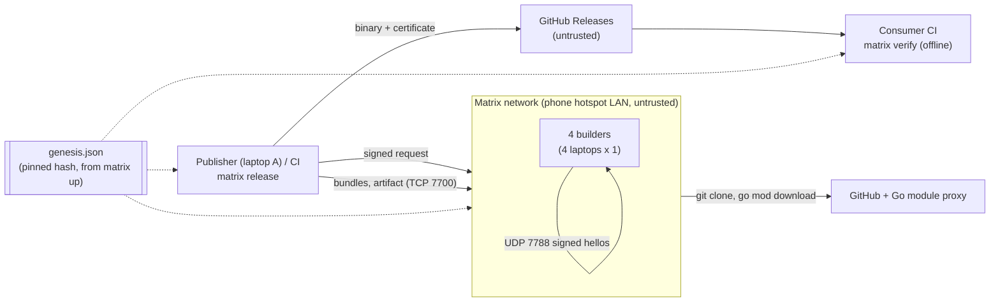
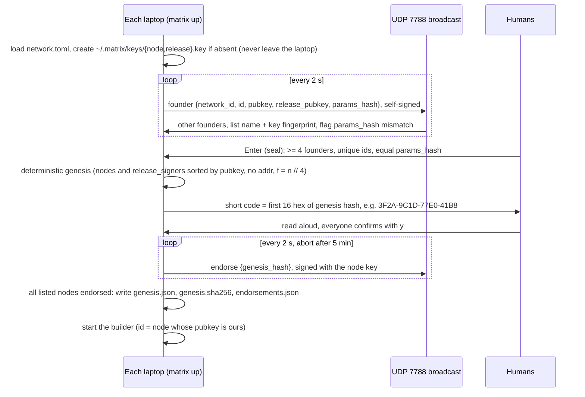
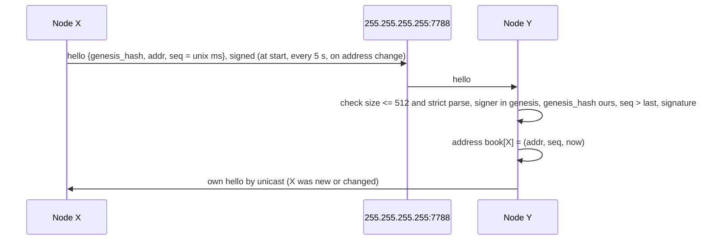
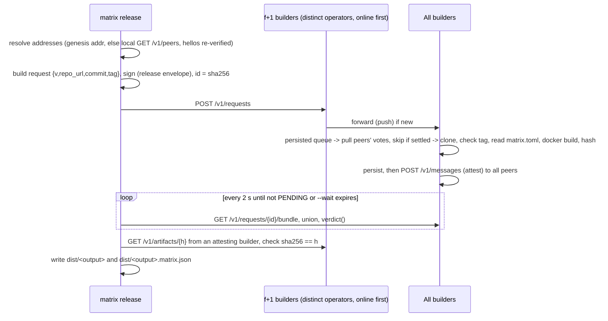
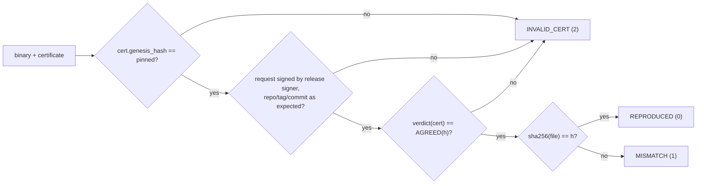

# Matrix — High-Level Design

| | |
|---|---|
| **Source of truth** | [RFC-0001 rev 5](../Matrix_RFC_001.md). If this document disagrees with the RFC, the RFC wins. |
| **Detail** | [LLD](LLD.md), [OpenAPI](openapi.yaml), [OPS](OPS.md), [DEMO](DEMO.md) |
| **Principle** | Keep it simple. Count signed answers; never agree on anything. |

## 1. What Matrix does

A publisher runs n builders on independent operators, at most f per operator. When a release is tagged, every selected builder builds the tagged commit in a pinned, sandboxed Go toolchain and signs the SHA-256 of the binary. A release is **certified** when f+1 builders signed the same hash. The binary ships with a certificate (`<output>.matrix.json`) that anyone can check offline.

The demo and default deployment is 4 laptops on one phone hotspot, one builder each: n = 4, f = 1 (f = n // 4), replicas R = 4, threshold T = 2. The laptops found the network themselves (`matrix up`) and find each other's addresses by signed UDP hellos.

- **Safety:** up to f = 1 malicious builder cannot certify a binary that no honest builder produced. Two colluding builders would reach T = 2: that is exactly the f bound.
- **Liveness:** up to s = 1 more honest builder may crash, be offline or fail. 1 malicious + 1 offline still leaves 2 honest builders = T.
- **No coordinator, no authority:** every decision is a local pure function over signed data. Genesis is created by a unanimous ceremony, not by anyone in charge.

## 2. Design principles

1. **Count, don't agree.** Builds are deterministic, so the right answer is the one with f+1 matching signatures. No leader, no consensus, no log.
2. **Trust signatures, not transport.** Every message is an Ed25519 envelope with domain separation. The network, the addresses, the release page and the uploader are untrusted.
3. **Pure core, thin shell.** `canon`, `crypto`, `genesis`, `model`, `select` and `verdict` are pure and never touch I/O. Everything with side effects (`store`, `builder`, `net`, `discovery`) sits around them.
4. **Fail closed.** Only exit code 0 means success. Environmental errors abstain; they never vote.
5. **Parsers never raise.** Hostile input returns `None`, which means ignore.
6. **Static membership.** One `genesis.json`, pinned by hash, defines everything: builders, operators, release signers, allowlists and parameters. The founding ceremony only *creates* this list; signed hellos only *locate* its members. **Disconnect ≠ leave:** an offline member is a silent voter that can delay, never mislead. The list changes only by re-founding.
7. **Addresses are not identity.** Genesis carries no addresses (dev genesis may, as a fallback). A node's address comes from its own signed hello, so DHCP changes never touch the genesis hash.
8. **KISS.** Three runtime dependencies (`pynacl`, `aiohttp`, `textual`). One SQLite file per builder. One build slot per builder. Full-mesh push plus pull anti-entropy; no gossip membership, no DHT, no new frameworks.

## 3. System context



## 4. Components

| Component | Process | Responsibility | Module(s) |
|---|---|---|---|
| Core library | (shared) | Canonical JSON, signing, genesis, strict models, selection, verdict | `canon`, `crypto`, `genesis`, `model`, `select`, `verdict` |
| Builder daemon | `matrix-node` or `matrix up` | HTTP API, request forwarding, persisted build queue, attestations, pull sync, evidence | `node`, `net`, `protocol`, `store` |
| Build runner | inside the daemon | git checkout, recipe check, two-step hardened Docker build, hash, artifact, outcome classification | `builder` |
| Discovery | inside the daemon | Signed UDP hellos on port 7788 every 5 s; in-memory address book `node_id -> (addr, seq, last_seen)`; online = hello < 15 s old; `GET /v1/peers` | `discovery`, `net` |
| Founding ceremony | `matrix up` | Local keys, founder announcements, seal, deterministic genesis, short code, unanimous endorsements, then starts the daemon in the same process | `cli`, `discovery`, `node` |
| Fault injector | inside the daemon | Demo-only misbehaviour (`inject`, `lie`, `collude`, `stall`, `crash`, `equivocate`, `bad-artifact`) | `faults` |
| CLI | `matrix` | `keygen`, `up`, `release`, `status`, `verify`, `evidence`, `tui` | `cli` |
| TUI | `matrix tui` | Read-only live view over the HTTP API; builders online/offline from verified hellos | `tui` |
| Transport | (ops) | Plain LAN (phone hotspot) by default. tinc or WireGuard optional, for confidentiality only. Untrusted. | (ops) |

### Layering

Imports only point downward. A lower layer never imports a higher one.

```
L4  node.py   cli.py   tui.py                         entrypoints
L3  net.py    protocol.py   faults.py   discovery.py  side-effecting orchestration (sockets, asyncio)
L2  store.py  builder.py                              I/O adapters
L1  verdict.py  select.py  model.py                   pure logic
L0  canon.py  crypto.py  genesis.py                   pure primitives
```

## 5. Deployment views

### 5.1 Hackathon demo: 4 laptops on a phone hotspot

| Laptop (operator) | Builder id | Address | Role |
|---|---|---|---|
| laptop A | its hostname (from `matrix up`) | discovered, `:7700` | builder + publisher (`matrix release`, `matrix tui`) |
| laptop B | its hostname | discovered, `:7700` | builder |
| laptop C | its hostname | discovered, `:7700` | builder |
| laptop D | its hostname | discovered, `:7700` | builder |

- Every laptop runs `matrix up` from the same repo checkout (same `network.toml`). After the ceremony it runs the builder in the same process: listen `0.0.0.0:7700`, data dir `~/.matrix/data`, discovery on, builds through the host Docker daemon. Builds run on all 4 laptops (R = n), including A.
- Ports: TCP 7700 (HTTP API), UDP 7788 (hellos and ceremony messages). Windows laptops use WSL2 with mirrored networking and firewall rules for both ports ([OPS](OPS.md)).
- Addresses are not fixed: DHCP on the hotspot may change them; the next hello updates every address book.
- `matrix verify` runs on any machine without network use: a laptop with Wi-Fi off, or a judge's machine.
- tinc or WireGuard may be layered underneath for privacy. Plain LAN loses only confidentiality (anyone on the hotspot can see which releases are built); integrity comes from signatures.

### 5.2 Development: one machine with Docker Compose

[docker-compose.yml](../docker-compose.yml) runs 8 builders as containers on one compose network, from a dev genesis made by `scripts/dev_genesis.py`. Dev genesis keeps static `addr`s (`builderN:7700`), and operators are still `laptopA..D` so per-operator placement can be tested. `dev_genesis.py --nodes 4` gives an n = 4, f = 1 network with the demo's parameters. The local integration harness starts nodes with `--no-discovery` and uses the static `addr`s. Builders reach the host Docker daemon through the mounted socket. See [LLD §12](LLD.md#12-development-environment).

### 5.3 Production (future, not MVP)

Each operator is an independent CI provider or cloud account (for example `github-actions`, `gitlab-ci`, `aws-account-2`, `onprem`), with at most f builders each and no shared credentials. Membership changes become genesis epochs (RFC §10).

## 6. Key flows

### 6.1 Founding ceremony (`matrix up`, once per network)



Same founders give a byte-identical genesis, so the same hash on every laptop. The human comparison of the short code is the trust root (like Bluetooth pairing or Signal safety numbers); unanimity means anyone can veto. Later runs find `~/.matrix/genesis.json` and skip the ceremony; `--refound` creates a new network, and old certificates still verify against their old pin.

### 6.2 Address discovery



Any check failing drops the packet silently. `PeerClient` resolves a peer from the address book, else genesis `addr`, else unreachable. CLI and TUI get addresses from the local node's `GET /v1/peers` and re-verify every hello against genesis. The book is in memory only and refills within 5 s of a restart.

### 6.3 Release (publisher side)



With n = 4 the publisher submits to 2 builders.

### 6.4 Verify (consumer side, offline)



Consumers pin the genesis hash from a trusted channel (the project README in the source repository, or the founders directly; never the release page alone, RFC A5) plus a copy of `genesis.json`. `verify` never opens a socket.

### 6.5 Anti-entropy (pull sync)

Every `sync_interval_s`, each builder asks each peer for requests seen since that peer's last cursor, fetches unknown requests, then pulls bundles for every request still inside `request_ttl_s` and runs each envelope through the normal validation path. Push to all peers gives speed; pull gives completeness. This is gossip with full fanout over the static member list, not gossip membership.

### 6.6 Restart and reconnect

State lives in SQLite. On start: delete leftover `work/*` and `mx-<node_id>-*` containers, expire old artifacts, re-send own stored attestations (never rebuild), put unattested selected requests still in TTL back in the persisted queue, then start sync with all cursors at 0 and discovery. A builder never signs two different results for one request.

A laptop that drops off (Wi-Fi off, new DHCP IP) shows offline after 15 s but stays a member. On return its fresh hello (higher `seq`) updates every address book within ~5 s, pull sync fetches what it missed, and queued requests that settled meanwhile are marked `MISSED` without a build.

## 7. Data and trust boundaries

| Data | Where | Trusted? | Protected by |
|---|---|---|---|
| `genesis.json` | Every builder and client | Yes, pinned by hash | Unanimous founding ceremony, short code compared by humans; consumers get the pin from a trusted channel |
| `network.toml` | Repo checkout on each laptop | Input to the ceremony only | `params_hash` must match across founders |
| Builder private key | `~/.matrix/keys/node.key` on its laptop only | Yes | Generated locally, file permissions (0600), never leaves the laptop |
| Release-signer key | `~/.matrix/keys/release.key` on each founder's laptop, or CI secret | Yes | File permissions (0600) / CI secret store |
| Release envelope | SQLite `requests`, certificate | Verified | Ed25519 + allowlists |
| Attestations | SQLite `attestations`, bundles, certificate | Verified | Ed25519 + selected-set check |
| Hellos, address book | UDP 7788, memory, `GET /v1/peers` | **No**, only locates members | Ed25519 + genesis membership + `seq` anti-replay; clients re-verify |
| Artifacts | `artifacts/<hash>` on each builder | **No**, checked by hash | SHA-256 |
| Build logs | Builder disk | Local only | Served to loopback callers only (host details stay on the laptop) |
| Evidence | SQLite | Informational, public | Signed attestations anyone can recheck |
| Bundles from peers | HTTP | **No** | Re-verified envelope by envelope |
| Release page | GitHub | **No** | `matrix verify` |

## 8. Security controls (summary)

| Threat | Control |
|---|---|
| ≤ f builders lie, collude, inject code | f+1 matching signatures required (verdict) |
| Equivocation | Two signed results from one signer → dropped from count, `EQUIVOCATION` evidence |
| Swapped binary / certificate on the release page | `verify`: `MISMATCH` / `INVALID_CERT` |
| Downgrade (old cert for new tag) | `verify` requires the expected repo and tag |
| Anyone on the LAN triggering builds | Requests must be signed by a genesis release signer, for an allowed repo |
| LAN attacker forging or redirecting addresses | Hellos signed by the member's genesis key; a member can only misstate its own address, which makes only itself unreachable (liveness, never safety). Jamming the LAN is a liveness attack no protocol prevents |
| Rogue device on the hotspot (imposter, Sybil) | Not in genesis → hellos dropped. During founding it shows as an extra row and a different short code; the team refuses to confirm, and unanimity lets anyone veto |
| Replayed hellos | `seq` must strictly increase per signer; genesis hash inside the signed body |
| Shrink-to-quorum (knock honest laptops offline) | Disconnect ≠ leave: membership never changes on connect or disconnect, only by re-founding |
| Malicious repo executing code during the build | Recipe from tagged commit, ldflags allowlist, `GOTOOLCHAIN=local`, proxy-only deps, network-off build, hardened unprivileged container |
| Cross-network replay | Signed bytes are prefixed with `matrix/v1\0<genesis_hash>\0` (ceremony: `matrix/v1-founder\0<network_id>\0`) |
| Honest flake turned into `BUILD_FAILED` | `FAILED` only for a deterministic, rerun-confirmed compile error; everything else abstains |
| Flood | 20 new requests/min/builder; one build at a time, the rest queued in SQLite until the TTL (LLD L30); UDP packets size-capped (512 B) with membership checked before the signature |
| Host details leaking through build logs | `GET /v1/requests/{id}/log` answers loopback callers only, 404 otherwise |
| Hostile bytes to parsers | Size caps, strict keys, duplicate-key rejection, never-raise |

## 9. Quality attributes

| Attribute | Target |
|---|---|
| Time to certify (demo profile) | < 90 s after the request on a warm module cache |
| Build timeout | 150 s (full) / 45 s (demo). Measure in hour 1. |
| Builder footprint | 2 GiB RAM, 1 CPU per build container; ≥ 2 GiB free disk |
| Address convergence | New or changed address known to all members within ~5 s; offline shown after 15 s |
| Founding | About one minute for 4 laptops; aborts after 5 min without all endorsements |
| Offline verify | < 1 s, no network |
| Code size | Small enough to read in an hour. Prefer deleting code to adding options. |

## 10. Out of scope (MVP)

Non-Go builds, cgo, multiple binaries per release, archives, dynamic membership (joining or leaving without re-founding; genesis epochs are future work), gossip membership, DHTs, any signing or naming authority, threshold signatures, public rebuilders, Windows hosts (Windows laptops run the builder inside WSL2). See RFC §3 and §10.

## 11. Traceability

| HLD section | RFC section | LLD section |
|---|---|---|
| Components | §6.1, §7.1 | §2, §3 |
| Founding ceremony, discovery | §7.15, §7.16 | §3.10a, §3.12, §3.13 |
| Release flow | §6.3, §7.11 | §3.13 |
| Verify flow | §6.4, §7.11 | §3.13 |
| Pull sync | §7.9 | §3.10 |
| Builder | §7.10 | §3.8 |
| Security | §4, §8 | §3.4, §3.8 |
| Deployment | §6.2, §7.13 | §12 |
